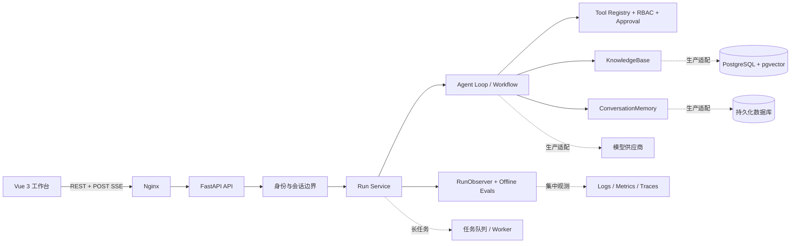

# AI Agent 系统设计基线

本文描述主线 Demo 的真实边界，以及从单机教学实现演进到生产系统时需要新增的组件。图中的虚线目标组件不是当前仓库已经实现的能力，答辩时必须明确区分“现状”和“规划”。

## 1. 当前系统与目标系统

当前系统默认使用 Mock 模型、进程内会话/观测/知识/记忆和固定工具，适合离线学习与确定性回归。生产目标需要持久化、任务隔离、集中遥测、真实身份和供应商适配，但不应该改变领域事件、工具策略与 RAG 接口。



## 2. 组件责任与数据所有权

| 组件 | 当前实现 | 生产责任 | 不应该负责 |
| --- | --- | --- | --- |
| Vue/Nginx | 页面状态、SSE 解析、同源代理 | 展示、取消、重连、静态资源 | 模型密钥、角色判定、审批真值 |
| FastAPI | 参数校验、身份解析、HTTP/SSE | 接入层、限流、请求关联 | 把供应商原始对象泄露给前端 |
| Run Service | 进程内 session/run | 幂等创建、状态机、所有权 | 任意执行模型产生的代码 |
| Agent Loop | 手写循环与显式 Workflow | 决策编排、停止条件、取消边界 | 身份提权、无限重试 |
| Tool Registry | Schema、RBAC、精确审批 | 最终授权与副作用边界 | 相信 Prompt 中的“已批准” |
| KnowledgeBase | 内存索引、可选 pgvector 适配 | 文档版本、租户隔离、引用 | 把检索文本当系统指令 |
| Memory | 显式批准的事实 | 生命周期、删除、审计 | 默认永久保存全部对话 |
| Observability/Evals | 白名单日志、离线行为断言 | SLO、告警、成本与回归门禁 | 保存 Prompt、密钥或原始异常 |

## 3. 两条关键时序

### 普通流式运行

```text
创建 session -> 返回主体绑定或匿名 capability
提交 run + timeout -> 校验会话所有权 -> 创建 run_id
Agent 决策 -> 可选工具 -> 形成稳定领域事件
SSE 发送事件 -> 前端落终态 -> 按 run_id 查询摘要
断连 -> 发出协作式取消 -> 最多等待短暂宽限 -> 后台结果安全回收
```

### 有副作用的工具

```text
服务端身份 -> 角色过滤工具定义 -> 模型提出结构化调用
-> 再次检查角色 -> 匹配主体/call id/工具/参数摘要审批
-> Schema 校验 -> 原子消费审批 -> handler
-> 写入幂等结果与审计事件
```

生产实现应在副作用前持久化幂等键与审批消费结果。当前内存实现只用于单进程教学，不支持跨实例原子性。

## 4. 容量与成本估算方法

先写变量，再代入业务数据；不要从“需要多少台服务器”开始猜。

```text
日运行量             = 峰值或平均 RPS × 86,400
并发运行数           ≈ 峰值 RPS × p95 运行秒数
模型 Token 吞吐      = 峰值 RPS × 平均输入/输出 Token
SSE 连接预算         >= 并发运行数 × 重连与突发系数
每日事件原始体积     = 日运行量 × 每运行事件数 × 平均事件字节
模型日成本           = 输入 Token × 输入单价 + 输出 Token × 输出单价
```

示例仅用于练习，不是本项目实测：若峰值为 2 RPS、p95 为 12 秒，则至少有约 24 个并发运行；按 1.5 倍余量准备约 36 条活跃 SSE。若每次 6,000 Token，峰值需求约 12,000 Token/s。若每天 172,800 次运行、每次 50 个 500 B 事件，原始事件约 4.32 GB/天，必须设置采样、保留期与聚合策略。

模型价格经常变化，答辩时应填写供应商和查询日期，不能把本文示例当作当前报价。`usage=null` 表示未知，不能参与成本总和时冒充零。

## 5. SLO 与失败策略

| 故障 | 用户表现 | 自动策略 | 禁止策略 | 关键证据 |
| --- | --- | --- | --- | --- |
| 模型限流/短暂失败 | 等待或失败 | 只重试显式瞬态错误，指数退避和总截止时间 | 重放所有异常 | retry 次数、provider code |
| 工具超时 | 步骤失败 | 取消可取消 I/O；查询幂等结果 | 盲目再次执行副作用 | tool duration、idempotency key |
| SSE 断开 | 页面中断 | 取消信号；按 run_id 恢复状态 | 创建新的副作用 run | disconnect、terminal state |
| 向量库不可用 | 无引用 | 降级为明确拒答或只读缓存 | 无证据继续编造 | retrieval error、evidence count |
| 日志/Trace 后端不可用 | 可观测性下降 | best-effort 写入与告警 | 让成功业务请求失败 | sink failure count |
| 单实例重启 | 内存状态丢失 | 生产迁移持久化 run/approval | 宣称内存可恢复 | recovery time、lost runs |

建议的首版目标：核心 API 可用性 99.9%，成功请求 p95 由业务和供应商共同确定；所有副作用调用必须有可查询终态，越权执行数必须为 0。目标需要用真实流量基线校准。

## 6. 幂等、重试与恢复

1. 客户端为业务请求生成 `client_request_id`，服务端以“主体 + 请求 ID”唯一约束创建 run。
2. 每个副作用工具生成独立 `idempotency_key`，存储输入摘要、状态和结果引用。
3. 审批消费与任务入队需要同一事务，或使用 Outbox 避免“批准已用但任务未提交”。
4. Worker 使用租约与心跳；超时任务先查询外部系统结果，再决定是否补偿。
5. SSE 只是传输，不是真相来源；重连后从持久化事件序号继续。
6. DLQ 中保存结构化失败信息，不保存密钥和不必要的用户正文。

## 7. 威胁模型

| 资产 | 主要威胁 | 当前控制 | 生产补强 |
| --- | --- | --- | --- |
| 模型/工具密钥 | 前端打包、日志泄露 | 服务端环境变量、日志白名单 | Secret Manager、轮换、出站代理 |
| 用户数据与记忆 | 越权读取、永久保留 | server-owned principal、显式批准/删除 | 租户行级策略、加密、保留期 |
| 高风险工具 | Prompt Injection、重放 | RBAC、精确单次审批、Schema | 持久事务审批、幂等、人工工作台 |
| 匿名会话 | session ID 猜测/串会话 | 高熵 capability、摘要存储、三入口复核 | TLS、过期、撤销、速率限制 |
| RAG 文档 | 恶意指令、来源伪造 | 证据结构、保留文档 ID | 文档 ACL、签名/版本、内容扫描 |
| 代码/浏览器 Agent | 宿主逃逸、账号滥用 | 工作区/命令/站点/动作白名单 | 沙箱容器、网络策略、临时凭据、录屏审计 |

## 8. 演进路线

1. **单机教学版（当前）**：Mock、内存状态、确定性测试、同源 SSE。
2. **单实例持久版**：PostgreSQL 存 run/session/approval，pgvector 存知识；保持领域接口。
3. **异步 Worker 版**：长任务入队，API 只创建/查询，事件按序持久化。
4. **多租户版**：OIDC、租户隔离、配额、审计保留期、集中 Secret。
5. **规模化版**：供应商路由、熔断、采样 Trace、成本预算、区域恢复演练。

每一步都必须先补迁移测试与回滚方案。不要因为“将来可能扩容”提前引入队列、缓存和微服务。

## 9. 已知未实现项

- 当前状态与审批是单进程内存数据，重启即丢失。
- 静态 Token 只用于教学，不支持 OIDC/JWT 生命周期。
- 协作式取消不能强杀已经进入的同步调用。
- 没有真实模型价格、生产负载基线、分布式 Trace 或告警平台。
- Docker Engine 未启动时只能验证 Compose 配置，不能证明镜像运行健康。

这些是答辩中的工程边界，不是应该隐藏的缺陷。
