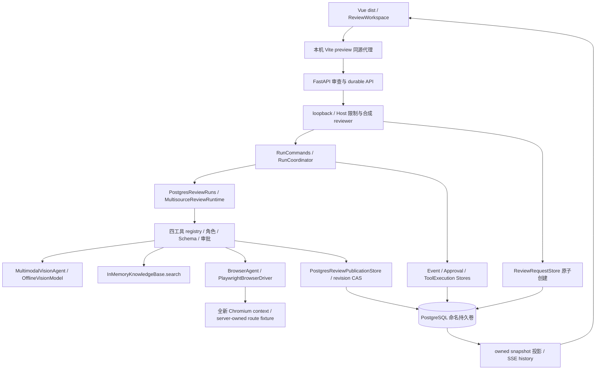
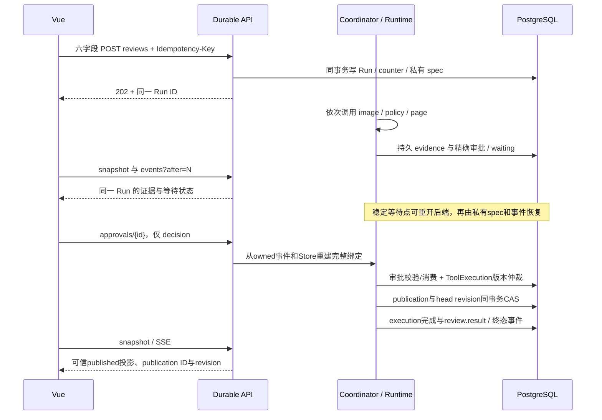

# 多源证据审查：架构与数据责任

本文描述 `multisource-review-v1` 的实际调用链。任务状态见[status](continuity/status.md)，九类交付物、
成本、安全与证据索引见[作品集报告](m14-portfolio-report.md)，运行见[本机PG部署](m14-review-deployment.md)。

## 1. 先区分执行档位

| 档位 | 入口与资源 | 能证明的范围 |
| --- | --- | --- |
| 普通研究/教学 | 默认create_app、manual/mock、默认memory；另有显式PostgreSQL设置 | 保留手写Loop、框架对照及legacy兼容；不自动启用审查创建 |
| 本机内存审查 | create_demo_review_app；合成目录、OfflineVision、真实fixture Browser、内存发布 | 可交互演示三源证据、精确审批、刷新恢复；后端停止后记录丢失 |
| 本机PG审查 | create_postgres_demo_review_app；相同工具与目录，PG Run/spec/审批/事件/发布 | Vue构建产物、两次后端进程重启与同Run恢复；固定reviewer仅供loopback演示 |
| 历史M13完整容器链 | 原Compose中的Python backend、Nginx、PG/seed | 独立部署证据；该backend镜像不含M14所需Node/Chromium，不能借用为本场景全镜像证明 |
| 历史M14-T4在线视觉 | 单次授权MiniMax M Plan smoke | 独立fixture E4；不会由审查Run自动调用，也不授予后续在线权限 |

PG适配器、审批、ToolExecution和持久事件已有实现，不能再把它们统一标成规划。队列、Redis、微服务、
生产登录、HA和集中遥测没有因本作品集新增；当前架构无需画成已经拥有这些组件。

## 2. 本机PG审查的真实拓扑

这里API与Browser运行在宿主机，PG运行在容器；网页是被route拦截的合成HTTPS资料。
没有公网Browser、个人profile或本Run在线模型。规则库是内存合成corpus，不能把PG容器里可能存在的
pgvector扩展/seed说成此Run已使用持久向量检索。

主要装配点为[review_demo](../backend/app/review_demo.py)、
[PG review factory](../backend/app/advanced/postgres_review_application.py)及
[Runtime](../backend/app/advanced/review_runtime.py)。场景固定图片→规则→网页→审批发布；不是由LLM自由选择工具的开放规划器。

## 3. 两条时序：创建证据与批准发布

这里没有一笔覆盖审批、所有工具和外部系统的分布式事务。可承诺的原子单元分别是Run/spec创建、
publication/head写入以及各Store合同。发布边界中断后先查权威publication；有一致记录才对账，
缺失或不可用则UNKNOWN，不能以“尚未看到成功响应”为理由自动再次发布。

审批的 `decision=approve` 表示授权发布所请求的结论，不等于业务结论一定通过；
`requested_decision=reject` 也可能成为一条获准发布的拒绝结论。人工拒绝审批则不会执行发布。

## 4. 数据所有权

| 数据 | 所有者/存放位置 | 使用方式与边界 |
| --- | --- | --- |
| Principal / owner / 角色 | 服务端身份adapter；本机演示固定合成reviewer | body、图片、网页、RAG与模型输出不能覆盖它 |
| 六字段spec | 私有review_run_requests，随Run原子创建 | 每次PG run/resume恢复并核对request digest；不从input_text或answer推断 |
| PNG / 网页URL / 规则corpus | 服务端目录与装配 | 请求只提交资源ID/主题；不接受任意文件路径、URL或上传bytes |
| 图片/规则/页面内容 | 工具内部不可信数据 | 公开证据只出受审查的摘要/ref；不能变成权限或审批 |
| 有序evidence与终态 | 同一Run的EventStore | projector验证bundle、result refs和completed状态后暴露publication |
| 审批与ToolExecution | owner-scoped持久Store | 绑定principal/run/call/tool/arguments；消费与CAS阻止复用和重复执行 |
| Publication / head | PG事务表 | 业务幂等digest、owner scope digest、revision和有界结果；不是外部CMS发布 |
| 前端恢复记录 | 版本化sessionStorage | Run/session/sequence/待审批坐标，适用时含capability；不保存图片、完整证据或模型Key |

私有topic是数据库中的业务内容；“不进公开事件/日志”不等于加密存储。数据库访问控制、备份与保留期仍有部署责任。

## 5. HTTP、事件与前端恢复

- `POST /api/durable/reviews` 只在显式审查composition中注册，复用现有owner/key幂等创建。
- `GET /api/durable/runs/{id}` 的可空review来自同Run持久事件；普通Run保持review=null。
- `GET .../events?after=N` 使用排他sequence cursor；心跳不是业务事件。
- `POST .../approvals/{id}` 只收approve/reject，工具、参数和digest从服务端已存事实重建。
- 刷新先读snapshot，再续传SSE；重复帧忽略，缺口停止应用不完整增量。断开观察不自动取消Run。
- review.result不是任意JSON答案；三源bundle/result不匹配时不能显示published。

合同见[HTTP读取与创建](m14-review-api-contract.md)、[M12迁移](m12-api-migration.md)，前端状态由
[useAgentDesk](../frontend/src/composables/useAgentDesk.ts)管理，事件边界解析集中在
[agentApi](../frontend/src/services/agentApi.ts)。

## 6. 工程取舍与后续边界

| 已选择 | 原因 | 后续需要独立验证 |
| --- | --- | --- |
| 单Run、固定四工具、默认离线 | 让证据、审批和幂等行为可重复验证 | 在线视觉质量、动态规划与新工具合同 |
| PG持久控制面与发布，合成目录/规则留内存 | 分开证明恢复与业务适配，不假装生产知识治理 | 真实资源ACL、持久检索质量和资料生命周期 |
| 本机preview/backend/Chromium + PG容器 | 复用现有运行时，无需未经许可安装Linux浏览器 | 完整Linux镜像、生产Web服务、身份与egress |
| UNKNOWN先对账 | 响应失败不能证明副作用未发生 | 每个新外部Publisher的幂等/查询/补偿语义 |
| usage/cost保留unknown | 不把离线或历史数据混入本Run | 逐调用账本、版本化费率、硬成本门 |
| 复用现有Store与Coordinator | 保持旧Loop/Mock/legacy兼容，不新增基础设施 | 多进程终态竞争、进行中工具hard-kill、HA |

详细威胁、容量公式、故障复盘和迁移撤回步骤集中在[作品集报告](m14-portfolio-report.md)。
这些边界属于答辩证据的一部分，不通过扩张架构图或添加未运行的服务来掩盖。
