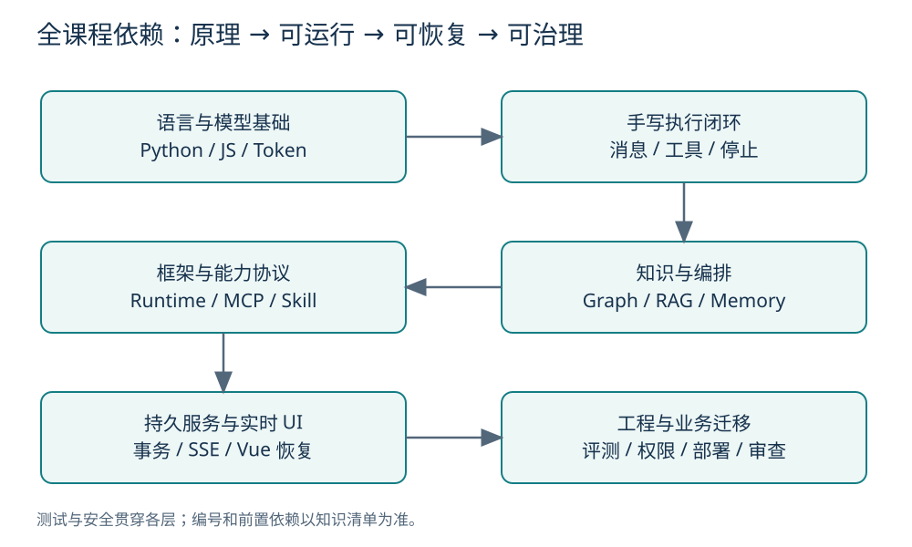
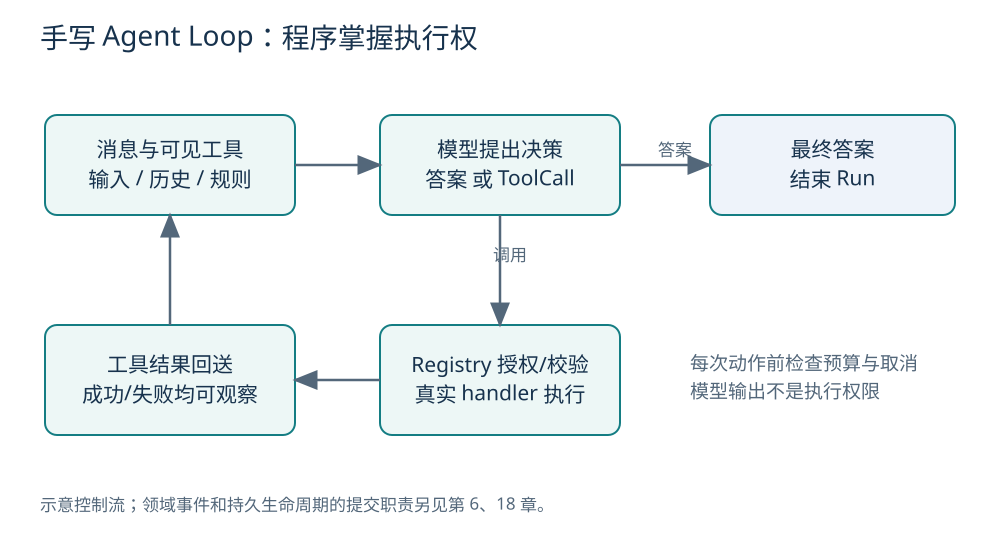
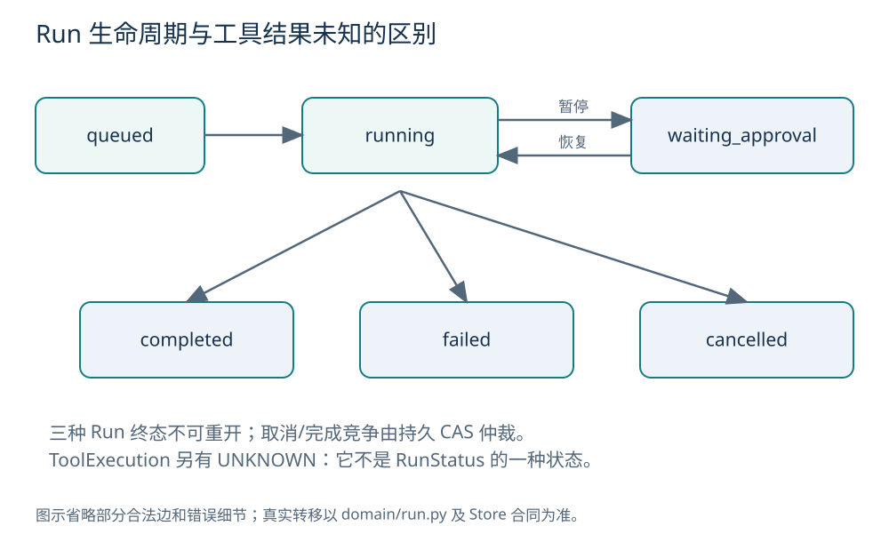
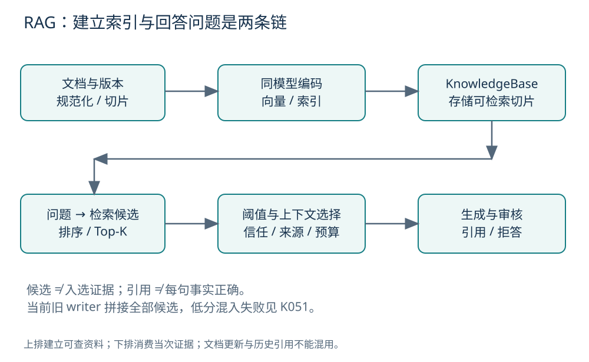
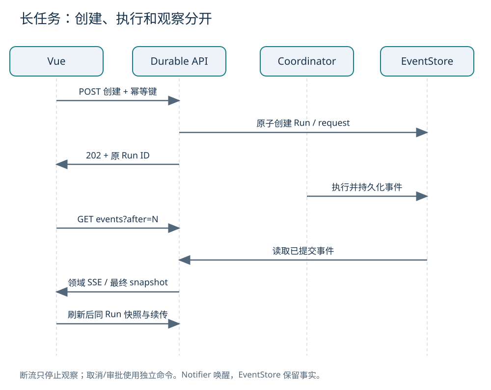
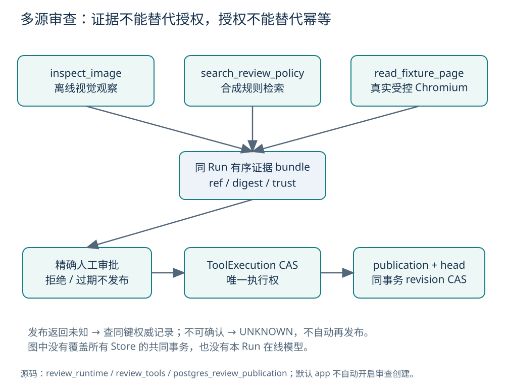

# AI Agent 课程知识手册

面向 Vue / JavaScript / 原生 PHP 开发者 · 预习、跟练、复习与业务迁移

资料快照：2026-10-30，Asia/Shanghai。源码基线：`7d0dd3b3855efc6422df3f9d8e23b031ed9f6274`。

这本手册把 M0–M14 的知识按依赖重排。你先掌握模型、工具和循环，再认识框架、知识、记忆、持久服务和工程治理。代码“已经存在”、某次测试“已经运行”和你“已经学会”是三件不同的事。本文不会用其中一件替代另外两件。

<a id="guide"></a>
## 使用说明与全课程导航

先认清几个常用缩写：AI 是 Artificial Intelligence（人工智能）；LLM 是 Large Language Model（大语言模型）；API 是 Application Programming Interface（应用程序接口）；SDK 是 Software Development Kit（软件开发工具包）；UI 是 User Interface（用户界面）；SQL 是 Structured Query Language（结构化查询语言）。其余术语在正文首次讲解处解释，完整检索见术语表。这里的 Agent 指受程序控制的任务代理。

**预习**：先读本节、每章目标、标记为“必学基础”的知识点，再沿流程图解释输入、步骤和输出。遇到陌生 Python 写法回到第 2–3 章，不必先学完整 Python 语言。

**跟练**：先看对应章节的“跟练”，在仓库根目录执行离线命令；看清预期输出，再打开源码中的指定类或函数。练习中的业务改动由你以后另行完成，本手册制作没有替你修改课程实现。

**复习**：按目录定位知识编号，先遮住附录答案回答问题，再查易混表、故障表、命令表和源码索引。能复述“为什么这样做、坏了查哪里、什么条件下需要换方案”，比背术语更重要。

阅读层级：**必学基础**支撑主线；**进阶理解**帮助看懂框架和取舍；**工程扩展**用于持久化、安全、部署及复杂故障。工程扩展可以第二遍再读，但涉及真实写入前必须先读权限、审批和幂等。

本书采用五种事实标记：**通用原理**表示不依赖本项目的概念；**当前实现**对应这份源码快照；**离线模拟**表示外部边界由确定性替身代替；**历史真实验证**必须同时注明环境、日期与验证 ID；**未来规划**没有被本文当作已完成。一个能力也可能同时具有“真实框架执行”和“模型离线模拟”两种属性。

仓库的证据等级是：E0 文件/依赖存在；E1 import、配置或构造成功；E2 真实框架公开 API 在离线边界下执行；E3 与应用领域契约及回归集成；E4 经授权实际调用指定外部服务。E3 不是“生产级”，E4 也不是“长期可靠”。详见[课程协议](../continuity/course-delivery-playbook.md)。



图中主线是先能解释并运行，再能恢复和治理。安全与测试贯穿各层，不是最后才补的插件。27 章共 108 个知识单元，完整清单见[知识盘点](knowledge-inventory.md)，资料和验证边界见[制作检查报告](quality-report.md)。

**环境与版本**：后端使用 Python，历史验证环境为 Python 3.12.10；基础语法要求 3.11+。后端清单锁定 FastAPI 0.139.0、Uvicorn 0.51.0、openai-agents 0.18.2、LangChain 1.3.13、LangGraph 1.2.9、MCP Python SDK 1.28.1、Psycopg 3.3.4。前端是 Vue 3、TypeScript、Vite，测试使用 Vitest 和 Playwright；TypeScript MCP Server 使用 Node.js、MCP SDK 和 Zod。实际解析版本以仓库锁文件为准，`latest` 是依赖声明而不是可复现版本号。本文不要求升级这些依赖。

**运行约定**：除明确写“frontend 目录”外，命令从仓库根目录执行。使用已有 `.\.venv\Scripts\python.exe`；`-B` 禁止写字节码，`-X utf8` 保证中文终端输出，`-S` 禁用 site-packages，只适用于标准库实验。不要给 FastAPI/LangGraph 测试加 `-S`。缺依赖时回原课程环境说明，本书制作不安装课程依赖。全文代码块注明“可运行示例”“源码节选”或“伪代码”；单纯展示数据结构的 JSON 不是调用外部接口。

PDF 长代码行开头的 `>` 只是排版续行标记，不是代码内容；复制运行优先使用 Markdown 原行。

<a id="contents"></a>
## 详细目录

<!-- TOC:START -->
<!-- TOC:END -->

<a id="ch01"></a>
## 第 1 章 · Agent 与模型基础

学习目标：分清模型、程序和业务流程各自做什么，解释工具调用为什么需要宿主执行。层级：必学基础。前置：JavaScript 函数、JSON 和请求响应。

<a id="k001"></a>
### K001 · Agent、聊天与工作流

**是什么与用途**：聊天系统通常接收消息并生成回复；Agent 则把模型的选择接入“观察结果—选择动作—执行—再次观察”的任务闭环。技术上，它是由模型策略、工具接口、状态和控制器组成的系统，而不只是一段 Prompt（给模型的任务说明）。

Workflow（工作流）把步骤与转移规则显式写进程序。像 Vue 表单的“填写→校验→提交→完成”，固定步骤不必让模型重新决定。Agent 适合下一步依赖非结构化信息的场景，例如先判断要查哪类资料。两者可以组合：外层固定审批流程，内层模型选择只读检索工具。

**真实过程**：用户输入进入运行时；模型返回答案或动作提议；程序校验动作并执行；结果进入状态与下一轮上下文；终止条件决定何时返回。缺少控制器，模型即使写出“我已提交”，也不会自动产生数据库写入。

项目阅读：[模型契约](../../backend/app/models/base.py)中的 `ChatModel` 与[领域类型](../../backend/app/domain/agent.py)。易错：按角色名称把几个普通函数都叫多 Agent，参见 [K045](#k045)。

自测 Q001：让模型回答“我已发邮件”，能证明邮件发出吗？[参考答案](#a001)

<a id="k002"></a>
### K002 · Token、上下文窗口与生成

**通俗解释**：模型读的不是“完整汉字列表”，而是 tokenizer（分词编码器）产生的 Token，即文本片段的编号。一个 Token 不固定等于一个字或一个单词。Context window（上下文窗口）限制一次请求能处理的上下文规模；输入、输出及其他计入窗口的内容要按具体模型规则处理。UTF-8 是 Unicode Transformation Format, 8-bit（8 位 Unicode 转换格式），把文字编码为字节；一个汉字可以占多个字节。

**真实过程**：应用组织消息→模型将输入编码为 Token→根据已有输入及已生成部分计算下一个 Token 的分布→选取并追加→重复直到结束或达到限制。这里说的是输出生成过程，不是模型在执行你电脑上的代码。

它像前端分页接口有数据大小上限，但超长历史不是“浏览器滚动后模型还能继续记住”。未再次发送且没有存储、检索机制的旧内容，不能指望模型自行找回。当前上下文预算使用 UTF-8 字节数估算，见 [K059](#k059)，不能把估算值写成真实供应商用量。

项目阅读：[RuntimeRequest](../../backend/app/agent/runtime.py)、[ContextAssembler](../../backend/app/context/assembler.py)。排错先查本次到底发送了哪些片段，再判断模型是否忽略信息。

自测 Q002：删除请求中的旧消息、只在页面上保留聊天气泡，模型还一定知道旧消息吗？[参考答案](#a002)

<a id="k003"></a>
### K003 · 训练、推理与模型局限

Training（训练）是通过数据和优化过程调整模型参数；Inference（推理）是用已有参数处理本次输入。往 Prompt 增加公司资料通常只是改变本次输入，不等于训练了公司专属模型。RAG 也是先取资料再给模型使用，见第 13 章。

模型擅长处理语言模式与不完整表达，但生成内容不自动等于事实。Hallucination（幻觉）指输出了缺乏依据或不正确、却像真的内容；格式正确也可能事实错误。Sampling（采样）及 temperature（温度）等生成配置影响输出选择，低温不能保证真实、授权正确或业务无误。

工作上可以让模型把用户投诉分类，但“是否退款、退款金额是否合规”要由业务规则、工具校验和审批确定。正确分工是让模型提供候选或结构化判断，程序执行确定约束，评测衡量实际效果。

当前 `MockModel` 按脚本返回 `ModelDecision`，没有训练或真实语言推理。它证明循环和错误分支能运行；不能证明真实模型理解业务或回答质量。项目阅读：[MockModel](../../backend/app/models/mock_model.py)及[离线评测](../../backend/app/evals/offline.py)。

自测 Q003：Mock 测试全绿，能推出换真实模型后答案质量合格吗？[参考答案](#a003)

<a id="k004"></a>
### K004 · 结构化输出与执行权

Structured output（结构化输出）把答案约束成可解析形状，例如 `{"answer":"结果是5"}`。Function Calling（函数调用）则让模型提出工具名和参数，例如“调用加法，a=2，b=3”。前者解决如何读取结果，后者解决如何表达动作意图；二者都不直接授予执行权限。

像 Vue 组件发出 `emit('submit', payload)`，父组件收到事件仍应决定是否提交。模型的 ToolCall 是提议，宿主的 ToolRegistry 才校验角色、参数和审批并调用 handler（实际处理函数）。

**输入输出关系**：可见工具定义加消息→模型产生结构化调用→程序解析与校验→handler 返回 ToolResult→模型结合结果生成答案。Schema 只约束形状，例如“金额是数字”，业务仍须判断“金额是否允许、该用户是否有权退款”。

项目阅读：[ToolCall、ModelDecision](../../backend/app/domain/agent.py)、[ToolRegistry](../../backend/app/tools/registry.py)。常见错误是看到 JSON 可解析就跳过权限，或把回答里的“approved=true”当成人工批准。

自测 Q004：JSON Schema 校验通过，为什么仍可能拒绝执行？[参考答案](#a004)

**跟练**：先不运行服务，打开领域类型，分别找出消息、工具请求和最终答案的字段；口述一次“20 加 22”的闭环。

**复习摘要**：模型生成候选，程序掌握执行权；上下文有容量且必须显式提供；结构和事实、权限是不同维度。

<a id="ch02"></a>
## 第 2 章 · Python 工程入门

学习目标：看懂本仓库最常见的 Python 写法，知道错误发生在导入、解析、业务还是测试层。层级：必学基础。前置：第 1 章。

<a id="k005"></a>
### K005 · 模块、包与虚拟环境

`.py` 文件是模块，带组织关系的目录形成包；`from backend.app... import ...` 可类比 ES Module 的 `import`。`python -m backend.app.demo` 按模块路径执行并建立包上下文，不是把脚本路径简单换一种拼法。`if __name__ == '__main__'` 让命令行入口只在直接执行模块时启动，导入时不自动跑演示。

Virtual environment（虚拟环境）隔离某项目的 Python 包。`.venv` 类似项目自己的运行依赖环境，但不是 `node_modules` 的逐项对应物：解释器和包搜索路径也会变化。多个 Python 共存时，裸 `pip` 可能安装到另一解释器，因此使用“目标解释器 `-m pip`”定位。

当前 M1 包导出保持标准库边界；`-S` 下仍应可执行手写测试。错误 `No module named backend` 先检查工作目录与 `-m`；报第三方包缺失先检查是否误加 `-S` 或用了错误解释器，不要立即重装所有依赖。

项目阅读：[Python 实验](../../labs/python-basics/async_json.py)、[Demo 入口](../../backend/app/demo.py)。

自测 Q005：为什么本仓库常用 `.\.venv\Scripts\python.exe -m ...`？[参考答案](#a005)

<a id="k006"></a>
### K006 · 集合、None 与 JSON

Python `dict` 近似 JS 普通对象，`list` 近似数组，`tuple` 表示固定序列，`set` 表示去重集合。`None` 对应“没有值”，与空字符串、空列表和数字零含义不同。JSON 是 JavaScript Object Notation（JavaScript 对象表示法），使用 `null/true/false`，Python 使用 `None/True/False`；序列化负责转换语法，不要手写字符串替换。

`json.loads(text)` 把 JSON 文本变成 Python 数据，类似 `JSON.parse`；`json.dumps(value, ensure_ascii=False)` 把数据编码成文本并保留可读中文。能解析不代表字段合法，解析后仍在外部入口校验，例如检查 `topic` 非空、`max_sources` 是整数。

**可运行示例，Python 标准库**：

```python
import json
data = json.loads('{"topic":"Agent","max_sources":2}')
print(data["topic"], data.get("max_sources", 3))
print(json.dumps({"result": None}, ensure_ascii=False))
```

预期输出 `Agent 2` 和 `{"result": null}`。关键行 `get` 提供缺省值，不负责类型校验。Python 中 `bool` 是 `int` 的子类，所以只用 `isinstance(value, int)` 会接纳 `True`；实验显式排除它。项目：`parse_task`，见[基础实验](../../labs/python-basics/async_json.py)。

自测 Q006：JSON 字符串 `"2"` 和数字 `2` 能无条件互换吗？[参考答案](#a006)

<a id="k007"></a>
### K007 · 类型、dataclass 与 Protocol

Python `value: str`、`list[Message]` 和 `str | None` 是类型注解，近似 TypeScript 的类型声明。它们帮助编辑器和检查器理解代码，但不会因为函数写了 `amount: int` 就自动拒绝字符串。外部校验仍由 Pydantic、解析函数或领域构造器承担。

`@dataclass` 为“主要携带数据的类”生成构造等方法；`frozen=True` 禁止常规属性重新赋值，便于把状态当快照处理，但不是递归冻结所有嵌套对象。Protocol 是结构化接口：对象具备约定方法就能适配，类似 TypeScript interface。它让内存与 PostgreSQL Store、Mock 与真实模型共用调用方式。

**伪代码，省略校验与导入**：

```python
class Model(Protocol):
    def decide(self, messages: list[Message]) -> ModelDecision: ...
```

省略号表示接口声明，不是业务逻辑。业务依赖 `Model` 能力而不是某一家厂商。`TypedDict` 声明字典键结构，LangGraph State 常用它；它也不替代运行时验证。

项目阅读：[领域 dataclass](../../backend/app/domain/agent.py)、[模型 Protocol](../../backend/app/models/base.py)。修改接口要同步看适配器和共享契约测试，不只修一个调用点。

自测 Q007：把函数参数注解成 `int`，能阻止 HTTP 请求传字符串吗？[参考答案](#a007)

<a id="k008"></a>
### K008 · 异常、测试与边界校验

异常像 JavaScript `throw`：中断当前正常路径，交由适合的调用层处理。`ValueError` 通常表达值不合法，`TypeError` 表达类型不合适；项目还定义稳定领域异常。不要每层 `try/except Exception` 再返回空字典，那会把存储故障伪装为“无数据”。

入口校验后，内部依靠类型与领域契约流转。只在“能恢复、能转换为本层契约、或需要清理”的边界捕获异常。`finally` 用于释放连接等资源，`with/async with` 用上下文管理器成对进入退出。错误的清理顺序会留下进程或连接，见 [K024](#k024)。

`unittest.TestCase` 是标准库测试结构，`assertEqual`、`assertRaises` 分别检查结果和异常。测试不是“调用没报错”就结束；例如未授权工具必须断言 handler 没执行。输入校验正常和错误分支都需要可观察证据。

项目阅读：[Loop 测试](../../backend/tests/test_manual_agent_loop.py)、[安全测试](../../backend/tests/test_tool_security.py)。本书没有为纯文档改动添加业务测试。

自测 Q008：数据库查询抛错时返回空列表，会造成什么误解？[参考答案](#a008)

**跟练，可运行**：

```powershell
.\.venv\Scripts\python.exe -X utf8 -B labs/python-basics/async_json.py
```

预期得到 `completed` 与任务 JSON。以后独立练习时，可复制到临时学习目录，删去 `topic` 观察入口拒绝；不要把故意破坏的代码覆盖到课程主线。

**复习摘要**：模块入口解决导入路径，虚拟环境解决依赖归属，类型解决内部表达，外部校验解决不可信输入。

<a id="ch03"></a>
## 第 3 章 · 异步与 Node.js

学习目标：理解后端为什么需要异步、什么会阻塞、取消能保证到哪一步。层级：必学基础。前置：第 2 章及 JS Promise。

<a id="k009"></a>
### K009 · 协程与 Promise

`async def` 定义异步函数，调用通常得到 coroutine（协程对象），需要 `await` 或事件循环调度才能执行。JS 的 async 函数调用会返回 Promise，并立即开始执行到第一个等待点；不要机械地把两种启动语义等同。

`await` 的含义是本任务等待结果，把执行机会交还调度器；不是启动一个新线程，也不是把 CPU（Central Processing Unit，中央处理器）计算变快。Python 的 `asyncio.run(main())` 为命令行程序建立和收尾事件循环。FastAPI 已有事件循环，在请求处理内再次 `asyncio.run` 会出错，应 `await`。

真实任务可以在等待数据库时处理其他连接；若每次等待都阻塞主线程，SSE 心跳、取消和并发请求就会一起停住。当前 Python 与 Node 基础实验都通过一次异步等待返回结构化任务，但等待的是离线可控对象，不是访问远端服务。

项目：[Python main/execute](../../labs/python-basics/async_json.py)、[Node execute](../../labs/node-basics/async-json.mjs)。

自测 Q009：在 FastAPI 的 async 路由内，应使用 `await operation()` 还是 `asyncio.run(operation())`？[参考答案](#a009)

<a id="k010"></a>
### K010 · 事件循环与阻塞 I/O

Event loop（事件循环）管理就绪任务、I/O 等待和定时器。I/O 是 Input/Output（输入输出），如数据库、网络和文件读写。多个协程可以交错前进，但一个协程直接执行长时间同步函数时，循环不能凭函数名带 `async` 自动抢占它。

像浏览器主线程运行巨大同步循环会卡界面，后端同步数据库阻塞也会让同进程的其他异步工作延迟。项目为旧同步 Store 建立有界异步桥，把执行放进 worker thread（工作线程）；有原生异步池的路径则使用异步 I/O。

**伪代码**：

```python
# 坏例：同步查询可能卡住整个事件循环
result = sync_store.get(run_id)
# 桥接思路：等待线程执行，循环还能处理别的任务
result = await asyncio.to_thread(sync_store.get, run_id)
```

这不等于现有 Store 都应自行加 `to_thread`；真实项目已有桥、线程所有权和超时约束，重复包裹会打乱合同。项目：[async_facade](../../backend/app/stores/async_facade.py)、[桥接测试](../../backend/tests/test_postgres_async_stores.py)。

自测 Q010：函数声明成 `async def`，里面调用同步慢查询就不阻塞了吗？[参考答案](#a010)

<a id="k011"></a>
### K011 · 异步迭代、背压与资源关闭

异步迭代用 `async for` 逐项取得等待才能到达的数据，适合模型流和 SSE。数据生产者与消费者速度不同；Backpressure（背压）是让生产过程感知消费能力，避免无限积压。`await emit(event)` 让事件提交的完成顺序可观察，不是随意“扔给后台”。

输入是源事件流；运行时解码并发出领域事件；EventStore 持久化；通知唤醒读者；SSE 慢读者按游标读取已提交事件。通知队列有界时，丢通知不应等于丢事实，因为事实仍可从持久存储读回。

上下文管理器 `async with` 保证 client、连接等资源成对管理。任务结束要关闭迭代器、连接与子进程；重复创建一条流来“收尾旧流”不是正确清理。SDK drain（继续消费至清理结束）见 [K028](#k028)。

项目：[SDK Runtime](../../backend/app/agent/sdk_runtime.py)和[RunEventNotifier](../../backend/app/services/run_event_notifier.py)。常见问题是无限队列内存增长、未 await 导致事件乱序、退出时进程未关闭。

自测 Q011：有界通知队列丢了一个唤醒，为什么持久事件仍能补读？[参考答案](#a011)

<a id="k012"></a>
### K012 · 取消、超时与线程桥接

Cancellation（取消）是提出“停止后续工作”的信号；Timeout（超时）是等待超过限定时间。协作式取消要求运行代码主动检查信号或在可取消等待点响应。它们不自动撤销远端请求，也不能强杀已经开始的 Python 同步线程。

项目桥接有总等待上限和错误归一，调用方取消不会被普通业务异常吞掉。线程可能继续完成旧调用，所以特别是写数据库、发消息、发布等副作用，必须另有幂等和结果确认机制。

前端 `AbortController.abort()` 首先停止本地 fetch 等待；持久 Run 的真正取消是独立后端命令。就像关掉浏览器支付页面不等于支付退款，停止观察和停止业务必须分开。进程级代码 Agent 能清理进程树，但也不撤销已经写出的外部事实。

项目：[CancellationToken](../../backend/app/agent/cancellation.py)、[异步 Store 测试](../../backend/tests/test_postgres_async_stores.py)。修改注意：保留异常的层次和取消传播，别把 timeout 转成虚假的成功空结果。

自测 Q012：客户端超时后，能否立即断言发布没有发生并重新发布？[参考答案](#a012)

**跟练，可运行**：`node labs/node-basics/async-json.mjs`，观察 `completed`；对照 Python 实验的等待点和 JSON 边界。两个命令都不需要模型服务。

**复习摘要**：异步提升等待期间的可服务能力；不解决 CPU 阻塞和副作用撤销；资源所有权和清理顺序同样重要。

<a id="ch04"></a>
## 第 4 章 · 手写 Agent Loop

学习目标：脱离框架说清一次工具调用为什么需要两轮模型决策。层级：必学基础。前置：第 1–3 章。



<a id="k013"></a>
### K013 · 消息、决策与工具回送

Message（消息）记录角色和内容；用户消息提出任务，assistant 消息记录模型决定，tool 消息记录实际执行结果。`ToolCall.id` 将一次提议和其结果关联，避免多次工具调用相互混淆。消息历史是模型下一次决策的输入之一，不是 UI 气泡的装饰数据。

`ManualAgentLoop.run` 先建立用户消息，再让模型 `decide`。如果返回最终答案就结束；如果返回工具请求，则调用 Registry，把结构化成功或失败结果写回消息，再进入下一轮。工具报错也可以作为数据回送，模型因此有机会解释失败，而不必让整个服务异常退出。

**源码关联**：[ManualAgentLoop.run](../../backend/app/agent/manual_loop.py)、[test_executes_tool_then_returns_answer](../../backend/tests/test_manual_agent_loop.py)。修改消息形状时要核对配对 ID 和测试，不能只把工具结果显示到前端却不回送模型。

自测 Q013：工具算出了 5，但没把结果传回模型，下一轮模型有什么缺失？[参考答案](#a013)

<a id="k014"></a>
### K014 · ReAct 与循环控制

ReAct 来自 Reasoning and Acting（推理与行动结合），在工程上关注“根据上下文选择动作—取得观察—继续决策”的交替。你需要记录可解释的动作和结果，不需要收集或展示模型内部隐藏思维。

例如查套餐费用：先调用查询工具取得当前套餐，再根据结果决定是否查询地区限制，最后回答。真实过程不是模型一次生成一大段计划后宿主盲目全部执行；每次动作仍经过程序边界。

**伪代码，说明控制流而非替代源码**：

```python
for step in range(max_steps):
    decision = model.decide(messages, tools)
    if decision.final_answer is not None:
        return decision.final_answer
    result = registry.execute(decision.tool_call)
    messages.extend(call_and_result_messages(decision, result))
raise StepLimitExceeded()
```

实际源码使用自己的参数、事件和异常契约，不能把这个简图代码直接粘贴覆盖。Workflow 可以固定每一步，Agent Loop 则允许模型从可见工具中提出下一步；是否需要这种灵活性取决于业务。

自测 Q014：ReAct 是否要求把模型内部思维原文存入日志？[参考答案](#a014)

<a id="k015"></a>
### K015 · 停止条件和预算

不设置上限，模型可能反复请求同一工具。`max_steps` 限制循环步数，模型重试次数限制单次决策恢复，deadline 限制整个任务允许等待的时间；动作、输入输出字节和 Token 又是其他预算。它们控制不同资源，不能互相代替。

Loop 的正常停止是得到最终答案；失败停止可能是步数耗尽、预算不足或不可恢复错误；取消则属于独立终态。检查取消要放在下一次模型/工具动作前，避免已经要求停止还继续新动作。

类比 Vue 请求重试：你限制“按钮最多重试两次”，不代表网络层没有自己的隐式重试，也不代表每次请求只耗一秒。多层重试会放大次数与成本，SDK 路径要显式控制下层重试，见 [K028](#k028)。

项目：[ManualAgentLoop](../../backend/app/agent/manual_loop.py)、[步数与取消测试](../../backend/tests/test_manual_agent_loop.py)。不要为了让失败测试变绿直接放大预算；先看是否存在错误循环。

自测 Q015：步数上限是 3，能保证整个任务只运行 3 秒吗？[参考答案](#a015)

<a id="k016"></a>
### K016 · Mock、事件与可观察行为

MockModel 是按预设序列返回决策的模型替身。准备“加法 ToolCall→最终答案”两项，就能确定程序必须先执行工具，再结束；若只准备一次工具调用而缺下一次决策，脚本会耗尽。这种失败首先说明 fixture（测试固定数据）不完整，不是“模型理解失败”。

AgentEvent 是过程事实，例如 `run.started`、`tool.started`、`tool.completed`、`run.completed`。它们帮助测试顺序、前端显示和日志关联。早期同步 Loop 的事件对象不直接等于持久 Runtime 事件，后者另有 Run ID、序号、字段白名单和提交责任。

测试应检查返回值、事件顺序和副作用调用次数，不只匹配一句答案。注入时钟使耗时断言稳定，避免把机器偶然快慢写成测试要求。

项目：[MockModel](../../backend/app/models/mock_model.py)、[Loop 契约测试](../../backend/tests/test_manual_agent_loop.py)。本次已运行 11 项通过，具体证据见检查报告。

自测 Q016：只断言最终文本是“5”，漏掉了哪些关键行为？[参考答案](#a016)

**跟练，可运行**：

```powershell
.\.venv\Scripts\python.exe -X utf8 -B -S -m backend.app.demo
.\.venv\Scripts\python.exe -X utf8 -B -S -m unittest backend.tests.test_manual_agent_loop -q
```

预期 Demo 显示四类核心事件并返回加法结果，测试成功。阅读 `test_unknown_tool_is_returned_to_model`，解释工具失败为何仍可由模型形成回答。迁移练习：设计一个只读套餐查询工具的输入和结果，不连接真实业务接口。

**复习摘要**：工具结果必须回到下一轮；事件描述行为；Mock 固定外部不确定性；停止条件是控制器责任。

<a id="ch05"></a>
## 第 5 章 · Function Calling 与工具注册

学习目标：从模型请求一路跟到实际 handler，分清格式、权限和业务结果。层级：必学基础。前置：第 4 章。

<a id="k017"></a>
### K017 · Schema 与结构化调用

JSON Schema 是描述 JSON 结构及约束的规范。工具声明通过 `properties` 指定字段、`required` 指定必填项，并用 `additionalProperties=false` 拒绝额外字段。它像表单校验规则，但服务端不能因为前端已校验就省略自身边界。

**数据示例，节选加法工具参数形状**：

```json
{
  "type": "object",
  "properties": {"a": {"type": "number"}, "b": {"type": "number"}},
  "required": ["a", "b"],
  "additionalProperties": false
}
```

模型看到名称、描述、参数 Schema，再返回参数对象。程序先确认调用可信且获准，再校验参数和执行。JSON 语法正确、Schema 正确、业务合法是三个层次：`{"a":"2"}` 可能语法合法却类型不符。

项目：[builtin 工具定义](../../backend/app/tools/builtin.py)、[Registry 校验](../../backend/app/tools/registry.py)。本项目支持受控 Schema 子集，不应假设能自动支持 JSON Schema 所有关键字。

自测 Q017：`required` 与 `additionalProperties=false` 分别拦住什么？[参考答案](#a017)

<a id="k018"></a>
### K018 · 注册、发现与统一执行

Registry（注册表）保存可信工具定义和 handler。它像服务端维护的路由表：模型只能从暴露出的名字选择，不能提供任意 Python 导入路径、Shell 命令或 URL（Uniform Resource Locator，统一资源定位符，即网络地址）作为新工具。

输入是工具名、参数、可信执行上下文与 call ID；Registry 查定义、检查权限与审批、校验参数、执行 handler，并返回统一 ToolResult。Manual、SDK 和 MCP 适配路径最终共用这条规则，可避免每换框架重写一套权限。

发现阶段先按角色过滤可见工具，执行阶段仍校验权限：可见性是减少误选和信息泄露，真正执行边界防止伪造调用。Schema 快照避免注册后被原对象偷偷改动，属于现有共享边界，不意味着所有业务对象都需要深复制。

项目：[ToolDefinition、ToolRegistry](../../backend/app/tools/registry.py)、[SDK bridge](../../backend/app/agent/sdk_tools.py)。新增工具时就近实现 handler，填写必要的风险元数据，不先建立通用插件框架。

自测 Q018：工具已从模型的可见列表隐藏，执行端还要校验权限吗？[参考答案](#a018)

<a id="k019"></a>
### K019 · 权限、校验和错误回送

工具失败既可能是未知名称、参数非法，也可能是越权、需要审批、超时或 handler 失败。统一结果提供 `ok`、`value`、`error_code` 等安全字段，使上层能决定解释、终止还是允许重试，而不是解析随意异常文本。

在本项目，授权检查必须早于参数校验及 handler；未获准用户不应靠错误细节探知受限工具行为。身份来自可信上下文，不能让模型在 arguments 中传 `roles=['admin']` 自己提权。

一般工具错误可作为 tool 消息回送，模型解释“无法完成”；EventStore 失败则意味着系统无法可靠记录过程，不能伪装为“工具数据为空”让模型继续。不同错误层必须保留各自责任。

项目：[授权逻辑](../../backend/app/tools/registry.py)、[test_tool_security](../../backend/tests/test_tool_security.py)。排查时同时看稳定码和 handler 调用计数；只有报错字符串而没有行为断言，不能证明危险动作被挡住。

自测 Q019：把真实数据库异常全文发给模型与浏览器有哪些问题？[参考答案](#a019)

<a id="k020"></a>
### K020 · 只读工具与副作用工具

只读工具读取信息，副作用工具改变外部状态，如发布审查、退款、写文件。网络错误对两者含义不同：查询超时可在有限规则下再查；发布超时可能已经写入成功，重试会重复发布。

高风险调用需要精确人工审批、业务幂等和持久执行记录，分别回答“谁批准什么”“同一业务动作是否重复”“程序执行到哪里”。它们不是可互相替代的三个开关。

当前默认 Registry 的 `publish_report` 是明示模拟工具；M14 `publish_review` 在 PostgreSQL 档位实际写审查记录，但不是接入外部生产发布系统。M8 SDK 适配默认只开放低风险、无需审批、无副作用的工具；M10 和 M14 有各自独立恢复编排，不能把后者的能力直接套到通用 SDK 路径。

项目：[builtin](../../backend/app/tools/builtin.py)、[review_tools](../../backend/app/advanced/review_tools.py)。修改工具风险级别时必须检查 discover、approval 和持久恢复，而不只改描述。

自测 Q020：已经有人工审批，为什么发布仍然需要幂等键？[参考答案](#a020)

**跟练，可运行**：`.\.venv\Scripts\python.exe -X utf8 -B -m unittest backend.tests.test_tool_security -q`。观察未授权、参数提权、审批重放等拒绝；变式练习只设计“查询账单”和“撤销账单”的不同执行条件。

**复习摘要**：Schema 管格式，Registry 管执行，可信上下文管身份；副作用要额外处理审批、幂等和结果未知。

<a id="ch06"></a>
## 第 6 章 · FastAPI 与分层架构

学习目标：看懂从 HTTP 到模型和存储的责任链，避免把接口框架当 Agent 引擎。层级：必学基础。前置：第 3、5 章。

<a id="k021"></a>
### K021 · HTTP、DTO 与状态码

HTTP 是 Hypertext Transfer Protocol（超文本传输协议），在这里承载客户端与服务端的请求响应。FastAPI 负责路径、参数、响应与依赖；Pydantic schema 负责声明和校验边界数据。DTO 是 Data Transfer Object（数据传输对象），描述穿过接口的数据，不等于数据库表。

像 Vue 的请求封装只负责发送 `POST` 和处理返回值，后端路由也不应该直接堆模型循环与 SQL。典型过程是 body→边界模型→可信身份→用例服务→领域结果→响应模型。错误参数返回 422；资源不存在或不应暴露其存在时返回 404；冲突常用 409；401/403 则要结合该接口认证和授权合同。

不要把所有失败都包成 HTTP 200 加一句“失败”，否则前端和监控无法区分；也不要把所有 404 都当 URL 写错，可能是 owner 隔离。项目：[schemas](../../backend/app/api/schemas.py)、[main](../../backend/app/main.py)、[持久 API 测试](../../backend/tests/test_persistent_run_api.py)。

自测 Q021：创建请求参数正确却与已有幂等请求冲突，应先查哪类合同？[参考答案](#a021)

<a id="k022"></a>
### K022 · 领域、适配器与依赖注入

领域层表达 Run、Message、ToolCall 等业务概念；适配器把外部 SDK、HTTP、数据库转换成领域接口。Dependency injection（依赖注入）指由调用方把具体依赖交给使用者，而不是业务函数自己到处创建它。

可类比 Vue 组件接收服务对象，但这里更关注可替换与生命周期：同一 Runtime 可以注入确定性模型，同一 Store 契约可运行内存或 PostgreSQL 实现。测试不用真实网络也能验证业务行为，是因为替换的是明确的外部边界。

ApplicationContainer 负责组装 Settings、Store、Runtime 和服务。不要在领域类型中导入 FastAPI Request，也不要在路由里偷偷创建另一套知识库，否则 UI 引用和主 Run 可能来自不同事实源。

项目：[container](../../backend/app/container.py)、[Runtime Protocol](../../backend/app/agent/runtime.py)、[container 测试](../../backend/tests/test_container.py)。单次逻辑仍可就近内联，分层不意味着每行代码都拆成 helper 或 service。

自测 Q022：为什么把 SDK 原始事件直接发给 Vue，会增加更换模型的成本？[参考答案](#a022)

<a id="k023"></a>
### K023 · Runtime 与 Coordinator

Runtime 是一次 Agent 执行的适配契约：接收 RuntimeRequest、控制信号和事件 sink，发出领域中间事件，返回 RuntimeResult。Coordinator（协调器）负责业务 Run 的开始、取消、期限、审批恢复与终态提交。

两者像“可替换任务执行器”和“拥有任务账本的调度业务层”。Runtime 不自行生成持久 Run 的生命周期事件，Coordinator 不应该解析 SDK 的原始 response delta。这样更换引擎不会改变任务账本和前端协议。

真实顺序是先将 queued 原子推进 running，再调用执行器；中间事件先持久化再通知；结束时通过 CAS（Compare-And-Swap，比较并交换，详见 K066）仲裁完成和取消。终态只能有一个赢家，不能让晚到答案把已取消的 Run 改成成功。

项目：[runtime.py](../../backend/app/agent/runtime.py)、[RunCoordinator](../../backend/app/services/run_coordinator.py)、[共享契约测试](../../backend/tests/test_runtime_contract.py)。旧同步 Loop 通过 adapter 进入新契约，而不是直接透传旧事件。

自测 Q023：`run.completed` 应由解析 SDK 的 Runtime 还是拥有持久生命周期的 Coordinator 提交？[参考答案](#a023)

<a id="k024"></a>
### K024 · 配置、lifespan 与优雅停止

Settings 集中解析可信操作者配置，默认离线，不自动读 `.env`。在线路径需要显式开关、正确配置以及当次授权；“电脑上存在 Key”不能授权调用。配置错误应在恰当边界稳定失败，而不是导入模块时发请求。

Lifespan（应用生命周期）在启动与停止时管理数据库池、MCP worker 和恢复 supervisor。Graceful shutdown（优雅停止）先停止接纳新任务，再等待活动操作在有限时间内结束或取消，最后关闭共享资源。否则任务还在使用连接时，池已被关掉。

项目 admission（准入）边界还考虑完整响应 body；不能只在路由函数返回 StreamingResponse 时就当请求工作结束。Quiesce 指让系统进入没有继续活动工作的稳定停止阶段。默认运行、显式 PostgreSQL composition 和 review demo 的启动组合各自不同。

项目：[application_lifecycle](../../backend/app/application_lifecycle.py)、[quiesce 测试](../../backend/tests/test_run_coordinator_quiesce.py)、[Settings](../../backend/app/settings.py)。

自测 Q024：关闭应用时，为什么不应该先关数据库池再等正在执行的任务？[参考答案](#a024)

**跟练**：读 `create_app` 的 container 注入和 lifespan，再读一个 durable 路由。用四句话分别说明“参数校验、业务执行、状态提交、响应转换”在哪里发生。

**复习摘要**：API 是边界，领域是合同，适配器处理差异，Container 管组装，Coordinator 管生命周期。

<a id="ch07"></a>
## 第 7 章 · 框架对照

学习目标：根据任务选择抽象，理解“用了框架”需要什么证据。层级：进阶理解。前置：第 4、6 章。

<a id="k025"></a>
### K025 · 四类框架的职责与取舍

手写 Loop 让控制流可见，便于理解和定制；Agents SDK 提供模型、工具、运行器等约定；LangChain 提供模型与工具等集成抽象；LangGraph 以图和状态组织可恢复流程。它们有重叠，不能当四个必须串起来才能运行的组件。

选择顺序应从业务出发：步骤固定就优先确定性函数或工作流；模型要动态选择工具时需要 Agent Loop；跨调用审批和恢复需要显式状态与 checkpoint。新增框架的收益要抵消适配、调试和版本管理成本。

像 Vue 的表单能用几行状态完成，就不一定需要引入整套流程引擎。课程仍做框架对照，是为掌握可替换边界。项目的共享 Runtime 契约让同样的正常、失败和取消案例对照，避免拿“一个直接回答、一个复杂工具链”得出偏差结论。

项目：[runtime_comparison 测试](../../backend/tests/test_runtime_comparison.py)、[LangChain 实验](../../labs/langchain-agent/demo.py)。锁定依赖版本，框架升级后重验公开 API，不能只看 import。

自测 Q025：一个固定的“检索→校验→回答”任务，为什么不必默认用自由 Agent？[参考答案](#a025)

<a id="k026"></a>
### K026 · Agent、Runner 与真实调用链

SDK 的 Agent 对象声明名称、instructions、tools 和输出类型；Runner 才真正驱动模型与工具。只构造 Agent 或安装 SDK 是 E0/E1，不证明循环已经执行。运行 `Runner.run` 或 `run_streamed` 并消费结果，才进入执行链。

当前 `OpenAIAgentsRuntime` 为每个 Run 构造显式模型/client 与工具上下文，通过 SDK 流接口运行，再转换成领域事件及结果。LangChain 实验执行 `create_agent(...).invoke(...)` 等公开链路，采用确定性模型测试框架控制流，不发在线请求。

**类比**：组件定义不等于已经挂载；创建请求配置不等于请求已发出。**真实路径**：可信 RuntimeRequest→AgentFactory/ModelFactory→Runner→工具 bridge→ToolRegistry→安全结果→RuntimeResult→Coordinator 终态。

项目：[sdk_runtime](../../backend/app/agent/sdk_runtime.py)、[LangChain 测试](../../backend/tests/test_langchain_agent_lab.py)。M8 通用 OpenAI 在线门尚未完成，不能借 M14 独立 MiniMax 视觉结果补成 OpenAI 真实验证。

自测 Q026：Agent 构造成功和 Runner 在离线模型下执行成功，分别证明了什么？[参考答案](#a026)

<a id="k027"></a>
### K027 · 事件映射和 JSON 增量

网络 chunk 不保证是完整 JSON，更不保证刚好是用户可见文字。当输出类型是 `answer: str` 的结构化对象时，SDK delta 可能携带 `{"answer":"..."}` 的一部分，包括跨块的转义和 Unicode 代理对。

Runtime 的增量解码状态机识别键、字符串和 escape，只发出解码后的答案正文；每个完整对象对应一个 `segment`（片段编号）。同一对象跨很多 chunk 仍是同一 segment，新一轮对象才增加编号。Vue 在同 segment 内追加，换 segment 时切换草稿边界，不能把草稿和最终答案无界拼接。

SDK 工具事件也按白名单映射：call ID 与名称形成 `tool.started`，结果只留下安全的 `ok/error_code`。未知顶层事件或不支持的 handoff 稳定失败，避免升级后静默把敏感字段持久化。

项目：[SDK Runtime 解码与映射](../../backend/app/agent/sdk_runtime.py)、[SDK 测试](../../backend/tests/test_openai_agents_runtime.py)。易错：逐块 `json.loads`，或把供应商完整事件对象直接 `JSON.stringify` 后发给 UI。

自测 Q027：为什么一次 `delta` 到达时不能立即对它调用完整 JSON 解析？[参考答案](#a027)

<a id="k028"></a>
### K028 · Usage、guardrail 与 SDK 清理

Usage 是供应商/SDK 报告的请求与 Token 用量；guardrail（护栏）是输入、输出或工具边界的检查机制，不能取代业务授权。当前 SDK 有 turn、单次输出、重试和 deadline 等约束，但累计 requests/input/output 还包含完成后的核对，`max_cost_usd` 不能被描述为计费前硬限制。

取消时 Runtime 先禁止新领域事件，再调用 SDK immediate cancel，随后 drain 原迭代器，在有限宽限时间内收尾并关闭 client。重新创建一个流迭代器不能证明旧消费者已释放；晚到 delta 也不能继续落库。

**依赖与注意**：底层 client 关闭隐藏重试，SDK 层才管理明确重试次数，避免两层相乘。取消不撤销 Provider 已收到的请求，不杀死正在执行的线程。事件 sink 失败必须传播给 Coordinator，不能改成 Provider 错误。

项目：[SDK Runtime](../../backend/app/agent/sdk_runtime.py)。历史证据 `V-20260716-006/008` 为离线 SDK/Runtime 契约，非 Provider 在线质量或真实账单。

自测 Q028：为什么完成后发现超额，不能叫“调用前绝不超预算”？[参考答案](#a028)

**跟练，可运行**：`.\.venv\Scripts\python.exe -X utf8 -B -m unittest backend.tests.test_runtime_comparison backend.tests.test_langchain_agent_lab -q`。比较同一任务的接口结果、错误与取消，不以类名判断是否进入真实框架。

**复习摘要**：框架负责某类抽象，Runtime 吸收差异；流解析、事件映射和资源清理都是实际适配工作。

<a id="ch08"></a>
## 第 8 章 · MCP 工具协议

学习目标：能画出跨进程工具发现与调用链，分清协议和权限。层级：进阶理解。前置：第 3、5、6 章。

<a id="k029"></a>
### K029 · Host、Client、Server 与 STDIO

MCP 是 Model Context Protocol（模型上下文协议），让宿主与能力服务按共同协议互通。Host（宿主）运行用户应用与策略；Client（客户端）建立某个 Server 的会话；Server（服务端）暴露工具等能力。模型一般通过 Host 映射后的工具定义使用能力，而不是直接控制 Server 进程。

STDIO 是 Standard Input/Output（标准输入输出），本项目用父子进程管道传输协议。Python Host 启动固定登记的 Node/TypeScript Server，经 stdin/stdout 交换 JSON-RPC 消息；JSON-RPC 是以 JSON 表达请求、响应及 ID 的远程过程调用协议。

它像前后端约定接口，但 transport 是本地进程管道。stdout 必须保留给协议，普通日志应走 stderr；一行随手 `console.log('started')` 就可能破坏通信。固定 command/cwd 来自服务端目录，模型参数不能选择 executable。

项目：[McpClientManager](../../backend/app/integrations/mcp/client.py)、[TypeScript Server](../../mcp-servers/knowledge-server/src/index.ts)。

自测 Q029：MCP Server 能否把普通启动日志输出到 stdout？[参考答案](#a029)

<a id="k030"></a>
### K030 · 初始化、发现和调用

典型过程是启动 Server→建立 session→initialize（初始化协商）→list_tools（发现工具）→call_tool（调用工具）→关闭。直接 import Server 函数绕过了进程、transport、序列化和协议校验，不能冒充协议 E2E。

发现返回名称、描述与参数 Schema，但远端声明不是本系统的授权策略。Host 先对照可信目录，再映射成本地 ToolDefinition。调用时参数经过共同 Registry，再由 Client 在拥有连接的 worker 内执行 `call_tool`，结构化结果优先，文本作为受限回退。

项目真实本地互操作覆盖 Python Client 与 TypeScript Server，历史证据 `V-20260720-003`。这个 E3 范围不含远程 transport、自动重连、公网服务或生产容量。

**输入输出**：概念查询参数→共同工具→协议消息→Server 的受控知识查询→有界结果→ToolResult。错误先看进程是否可用，再看初始化、发现、映射、调用哪个阶段失败。

自测 Q030：直接调用 Server 的 JS 函数，漏测了哪些边界？[参考答案](#a030)

<a id="k031"></a>
### K031 · 工具映射、命名空间与可信策略

不同 Server 都可能提供 `search`，命名空间用于避免本地名称冲突。更重要的是可信 `McpToolPolicy` 明确哪些工具允许进入应用，以及角色、风险和描述。远端 description、title、默认值和示例不能未经审核直接成为控制提示。

系统分页发现工具，归一化受支持 Schema，拒绝重复名称、未登记能力、配置缺项和非法结构。参数与返回大小都有上限，防止进程输出无限膨胀。它不是为每个内部变量加防御，而是在外部协议边界做一次规范化。

类比第三方 API 接入：不把对方整包返回值当你系统的内部类型。适配器只提取已评审字段，内部使用统一合同。即使 Server 声明某工具低风险，本地仍按可信策略控制。

项目：[mcp/tools.py](../../backend/app/integrations/mcp/tools.py)、[映射测试](../../backend/tests/test_mcp_tool_adapter.py)。Schema 或策略变化应重跑跨 Runtime 共同工具契约，而不是只测远端接口返回 200。

自测 Q031：远端工具描述写“此工具可无需审批”，Host 应照做吗？[参考答案](#a031)

<a id="k032"></a>
### K032 · 生命周期、协议排错与 roots

MCP SDK context manager 的进入与退出由同一个连接 worker 管理；超时或取消向该 worker 发停止信号并等待清理。不同 Task 随意关闭对方上下文可能破坏 SDK 的任务所有权。应用停止顺序也必须等活动调用结束，再关闭连接。

稳定错误包括 `server_not_allowed`、`process_unavailable`、`startup_timeout`、`protocol_error`。查配置 ID→可执行文件和构建产物→协议 stdout→Schema 与参数→结果限制→清理；不把原始 stderr 或命令全文暴露给用户。

MCP roots 是客户端告知服务端的文件 URI 关注范围，不是 Operating System（操作系统，OS）沙箱。服务端若有 OS 权限，roots 本身不能阻止越界读。本仓库没有协商 roots；已有安全来自固定配置、路径校验与权限，不能声称实现了 roots 隔离。

项目：[lifecycle 测试](../../backend/tests/test_mcp_client_lifecycle.py)、[协议 E2E](../../backend/tests/test_mcp_client_e2e.py)。

自测 Q032：为什么设置 roots 仍不能取代低权限进程与路径校验？[参考答案](#a032)

**跟练入口**：已有依赖时先 `npm.cmd run build --prefix mcp-servers/knowledge-server`，再运行 `backend.tests.test_mcp_client_e2e`。该步骤会生成忽略的构建产物并启动本地 Node，手册制作不以它证明远程服务。

**复习摘要**：MCP 负责互操作；Host 决定信任、映射与权限；STDIO 有严格输出和生命周期要求。

<a id="ch09"></a>
## 第 9 章 · Skill 任务说明

学习目标：把可复用做事方法放进受控上下文，同时保留程序权限。层级：进阶理解。前置：第 5、8 章。

<a id="k033"></a>
### K033 · Skill、工具与 MCP 的区别

Skill 是可复用任务说明，告诉 Agent“某类工作怎么做、要产出什么”。工具提供执行能力；MCP 提供跨进程能力协议。比如研究摘要 Skill 要求列来源与限制，检索工具取得事实，MCP 可以把检索工具接入宿主。三者能协作，不是同一种功能的不同名字。

本仓库的 `research-summary` 是只读 Markdown 指南，不是安装后自动运行的 Python 模块。它能影响模型组织输出，不能产生新角色、审批或系统工具。即使文字要求“忽略权限”，Registry 的最终边界仍应拒绝。

**真实过程**：用户查询触发 resolver→加载批准范围的正文与引用→生成有界提示片段→Runtime 使用片段→模型仍经统一工具边界执行。缺 Skill 时模型也能运行，只是缺少这份特定任务方法。

项目：[Skill 正文](../../skills/research-summary/SKILL.md)、[输出约定](../../skills/research-summary/references/output-contract.md)。

自测 Q033：把“允许发布”写进 Skill，是否完成了发布授权？[参考答案](#a033)

<a id="k034"></a>
### K034 · Catalog、元数据与安全加载

Catalog（目录）列出可加载 Skill；frontmatter 是文件开头的元数据区，当前只接受严格 `name/description` 标量子集，不执行通用 YAML 标签。仓库固定 skills 根目录，正文仅加载明确链接的 `references/*.md`，不扫描和执行旁边任意脚本。

加载先解析规范化路径，再拒绝越界与符号链接组件，限制文件、引用数量及总字节。这样“引用 ../秘密文件”不会借文档加载路径取得文件读取权。这里只讲实现机制，不要求读取任何秘密做实验。

输入是服务端允许根目录的 Markdown；输出是不可变加载快照。若缺文件、编码错误或超限，应稳定拒绝，不悄悄加载半本指南。它像编译前端资源时限定 import 根，但实际仍由服务端文件访问规则保证。

项目：[SkillCatalog](../../backend/app/skills/catalog.py)、[Catalog 测试](../../backend/tests/test_skill_catalog.py)。修改引用约定时同步检查边界测试，不能为了“方便”扩成任意文件路径。

自测 Q034：为什么不能把 Skill 目录中所有文件都自动加载执行？[参考答案](#a034)

<a id="k035"></a>
### K035 · 触发、缓存和 Runtime 注入

Resolver（解析选择器）决定本次使用哪些 Skill。项目支持显式 `$research-summary`；隐式触发使用名称词元匹配规则，不是一个能理解所有中文同义词的智能分类器。因此你写“帮我总结”不一定命中这个 Skill。

Catalog 首次加载后缓存，只有可信调用方 `refresh()` 才重读盘。选择依据是原始 input_text；注入后仍保留原始输入、身份和工具上下文。内建 Runtime 经 `SkillAwareRuntime` 组合，显式注入自定义 Runtime 时不能假设 Container 自动包装。

输入查询→选择 Skill→有界片段→独立 system context 或 agent instructions→执行。Skill 提示与工具权限分开，不能让注入覆盖主体或 Schema。缓存意味着编辑了磁盘 Skill 后旧快照可能仍有效，排错要检查是否刷新及应用是否重建。

项目：[resolver](../../backend/app/skills/resolver.py)、[runtime](../../backend/app/skills/runtime.py)。

自测 Q035：修改 SKILL.md 后答案没变化，应先查哪两件事？[参考答案](#a035)

<a id="k036"></a>
### K036 · 效果评测与上下文开销

Skill 是否有效，需比较同任务触发与不触发的结果，例如是否有来源和限制字段，而不是只断言加载器找到文件。还要观察输入开销：每次附加长指南会消耗上下文，挤压 RAG 或历史消息空间。

项目固定离线评测执行真实 LangGraph Runtime API，但模型是确定性 fixture；它证明注入和输出合同能关联，不证明真实模型会始终遵循。`ceil(UTF-8字节/4)` 的开销估算不是 Provider Token，更不是账单。

**工作迁移**：给代码审查助手加入团队规范，先用数个典型任务比较“是否正确触发、是否遵守输出、是否越权尝试”，再考虑扩写指南。一次性任务可以直接说明，不必提前抽成 Skill。

项目：[skill_context 评测](../../backend/app/evals/skill_context.py)、[权限回归](../../backend/tests/test_skill_context.py)。历史 `V-20260720-005/007/009` 对应加载、注入与课程验收。

自测 Q036：离线评测显示加了 Skill 后格式更好，能推出真实模型质量提升多少吗？[参考答案](#a036)

**跟练，可运行**：`.\.venv\Scripts\python.exe -X utf8 -B -m backend.app.evals.skill_context`。先预测显式触发与普通查询分别增加多少上下文，再对照报告里的 scope 和 usage。

**复习摘要**：Skill 提供方法，触发器决定何时读，加载器限定读什么，Runtime 组合上下文，Registry 保持执行边界。

<a id="ch10"></a>
## 第 10 章 · Workflow 与任务推理

学习目标：区分确定流程和动态计划，知道重规划应该在哪些失败后发生。层级：进阶理解。前置：第 6–7 章。

<a id="k037"></a>
### K037 · State、节点、边和状态合并

State（状态）记录工作流此刻知道什么；node（节点）处理一个步骤；edge（边）决定后续去哪里。LangGraph 的 StateGraph 把这三个部分组合成可执行图。它像多个 Vue action 按明确条件更新共享状态，但图的推进与 checkpoint 是后端运行语义。

研究工作流 State 包含 question、evidence、draft、critique、approved、answer。retrieve 返回 evidence 更新，draft 返回草稿，review 返回判断，finalize 选择最终答复；节点返回的是状态补丁，不要求每次复制所有字段。某些图使用 reducer（合并规则）累积列表；缺省覆盖与追加要按实际声明区分。

**输入输出**：初始状态→节点读取已有字段→返回局部更新→图执行下一节点→得到最终状态。节点依赖必须通过状态或明确 invocation context，而不是靠全局变量偷偷共享。

项目：[create_research_workflow](../../backend/app/agent/research_workflow.py)。`draft()` 曾拼接全部候选，现已按相关性阈值筛选；修复前的失败与回归证据见 [K051](#k051)。图能编译不等于每个节点的逻辑都正确。

自测 Q037：节点只返回 `{"draft": "..."}`，是否意味着其他状态字段都被删除？[参考答案](#a037)

<a id="k038"></a>
### K038 · 顺序、条件、并行与路由

顺序边固定先后；条件边根据状态选择路径；并行分支把独立任务同时派发，再按明确规则汇总；路由器根据任务属性选择专家或工具。概念支持不等于本仓库每个流程都实际用了所有模式。

课程研究图当前是 retrieve→draft→review→finalize 顺序流程。虽然 review 产生 approved，最终选择发生在 finalize 函数内，而不是条件边自动重新研究。要查真实行为，应读 `add_edge/add_conditional_edges` 以及节点函数，不能看“审核员”名称就猜有多轮反思。

工作中，合同必须按固定顺序过审批时选确定性 Workflow；两个互不依赖的资料查询可考虑并行，但先确认当前实现和错误汇总需求。不要因理论上能加并发而扩写本来清晰的单路径。

项目：[graph_runtime](../../backend/app/agent/graph_runtime.py)、[research_workflow](../../backend/app/agent/research_workflow.py)、[重规划图](../../backend/app/agent/replanning_runtime.py)。改边要检查终点可达、失败路径和副作用重复。

自测 Q038：State 中有 `approved` 字段，就一定存在条件边或循环审核吗？[参考答案](#a038)

<a id="k039"></a>
### K039 · 计划、诊断和有界重规划

Plan-and-execute（先规划再执行）先形成结构化步骤，再逐步执行。Replanning（重规划）在特定失败或新观察后调整剩余步骤；它不同于重复相同请求的 retry（重试）。

当前 `ReplanningLangGraphRuntime` 记录 operation、已完成步骤、revision、执行和重规划次数、路径签名。输入问题由 planner 生成计划；executor 执行；diagnose 分类失败；只有明确允许的可重试只读失败，才在次数和时间预算内生成新路线。

权限、参数、审批、存储和取消错误不能通过换计划绕过。像套餐查询接口暂时不可用，可以按批准策略改查另一个只读来源；“无权退款”不能重规划成另一个退款工具继续试。

项目：[TaskPlan、ReplanningLangGraphRuntime](../../backend/app/agent/replanning_runtime.py)、[重规划测试](../../backend/tests/test_langgraph_replanning.py)。历史 `V-20260722-001` 是确定性 planner/executor 的真实图执行，非在线规划质量。

自测 Q039：重试和重规划的区别是什么？`permission_denied` 能否触发换工具绕过？[参考答案](#a039)

<a id="k040"></a>
### K040 · 循环检测、失败与恢复边界

只比较 step ID 不够：模型可以把同一组操作换一批 ID，继续原地兜圈。路径签名根据操作语义识别重复路线；再配合 revision、总执行次数与重规划预算，才能防止无限变化表面标签。

已完成副作用不能作为“新的剩余步骤”再次执行。恢复到 pending 只读步骤，可以在合同允许下再读；恢复到结果未知副作用，当前工作流拒绝自动重放，返回 `side_effect_resume_unsafe`。Checkpoint 只告诉你图保存到了哪里，不保证外部动作没发生。

故障注入通过损坏 saver、失败写入、取消和工具 timeout，检查错误是否产生安全终态与停止事件。这些确定性测试模拟的是具体窗口，不是把整台机器真的断电。

项目：[恢复故障矩阵](../../backend/tests/test_langgraph_recovery_faults.py)、[replanning_runtime](../../backend/app/agent/replanning_runtime.py)。改恢复策略前先辨认步骤是否有副作用，不要统一“继续执行下一次”。

自测 Q040：把同一路线所有 step ID 换掉，为什么不应绕过循环检测？[参考答案](#a040)

**跟练，可运行**：`.\.venv\Scripts\python.exe -X utf8 -B -m unittest backend.tests.test_langgraph_replanning backend.tests.test_langgraph_recovery_faults -q`。画出正常、可恢复只读失败和未知副作用三条路线。

**复习摘要**：状态和边决定真实流程；重规划需明确原因与预算；保存图状态不等于解决外部世界的一致性。

<a id="ch11"></a>
## 第 11 章 · Checkpoint 与审批恢复

学习目标：解释跨调用续接需要保存什么，避免把前端开关当服务端审批。层级：进阶理解。前置：第 10 章。



<a id="k041"></a>
### K041 · Checkpoint、thread 与版本

Checkpoint（检查点）保存图的可恢复执行状态；thread ID 定位一条图执行历史，不是 OS 线程，也不应直接采用不可信用户传入的全局 ID。项目从可信 owner 与 Run 派生版本化摘要，防止错用户、错任务共享状态。

`CheckpointedLangGraphRuntime` 使用实际 StateGraph 和 saver。M10 两个 Runtime 对象共享 `InMemorySaver`，能跨 invocation（一次调用）恢复；进程退出后内存没了，因此不等于持久恢复。M11 的 PostgreSQL checkpointer 才补充真实进程证据。

Checkpoint 有状态版本；未知版本拒绝，升级要提供显式迁移和夹具。原始输入、RuntimeRequest、事件 sink、取消对象不应塞进 checkpoint；它们包含当次资源和控制面，不是可安全序列化的领域状态。

项目：[RuntimeCheckpointContext](../../backend/app/agent/runtime.py)、[checkpoint_runtime](../../backend/app/agent/checkpoint_runtime.py)、[checkpoint 测试](../../backend/tests/test_langgraph_checkpointing.py)。

自测 Q041：销毁 Runtime 对象再创建一个，共用内存 saver，证明进程重启恢复了吗？[参考答案](#a041)

<a id="k042"></a>
### K042 · interrupt 与 Command resume

`interrupt()` 把工作流暂停为等待外部决定；`Command(resume=...)` 提交恢复信息。它不是在 HTTP 线程里一直阻塞等人点击，而是保存等待状态，稍后另一次请求续接。

重要细节是恢复可能重新进入含 interrupt 的节点，所以审批前不能在同节点先做不可重复副作用。项目先在 prepare 节点固定规划和审批请求，再在 execute 节点 interrupt；恢复使用已保存参数，不重新让模型猜一次目标。

过程是创建审批请求→Run 转 waiting_approval→返回控制权→客户端发送 approve/reject→服务端校验绑定→恢复原图→执行或拒绝。请求对象和连接早已不是同一个，服务端记录才是续接依据。

项目：[ApprovalLangGraphRuntime](../../backend/app/agent/approval_runtime.py)、[审批恢复测试](../../backend/tests/test_langgraph_approval_resume.py)。只看见一个“批准”按钮，不证明它真的走了 interrupt/resume 链。

自测 Q042：为什么不把“先发布，再 interrupt 等确认”写在同一节点？[参考答案](#a042)

<a id="k043"></a>
### K043 · 服务端精确审批和单次消费

精确审批绑定 principal（经认证主体）、Run、call、tool 和 canonical arguments digest（规范化参数摘要），必要时还有 revision、证据 bundle。客户端只表达 approve/reject；“允许这个用户以后所有 publish”不是本项目的单次审批合同。

先验证请求属于当前 owner 和等待点，再校验摘要、过期与状态；真正执行前消费一次授权。并发两次批准只能让一个调用获胜；拒绝和过期应确保 handler 为零次。前端 disabled 仅改善操作体验，不是并发正确性。

SHA-256 是 Secure Hash Algorithm 256-bit（256 位安全散列算法），为内容生成固定长度摘要。摘要用于绑定内容，不是加密；公开低熵数据的 hash 仍可被猜测。规范化和版本必须稳定，否则同一业务参数可能因序列化顺序不同无法匹配。

项目：[审批 Store 合同](../../backend/tests/test_approval_store_contract.py)、[approval_runtime](../../backend/app/agent/approval_runtime.py)、[review Runtime](../../backend/app/advanced/review_runtime.py)。更改参数形状后要重新审视审批绑定。

自测 Q043：批准目标 A 后，把调用参数换成目标 B，为什么不能沿用审批？[参考答案](#a043)

<a id="k044"></a>
### K044 · 故障窗口与重放安全

最危险的窗口不是“还没执行就失败”，而是“外部动作完成，下一条 checkpoint 或响应写失败”。此时图看起来仍在等待，外部可能已经改变。不能把“没收到成功”推成“没执行”。

M10 故障 saver 验证这种窗口时 fail closed（失败时关闭危险路径）；M11/M14 进一步使用持久 ToolExecution 与业务 publication 对账。只有权威记录确认同一动作已完成，才修复本地投影；缺失或查询失败保留 UNKNOWN（结果未知），不自动重复动作。

输入是等待/运行中的记录和恢复请求；先查服务端执行状态及业务事实→选择恢复、返回已完成或人工处理。可恢复不是“一律再跑”，恰恰需要知道哪些东西绝不能重跑。

项目：[故障测试](../../backend/tests/test_langgraph_recovery_faults.py)、[ToolExecution Store](../../backend/app/stores/tool_execution.py)。恢复策略从内存到 PostgreSQL 的证据范围分开列，详见第 17、27 章。

自测 Q044：审批后发布成功，但 checkpoint 写失败，应首先重跑发布吗？[参考答案](#a044)

**跟练，可运行**：运行 `backend.tests.test_langgraph_checkpointing` 与 `backend.tests.test_langgraph_approval_resume`，解释“共用 saver”和“全新进程”之间的差别。

**复习摘要**：checkpoint 存执行状态；审批存可信授权；业务记录确认副作用；三者必须协作。

<a id="ch12"></a>
## 第 12 章 · 多 Agent 协同

学习目标：能证明何时需要多个 Agent，而不是仅按岗位命名函数。层级：进阶理解。前置：第 5、10 章。

<a id="k045"></a>
### K045 · 确定性角色与独立 Agent

“研究员、写作者、审核员”可以只是普通函数。M3 研究图就是确定性角色，各自查证据、拼草稿、检查规则；没有三个独立模型循环。真正的多 Agent 通常具有独立策略、上下文或工具边界，并发生实际独立调用。

角色命名有助理解职责，但不能作为框架使用证据。像把三个 Vue 方法叫“销售、财务、经理”，不会让它们变成三个独立服务。需要分开看逻辑职责与运行拓扑。

M10 创建独立 SDK Agent，并通过 manager-as-tools 执行，测试实际观察嵌套 Runner 调用及工具权限。它证明编排路径，在确定性 fixture 下运行，不证明真实多人协作或线上推理质量。

项目：[research_workflow](../../backend/app/agent/research_workflow.py)、[multi_agent](../../backend/app/agent/multi_agent.py)。先看是否调用公开 Runner API，再看角色怎样共享或隔离数据。

自测 Q045：一个函数名叫 reviewer，就构成独立审核 Agent 吗？[参考答案](#a045)

<a id="k046"></a>
### K046 · Manager-as-tools 与 handoff

Manager-as-tools（管理者将专家当工具）由 manager 保持主控制权，调用专家子任务并接收结果，再决定后续与最终答复。Handoff（移交）通常把当前控制交给另一个 Agent，控制权和上下文传播规则不同。

本项目 `create_manager_as_tools_topology` 用 `Agent.as_tool()` 暴露 researcher、writer、reviewer；manager 只接触这些编排工具。真实执行时专家各跑自己的有限 turns，结果回给 manager。它不是把专家描述写进同一个 system prompt。

通用 `OpenAIAgentsRuntime` 仍对不支持的 handoff 事件稳定拒绝；独立多 Agent 实验没有自动让主 Runtime 获得所有 handoff/恢复能力。这是跨实现边界必须保留的区别。

项目：[拓扑构造](../../backend/app/agent/multi_agent.py)、[对照执行器](../../backend/app/evals/multi_agent.py)。迁移真实客服分流时，先确定移交后谁负责最终状态、取消和工具权限。

自测 Q046：manager 调用专家返回后，谁保持主流程控制权？这与 handoff 有何区别？[参考答案](#a046)

<a id="k047"></a>
### K047 · 工具隔离与角色预算

独立角色应获得完成职责所需的最小工具。项目 researcher 使用固定事实查询，writer 无业务工具，reviewer 使用要求检查；manager 只能调专家。子角色同样要经过可信上下文、Schema 和最终 Registry，不能因为“内部 Agent”就免检。

每个子任务有 turns 上限；总体还需限制嵌套调用数、时间与输出。否则 manager 一次调用触发三个专家，各自又多轮，成本会大幅超过“看起来只有一轮”的外层计数。

输入先裁成专家真正需要的上下文，再运行并返回受限结果；将全部用户历史、工具权限和原始文件转交每个专家，会扩大泄露面和上下文开销。角色拆分应减少职责混乱，而不是增加不透明传递。

项目：[安全 run config 与角色工具](../../backend/app/agent/multi_agent.py)、[多 Agent 测试](../../backend/tests/test_multi_agent.py)。修改角色工具时同时检查 manager 能否绕过专家直接触达业务能力。

自测 Q047：为什么 writer 没有检索需求时，不应默认继承 researcher 的全部工具？[参考答案](#a047)

<a id="k048"></a>
### K048 · 单 Agent 对照和复杂度成本

多 Agent 的收益必须与同工具、同任务、同数据的单 Agent 比较。评价质量、失败率、请求数、Token、延迟和编排复杂度；不能只展示最好的一次多 Agent 答案。

历史 `V-20260722-003` 的三个固定问题，两组质量均为 1.0、失败率均为 0；manager 每例 9 次 fixture request、108 fixture Token，单 Agent 3 次、36 Token，故课程保留单 Agent 作为更简单选择。这是离线模型口径，不是 Provider Token 或账单。

多 Agent 适合确实需要不同工具权限、独立策略或可验证分工的任务；简单摘要或固定查答往往不值得。真实工作中先保留单 Agent 基线，再用固定评测说明拆分带来什么具体改善。

项目：[multi_agent 评测](../../backend/app/evals/multi_agent.py)、[workflow comparison 测试](../../backend/tests/test_workflow_comparison_eval.py)。

自测 Q048：两种方案质量相同，多 Agent 请求数三倍，应如何选择并说明依据？[参考答案](#a048)

**跟练，可运行**：`.\.venv\Scripts\python.exe -X utf8 -B -m backend.app.evals.multi_agent`。输出中找 evidence scope，不把 fixture usage 解释成花了多少美元。

**复习摘要**：角色不等于 Agent，专家调用不等于 handoff；工具隔离与预算要深入子任务；用对照评测决定是否拆分。

<a id="ch13"></a>
## 第 13 章 · RAG 原理

学习目标：从文档到答案追踪证据，分清检索、筛选和生成错误。层级：必学基础。前置：第 4、10 章。

RAG 是 Retrieval-Augmented Generation（检索增强生成）：先取与问题相关的资料，再让生成过程使用它。它不是“把文档放进向量库，答案就自动可靠”。



<a id="k049"></a>
### K049 · 加载、规范化与切片

加载把文档变为可处理文本；规范化处理重复空白等格式；chunking（切片）把长文分成适合检索和上下文的片段。Overlap（重叠）让相邻片段共享一部分文本，降低关键句跨边界时信息断裂的概率。

当前内存索引按规范化后的字符长度切，默认 `chunk_size=160`、`overlap=30`，步长为 130。它不是按 Token 或自然段智能切分；中文字符和模型 Token 也不是等价单位。重叠过多会增加索引体积和重复证据，过少可能截断上下文。

文档被赋 ID、标题、source；每片保存 chunk_index 与 excerpt。相同 ID 更新先替换旧切片，避免旧文和新文一起回答；seed 用摘要判断内容是否相同，适合服务端固定资料的重复初始化。

项目：[InMemoryKnowledgeBase.add/seed、_split_text](../../backend/app/knowledge/rag.py)、[切片测试](../../backend/tests/test_rag.py)。真实业务首先考虑文档结构、标题和版本；并非 chunk 越小越准确。

自测 Q049：切片长度 160、重叠 30，下一片从哪个偏移开始？重叠解决什么问题？[参考答案](#a049)

<a id="k050"></a>
### K050 · 召回、排序、Top-K 与阈值

Retrieval（检索/召回）找候选，ranking（排序）按分数排列，Top-K 只限制保留前 K 条，threshold（阈值）再判断分数是否达到最低要求。前 3 名只是相对较高，不等于三条都相关；空库、无共享词元或低分候选的含义也不同。

当前内存检索把英文词和中文双字组合计频，计算余弦相似度，按分数降序取 limit，再排除零分。它可观察、离线稳定，但不能理解所有同义表达。`limit=3` 不会自动采用 `THRESHOLD=0.3`，后者是研究工作流自己的审核规则。

**可运行示例，根目录 Python**：

```python
from backend.app.knowledge import Document, InMemoryKnowledgeBase
kb = InMemoryKnowledgeBase()
kb.add(Document(id="one", title="MCP", source="demo/mcp.md",
                content="MCP 通过协议连接 Agent 与工具资源。"))
hits = kb.search("MCP 如何连接工具？", limit=3)
print(len(hits), hits[0].citation.document_id)
```

预期至少一个命中且文档 ID 为 `one`。代码不调用模型或数据库；可以在已有 Python REPL（Read-Eval-Print Loop，读取—求值—打印循环，即交互解释器）粘贴执行。不要把相似分数直接显示为“可信概率”。

自测 Q050：Top-3 都返回了，为什么答案仍可能应该拒绝？[参考答案](#a050)

<a id="k051"></a>
### K051 · 证据选择、生成与拒答

Grounding（依据约束）要求回答受证据支持，而不是仅仅“旁边有引用”。候选 evidence 是检索原始结果；selected evidence 是实际允许进入草稿的子集；approved 是审核结论。三个阶段不能合成一个布尔值。

**修复前的失败**：`review()` 要求最高分至少 0.3，而旧版 `draft()` 拼接全部候选。测试中两条分数约为 0.3536 和 0.2462；高分候选使审核通过，低分片段“校验权限”也被拼进答案，导致 `test_writer_excludes_low_relevance_evidence_from_answer` 失败。

**当前实现**（节选）：

```python
selected_evidence = [item for item in state["evidence"] if item["score"] >= threshold]
if not selected_evidence:
    return {"draft": "没有检索到足够证据，暂不回答。"}
excerpts = "；".join(str(item["excerpt"]) for item in selected_evidence)
```

`draft()` 只拼接入选片段，原始 evidence 保留用于诊断；`review()` 仍决定草稿是否放行，不要求所有候选都达标，也不逐条核验语义。学习者已确认原失败用例转绿（1 项），研究工作流回归通过（4 项）。项目：[当前代码](../../backend/app/agent/research_workflow.py)、[回归用例](../../backend/tests/test_research_workflow.py)。

**阈值反例（KI-035，仍开放）**：legacy API 测试召回了正确的 MCP 资料，但按当前离线打分公式复算，该片段约为 `0.288675`，比 `0.3` 低约 `0.0113`。正确片段被召回，仍可能因未达门槛而无法进入草稿并放行。阈值须结合检索器的打分尺度，以及误召回和误拒答案例校准。参见 [API 测试](../../backend/tests/test_api.py) 和 [已知问题](../continuity/known-issues.md)。

自测 Q051：为什么“最高分合格”不能保证草稿里的每条事实都有充分依据？[参考答案](#a051)

<a id="k052"></a>
### K052 · 引用、重排与失败定位

Citation（引用）关联 document_id、title、source、chunk_index 和 excerpt，让读者核验出处。引用能证明“取到了哪段资料”，不能自动证明“答案每句话都正确”。M12 主链引用只来自实际进入本次上下文的片段，snapshot 不重新搜索。

Reranking（重排）用另一个评分过程重新排序候选，常用于改善前排质量；当前课程有相似度排序与评测，不能据此声称已经接入专用线上 reranker。需要新增时先用固定失败样例证明收益，再设计适配。

排错顺序是原文→规范化→切片→向量→候选→排序/阈值→上下文选择→生成→引用审核。召回到了但被预算裁掉，不是向量库没找到；资料进入了草稿仍编错，不是加大 Top-K 就能解决。

项目：[Citation](../../backend/app/knowledge/rag.py)、[rag_retrieval 评测](../../backend/app/evals/rag_retrieval.py)、[同 Run 投影测试](../../backend/tests/test_durable_run_projection.py)。

自测 Q052：检索命中正确文档但回答没用它，应先看哪些下游步骤？[参考答案](#a052)

**跟练**：执行上面的最小检索示例；读失败测试，手工区分“原候选、入选证据、审核结论”。`backend.tests.test_research_workflow` 当前有已知失败，练习目标是解释失败，不能把预期“全绿”写成事实。

**复习摘要**：先检索不等于有依据；Top-K 不等于阈值；引用不等于事实审核；按数据流定位错误。

<a id="ch14"></a>
## 第 14 章 · Embedding 与向量数据库

学习目标：解释“向量代表什么、能否混用、怎样更新与评测”。层级：进阶理解。前置：第 13 章。

<a id="k053"></a>
### K053 · 稀疏向量、稠密向量与相似度

Embedding（嵌入）把文本等对象表示为数值向量。Sparse vector（稀疏向量）常以词元及其权重表示，大量维度为零；dense vector（稠密向量）用固定长度数列表示，常由学习模型生成。它们是表示方式，不是“数据库”和“模型”的区别。

余弦相似度比较方向：点积除以两向量长度乘积。词频例中，共享词越多可能越相近；真实语义模型还会体现训练学到的关系，但并不保证任意业务含义都准确。余弦值不能直接当“回答正确概率”。

本仓库有三种需区分的实验：内存词频/中文双字稀疏索引；通用离线 hash provider；固定评测专用的课程主题 3 维向量。后两者都不等于线上语义 Embedding，也不能混作同一模型的质量证据。

项目：[rag.py 的 _cosine](../../backend/app/knowledge/rag.py)、[DeterministicEmbeddingProvider](../../backend/app/knowledge/embeddings.py)、[pgvector 评测器](../../backend/app/evals/pgvector_rag_retrieval.py)。

自测 Q053：向量库真的存了 vector 列，就能证明用了高质量语义模型吗？[参考答案](#a053)

<a id="k054"></a>
### K054 · 模型、维度与配置指纹

向量维度是数列长度；数据库 `vector(3)` 只能接收匹配维度。更隐蔽的问题是“维度相同、模型不同”：坐标含义不同，查询向量和文档向量仍不能随意比较。

项目 metadata 绑定 provider、model、revision、dimensions；文本规范化和配置摘要也参与缓存/存储兼容检查。模型变了通常需要重新索引，而不是直接改一个名称继续使用旧向量。Schema 兼容不等于语义空间兼容。

输入文本→指定模型编码→校验数量、有限数值、维度和 metadata→持久化。遇到维度错误先查真实配置与表结构，不要截断或补零“修复”向量。批处理中途 metadata 漂移也要拒绝，避免一次结果混入两套编码规则。

历史真实验证：`V-20260828-006` 用 DashScope 64 维进行一次授权文档写入、查询和清理；这不升级课程 vector(3) 评测，也不证明 OpenAI Embedding 成功。

自测 Q054：同为 64 维的两个模型，文档与查询向量能直接混用吗？[参考答案](#a054)

<a id="k055"></a>
### K055 · 批处理、缓存与有限重试

Batching（批处理）把很多文本按批次提交，减少请求开销；cache（缓存）避免相同输入重复编码。当前 `BatchingEmbeddingModel` 规范化文本、查缓存、合并重复缺项、分批编码、校验全部结果，再写新缓存并按原顺序还原。

缓存键包含模型 metadata 与规范化文本摘要，所以更换模型或内容会失效。只用文本当 key 会误用旧模型结果；先写一半缓存再发现后批无效，会留下难解释的部分状态。项目在校验流程后发布新项。

`RetryingEmbeddingProvider` 只重试显式 `RetryableEmbeddingError`，不是捕获任何错误。当前这个包装器是有次数上限的立即重试，不应把 M13 的指数退避机制强加描述到这里。认证、维度、格式和 metadata 错误不是瞬态重试理由。

项目：[embeddings.py](../../backend/app/knowledge/embeddings.py)、[批处理测试](../../backend/tests/test_embeddings.py)。当前缓存为内存，不证明跨进程持久缓存；两次相同请求少调用一次模型只是当前进程的合同。

自测 Q055：缓存键为什么需要模型 revision 和维度？[参考答案](#a055)

<a id="k056"></a>
### K056 · pgvector、HNSW 与索引更新

PostgreSQL 是关系数据库；pgvector 是让它保存与检索向量的扩展。HNSW 是 Hierarchical Navigable Small World（分层可导航小世界）近似近邻索引，帮助加速相似向量搜索。索引是访问加速结构，不是 Embedding 模型，也不会修复错误向量。

课程显式迁移建立文档、切片、向量列与索引；add/seed/update/delete 保留共同 KnowledgeBase 语义。更新相同 document ID 应在事务内替换，失败不能留下旧新切片混杂。查询用同一模型编码问题，按距离排序，转成领域 SearchResult 和 Citation。

近似索引存在速度、召回和参数取舍，不能以“有 HNSW”代替评测。历史固定 50 条评测中 pgvector 保留一条漏召回，见 [K079](#k079)。数据库重启仍有数据与开放域语义效果是两种能力。

项目：[PgVectorKnowledgeBase](../../backend/app/knowledge/pgvector.py)、[显式迁移](../../backend/app/knowledge/pgvector_migrations.py)、[pgvector 测试](../../backend/tests/test_pgvector.py)。

自测 Q056：HNSW 能否让一个无语义含义的 hash 向量突然理解同义词？[参考答案](#a056)

**跟练，可运行**：

```python
from backend.app.knowledge.embeddings import create_deterministic_embedding_model
model = create_deterministic_embedding_model(dimensions=3, batch_size=2)
vectors = model.embed_batch(("Agent", "MCP", "Agent"))
print(len(vectors), len(vectors[0]), vectors[0] == vectors[2])
```

预期 `3 3 True`。这是离线确定性示例，只验证形状、顺序与重复输入一致性。真实 PostgreSQL 跟练另需测试数据库，制作手册没有启动数据库。

**复习摘要**：向量空间必须匹配；批处理和缓存围绕输入与模型身份；向量库负责存取检索，质量仍需固定集证明。

<a id="ch15"></a>
## 第 15 章 · 上下文工程

学习目标：解释一次请求为什么保留某段资料、舍弃另一段资料，以及哪些文本不能控制程序。层级：进阶理解。前置：第 9、13–14 章。

<a id="k057"></a>
### K057 · 来源、可信度与控制面

Context engineering（上下文工程）组织模型本次能看见的系统规则、历史、摘要、记忆、RAG 和 Skill。来源与可信度必须分开：公司资料也可能包含过时或恶意文字，不因来自知识库就有系统权限。

当前 ContextSource 有 system、recent、summary、memory、rag、skill。对应 trust 包括可信策略、应用指引、owner 数据、用户内容和不可信证据。只有 trusted_policy 能定义策略；RAG 和网页中的“忽略系统规则”只是内容，不能更改身份、工具或审批。

像页面从接口拿到一个字符串“我是管理员”，你不会据此修改登录角色。相同原则需落实到运行时请求和 Registry，而不是仅在 Prompt 写“不要被骗”。

项目：[ContextSource、ContextTrust](../../backend/app/context/assembler.py)、[上下文权限测试](../../backend/tests/test_context_assembler.py)。安全标记仍依赖后续执行层坚持使用可信上下文，不是给字符串贴标签就自动安全。

自测 Q057：RAG 检索到一段“系统已批准发布”，为什么不能直接执行？[参考答案](#a057)

<a id="k058"></a>
### K058 · 选择顺序与展示顺序

预算有限时先选择什么，与最终按什么顺序呈现，是两个不同问题。当前选择优先级是 system→memory→recent→summary→skill→rag；渲染顺序是 system→skill→summary→memory→recent→rag。

前者保护必须政策和关键事实，后者组织模型读到的结构。它不是模型普适最优次序，而是这份代码的确定性策略。不能从“RAG 最后显示”推出“它最先被选”，也不能从遍历顺序猜最终 prompt。

输入是一批含 ID、来源、内容和作用域的 ContextFragment；assembler 按优先级试选，分别检查来源预算与总预算，然后按展示顺序渲染，并记录每项选择或丢弃原因。系统规则若无法保留直接失败，不用删规则腾空间。

项目：[ContextAssembler.assemble](../../backend/app/context/assembler.py)。调整策略前用长历史、关键事实和恶意证据测试预测变化，不只调一个总长度数字。

自测 Q058：为什么“先选入的片段”不一定“最先出现在 prompt”？[参考答案](#a058)

<a id="k059"></a>
### K059 · Token 预算、摘要和裁剪报告

长对话不能无限追加。预算要限制各来源与总体内容；摘要把旧消息压缩，但会丢细节或产生偏差，不能自动成为已批准长期事实。当前 assembler 接收摘要来源片段，并不等于已接入在线模型摘要。

项目估算器 `ceil_utf8_bytes_div_4` 用 UTF-8 字节数除以 4 向上取整。它可用于确定性预算测试，中文、英文和 JSON 开销不同，不能视为供应商 tokenizer。总体还计算渲染头与结构开销，而不只把正文估算相加。

报告包含 included/dropped、来源用量、不可用来源、估算器及选择原因。它像构建产物体积报告：解释哪项占空间，不是模型效果报告。必需规则超预算失败，来源不可用与来源查到零条必须分开。

项目：[ContextBudgetReport](../../backend/app/context/assembler.py)、[预算测试](../../backend/tests/test_context_assembler.py)。排错先看报告中的裁剪，而不是认定模型“忘性太大”。

自测 Q059：预算报告说估算 500 Token，能直接写成本按 500 个 Provider Token 计吗？[参考答案](#a059)

<a id="k060"></a>
### K060 · 可信身份与异步上下文接入

Collector（收集器）从 MemoryStore、KnowledgeBase、Skill builder 取得片段；assembler 只负责选择和渲染；Context-aware Runtime 把结果加入本次请求。三层分离让“没取到”“被裁掉”“没注入”能分别定位。

owner/session 必须来自可信 RunRecord，经 RuntimeContextIdentity 传播，不从用户正文、工具参数或 Run ID 字符串猜。错 owner 的记忆不能通过模型解释成同一个人。异步 collector 经既有桥取得同步来源，避免在事件循环直接访问同步 PostgreSQL。

当前默认内存链和 opt-in PostgreSQL 组合都有上下文接入证据，但不能把所有部署组合都说成默认持久 pgvector Context。配置与组成决定到底使用哪个 KnowledgeBase。

项目：[collector](../../backend/app/context/collector.py)、[async_collector](../../backend/app/context/async_collector.py)、[async_runtime](../../backend/app/context/async_runtime.py)。来源失败应遵循各合同，不能吞成“无依据”掩盖服务故障。

自测 Q060：owner 可否由用户消息里的“我的用户 ID 是 X”决定？[参考答案](#a060)

**跟练，可运行**：运行 `backend.tests.test_context_assembler`；从测试构造的超预算片段手算保留顺序，再对照 report。工作练习：为客服助手列出“系统规则、已确认客户偏好、产品文档”各自来源与可信度。

**复习摘要**：先可信收集，再预算选择，再明确渲染；估算不是实测；数据来源不能变成控制权限。

<a id="ch16"></a>
## 第 16 章 · 记忆系统

学习目标：设计能恢复、能纠错和能删除的记忆，不把聊天全文当永久事实。层级：进阶理解。前置：第 15 章。

<a id="k061"></a>
### K061 · 消息、状态、知识与长期事实

消息历史记录对话；Run 状态记录任务生命周期；checkpoint 记录图恢复位置；知识库存参考资料；长期事实保存经批准的用户信息。它们解决不同问题，保留期、身份、读取和更新方式也不同。

例如“我喜欢中文回复”经批准可成为用户事实；“本次查询执行到第二步”是运行状态；“某套餐条款”是知识；“用户刚问了什么”是消息。把所有内容放在一个无限增长的聊天数组，会混淆事实真假、跨用户隔离和删除责任。

读取时按任务取相关来源，而不是发送所有数据库记录。Context 负责组合，不代表它拥有这些数据的写入权。学习者在 `docs/progress.md` 勾选的训练结果也不是工程验收状态，二者必须分开。

项目：[MemoryScope、MemoryFact](../../backend/app/memory/store.py)、[RunRecord](../../backend/app/domain/run.py)。设计真实业务先问“为什么要记、谁能看、多久保留、如何修正”。

自测 Q061：任务恢复状态和用户长期偏好，为什么不应使用同一套无边界存储？[参考答案](#a061)

<a id="k062"></a>
### K062 · 批准记忆与 owner/session 隔离

长期记忆不是模型随口总结就能落库。当前创建要求明确 approved，owner 来自服务端主体，scope 区分 session/user。未经批准事实应拒绝写入，不让低可信模型输出永久污染后续上下文。

session 表示对话作用域，owner 表示可信所有者；知道某个 session ID 不等于拥有该会话。按 owner 读取、纠正和删除，跨 owner 对同 ID 不暴露敏感值。HTTP body 不能任意传 owner 覆盖服务端身份。

工作类比是保存客户资料：前端字段“这是用户本人确认”只能作为输入意图，最终仍需后端认证和业务批准。记忆适合稳定偏好或明确事实，不适合把未经核实的检索段落永久保存为本人信息。

项目：[memory/store.py](../../backend/app/memory/store.py)、[Memory API](../../backend/app/main.py)、[memory 测试](../../backend/tests/test_memory.py)。

自测 Q062：模型推测“用户住在米兰”，为什么不能自动存成已确认事实？[参考答案](#a062)

<a id="k063"></a>
### K063 · 原子回合发布与幂等重放

一回合包含 user 和 assistant 两条消息。早期两次 append 可能只写 user 就崩溃，形成半回合。当前 PublishTurn 把 Run ID、session 和两条消息绑定成一个命令，以规范化摘要检查重复，Store 内一并写账本、序号和消息，并裁剪窗口。

同 Run 同 binding 重放返回 `created=false`；改消息或 session 则冲突。PostgreSQL 事务使回合内部 all-or-nothing（全有或全无）。但 Run/Event 与 Memory 使用不同 pool，不共享一个事务，不能宣称整个任务和消息一次原子提交。

Coordinator 在 completed terminal 后发布回合；若这时进程退出，后续显式 execute/resume 看到已完成 Run 时只重放同一 PublishTurn，补齐消息而不再调用模型。当前不是后台自动扫描所有缺失消息。

项目：[PublishTurn](../../backend/app/memory/store.py)、[ADR-0027](../continuity/decisions/ADR-0027-atomic-conversation-turn-publication.md)。不要给账本随意加短 TTL，否则旧 Run 重放可能重复插入。

自测 Q063：一回合内部是事务，能否推出它与 Run 终态也处于同一事务？[参考答案](#a063)

<a id="k064"></a>
### K064 · 纠正、删除、版本和审计

事实创建从 version 0 开始；纠正携带 expected_version，成功后加 1，防止旧页面覆盖已更新值。删除使用 tombstone（墓碑标记）：保留 ID、版本和删除状态，清空 key/value，active facts 不再返回它。

Store 在同事务更新事实和追加 audit（审计），审计只记录动作、版本与摘要等必要元数据，不保存事实原文。插入审计失败时事实更新也回滚；普通审计行更新/删除有数据库触发器限制，但 DB owner 仍有更高权限，所以不是外部不可篡改账本。

纠正后下一 Run 应读新值，删除后不能再次注入新旧值。兼容 no-version delete 仍保留，不能说所有调用都强制 CAS。摘要不是加密，低熵值可被猜测，删除也不自动清理所有备份。

项目：[MemoryFact 与命令](../../backend/app/memory/store.py)、[PostgresMemoryStore](../../backend/app/memory/postgres.py)、[事实生命周期合同](../../backend/tests/test_memory_store_contract.py)。

自测 Q064：事实删除后保留 audit digest，能称为“所有历史内容不可恢复地清除”吗？[参考答案](#a064)

**跟练，可运行**：`.\.venv\Scripts\python.exe -X utf8 -B -m unittest backend.tests.test_memory_store_contract -q`。选出 same-version conflict 与 tombstone 用例，说明每一步对下一次 Context 的影响。

**复习摘要**：记忆按类型与主体隔离；整回合可原子发布；跨域靠明确重放收敛；事实纠正、删除和审计都要有生命周期。

<a id="ch17"></a>
## 第 17 章 · PostgreSQL 与可靠运行

学习目标：理解数据库约束如何支持 Agent 的重试、竞争和恢复。层级：工程扩展。前置：第 6、11、16 章。

<a id="k065"></a>
### K065 · 迁移、事务和约束

Migration（迁移）是按版本推进数据库结构的变更；transaction（事务）把一组操作一并提交或回滚；constraint（约束）由数据库强制保证唯一性、外键、非空或合法范围。它们不是只给 DBA 用的术语，而是避免应用“只写一半”的基础。

课程 app migration 已到 8 条；knowledge/pgvector 另有迁移体系，不能把二者混成“总共只有八张表”。迁移历史不重编号、不改写已应用文件；后续变化追加新版本。显式迁移与应用正常请求解耦，避免每次查询偷偷改表。

Run 状态与生命周期事件同事务提交，避免状态成功而事件缺失；私有 review request 后续也与 Run 原子创建，见 K106。SQL 参数绑定与原生 PHP 数据库封装中的占位符同理，不能拼接用户值。

项目：[postgres_migrations](../../backend/app/stores/postgres_migrations.py)、[迁移目录](../../backend/migrations)、[PostgreSQL 集成入口](../../backend/tests/postgres_store_integration.py)。空库、重复迁移、失败回滚要分别验证。

自测 Q065：数据库事务能否自动包含发到第三方系统的 HTTP 请求？[参考答案](#a065)

<a id="k066"></a>
### K066 · CAS、版本与幂等创建

CAS（比较并交换）要求“只有当前 version 等于我读到的旧版本，才允许更新”。像编辑表单保存时带版本，服务端识别页面是否过期。两个请求都拿 version 2 更新，最多一个推进到 3，另一个收到冲突。

Idempotency（幂等）让同一业务请求重复提交不会创建多个结果。项目保存原键摘要和版本化 canonical request digest；同 owner、同键、同请求返回原 Run，同键改内容返回 409。它不是任意重复输入都共用一个结果，也不是前端禁用按钮。

**教学 SQL，非直接迁移命令**：

```sql
UPDATE runs SET status = :new_status, version = version + 1
WHERE id = :run_id AND version = :expected_version;
```

需检查受影响行数并使用项目真实表与绑定方式。CAS 管竞争，幂等管同请求重放；身份管理是另一维度。首次匿名 capability 的特殊 bootstrap 规则不能推广到所有幂等接口。

项目：[Store 合同](../../backend/app/stores/base.py)、[Run Store 测试](../../backend/tests/test_run_store_contract.py)。

自测 Q066：同一个幂等键提交不同问题，为什么应该冲突而不是覆盖旧 Run？[参考答案](#a066)

<a id="k067"></a>
### K067 · ToolExecution 与结果未知

ToolExecution 是一次工具动作的持久执行账本，状态包含 pending、waiting_approval、running、completed、failed、cancelled、unknown。它与 Run 生命周期不同：UNKNOWN 是工具结果状态，不是 RunStatus 的第七种取值。

先记录意图，再用版本 CAS 取得执行权，执行后写安全结果。数据库和外部系统仍可能出现“动作已发生但结果未确认”，所以账本不能单独保证任意外部系统 exactly-once（恰好一次）。需要业务幂等键及权威查询能力配合。

输入恢复记录→检查是否有完成证据→按同业务键查询发布事实→一致则补齐完成→没有记录或查询失败则 UNKNOWN。UNKNOWN 不是“可以重新再试”的普通失败，而是需要对账的事实边界。

项目：[ToolExecution 类型](../../backend/app/domain/run.py)、[postgres_tool_execution](../../backend/app/stores/postgres_tool_execution.py)、[执行账本合同](../../backend/tests/test_tool_execution_store_contract.py)。

自测 Q067：Run failed 是否必然代表它执行过的所有外部动作都没有发生？[参考答案](#a067)

<a id="k068"></a>
### K068 · 租约、恢复扫描与异步数据库

Lease（租约）是有期限的执行所有权。活动执行定期续租，进程失联后到期，recovery scanner（恢复扫描器）可以认领孤儿 Run。版本与 owner 绑定避免两个恢复者都认为自己有权收尾。

当前 RunRecoveryService 扫描过期租约，仲裁工具状态并把孤儿 Run 收敛到安全终态；它不是自动重启模型并继续所有业务。等待审批与普通 running 也有不同规则。Supervisor 管扫描周期和退出，Container 管池与桥的生命周期。

同步 memory/approval Store 通过有界桥接入 async，Run/Event 使用相应异步池。不要为了“统一”在请求里绕开桥，也不要启动第二个无管理扫描循环。真实重启证据依环境和窗口限定，进行中 durable Run 的 OS hard-kill 恢复仍由 KI-016 跟踪。

项目：[RunRecoveryService](../../backend/app/services/run_recovery.py)、[supervisor](../../backend/app/services/run_recovery_supervisor.py)、[恢复测试](../../backend/tests/test_run_recovery.py)。默认内存实现不能变成跨进程保障。

自测 Q068：租约过期后恢复扫描，是否等于自动重新执行所有失败工具？[参考答案](#a068)

**跟练**：运行离线 Store 与 recovery 合同测试；画出“读 version→CAS 执行→结果写入”的窗口。真实数据库入口使用 `backend.tests.postgres_store_integration`，不是 M11 旧计划里不存在的 `backend.tests.integration.*`。

**复习摘要**：事务保护同一数据库边界；CAS 处理竞争；幂等处理重放；租约发现失联；UNKNOWN 保留未确认事实。

<a id="ch18"></a>
## 第 18 章 · 持久 API 与 SSE

学习目标：解释长任务创建、观察、恢复和取消为什么应分开。层级：必学基础。前置：第 6、17 章。



<a id="k069"></a>
### K069 · owner、capability 与持久 Run API

Durable（持久可恢复）Run 先创建并返回 202，再由客户端查询或订阅；202 表示已接受，不是已完成。认证 owner 只来自 Principal；匿名首次请求使用安全随机幂等键建立 capability（持有即有权的访问凭证）及 owner，服务端只保存必要摘要。

核心接口是 `POST /api/durable/runs` 创建、`GET /api/durable/runs/{id}` 查快照、`GET .../{id}/events?after=N` 读事件，另有 cancel 与 approvals 命令。创建必须 `Idempotency-Key`；后续匿名访问携带 `X-Session-Token`，不能把凭证放 URL。

同 owner/key 的原请求可重放；跨 owner 读同 ID 返回 404，避免暴露存在性。幂等键的一般用途与匿名 bootstrap 是不同概念，不能把所有系统的幂等键当登录 token。

项目：[main 的 durable 路由](../../backend/app/main.py)、[API 合同测试](../../backend/tests/test_persistent_run_api.py)、[迁移说明](../m12-api-migration.md)。

自测 Q069：收到创建 202 后，页面是否应立即显示“已完成”？[参考答案](#a069)

<a id="k070"></a>
### K070 · SSE 分帧、序号和心跳

SSE 是 Server-Sent Events（服务器发送事件），基于 HTTP 的单向事件流。客户端通过另一 HTTP 命令提交取消或审批，不需为了按钮操作把它改成双向协议。当前使用 Fetch 便于携带认证 header；早期 POST 流也是使用 Fetch 的原因之一，当前订阅本身是 GET。

**协议示例，演示一个有效中间帧的形状**：

```text
id: 2
event: tool.started
data: {"run_id":"r1","sequence":2,"step":1,"created_at":"2026-10-30T00:00:00+00:00","data":{"id":"c1","name":"add_numbers"}}

: heartbeat

```

空行分帧，`data` 是完整 envelope；一次网络 chunk 可能只有半个汉字或包含多个帧。TextDecoder 的流模式保留跨块 UTF-8，buffer 以空行拆完整帧，未完成部分继续等。

`id` 等于业务 sequence；心跳是注释，不消耗业务序号。`after=N` 排他地取大于 N 的事件，不按时间戳排序。项目：[格式化与 stream](../../backend/app/main.py)、[前端 parseFrame](../../frontend/src/services/agentApi.ts)。

自测 Q070：一个网络 chunk 是否可以直接当成一个 SSE 帧？[参考答案](#a070)

<a id="k071"></a>
### K071 · 先持久化、续传与 snapshot

EventStore 是已提交事件的事实源，Notifier 只是唤醒信号。先写事件再通知，慢消费者或通知丢失仍按 sequence 补读。Snapshot（快照）则给出当前权威状态和最终结果，不是浏览器自己重放猜出的状态。

客户端只应用同 Run 严格递增的事件；重复忽略，缺口停止盲目拼接并读 snapshot。有界重连从最后成功应用的序号继续，不能把 parser 最后读到但尚未成功应用的序号当恢复点。

服务端在终态后还需最后补读，避免先看到 terminal state 却漏掉同时提交的最后事件；心跳与定期重查处理通知竞态。实际事件包括 `model.output.delta`、`model.usage`、`rag.citations`、`run.waiting_approval` 等；阶段页的 `model.delta/usage.updated/evidence.added` 是示意，不能照抄。

项目：[persistent_sse 测试](../../backend/tests/test_persistent_sse.py)、[notifier](../../backend/app/services/run_event_notifier.py)。断线只停止观察，后台 Run 继续，取消必须单独命令。

自测 Q071：网络恢复时为什么应补读同 Run，而不是再次 POST 创建任务？[参考答案](#a071)

<a id="k072"></a>
### K072 · 同 Run 投影与兼容 API

Projection（投影）从已存事实计算适合接口读取的视图。当前 durable snapshot 的 answer、citations、usage 来自同一 Run；citation 只投影实际入选上下文的公开片段。快照查询不重新检索今天的知识库，否则历史回答出处会漂移。

早期 Vue 在 legacy 流后另调 `/api/research`，那是两次独立执行。现在主链已经迁移，不能把第二次研究结果覆盖第一次 Run 答案，也不能把另一场在线 smoke 的 usage 填到本 Run。

旧 session/run/research 端点仍隔离兼容，ADR-0033 不授权删除它们。新功能只接 durable；兼容保留不表示双写两个系统。普通 Run 的 `review=null`，审查 Run 才有同事件构建的 review 投影。

项目：[durable projection 测试](../../backend/tests/test_durable_run_projection.py)、[review_projection](../../backend/app/api/review_projection.py)、[ADR-0033](../continuity/decisions/ADR-0033-legacy-run-api-compatibility.md)。

自测 Q072：刷新时重新搜知识库再生成引用，为什么会破坏历史可追溯性？[参考答案](#a072)

**跟练，可运行**：运行 `backend.tests.test_persistent_sse`，查找 after、断开和终态竞态用例。手工把上面帧拆成两块，预测 parser 何时可以产生事件。

**复习摘要**：创建、观察、取消是独立动作；序号保证顺序，存储保证补读，snapshot 提供权威结果。

<a id="ch19"></a>
## 第 19 章 · Vue 实时工作台

学习目标：把熟悉的 Vue 能力用于长期任务 UI，能解释刷新和断线行为。层级：必学基础。前置：第 18 章。

<a id="k073"></a>
### K073 · 类型、请求封装和 composable

Vue 3 Composition API 用 ref/computed 等组织响应式逻辑，composable（组合式函数）把一类状态和动作组合复用。`useAgentDesk` 管运行状态，`agentApi.ts` 管请求/SSE，组件只展示和触发动作，类型文件表达领域协议。

事件用 discriminated union（判别联合）按 type 区分 data，例如 tool.started 必须有 id/name。外部 JSON 仍在 parser 边界校验；`as DurableRun` 的类型断言本身不是运行时验证，读代码时要分清已经检查的字段和单纯静态声明。

`shallowRef` 只跟踪根替换，适合以新数组/对象发布大事件列表；`computed` 派生 canRun/canCancel，避免模板和事件处理各写一份条件。无需为这个课程引入 Pinia。

项目：[types/agent.ts](../../frontend/src/types/agent.ts)、[agentApi](../../frontend/src/services/agentApi.ts)、[useAgentDesk](../../frontend/src/composables/useAgentDesk.ts)。新增事件先定义类型和边界解析，再处理状态和显示。

自测 Q073：TypeScript 的 `as` 能校验服务器实际返回的 JSON 吗？[参考答案](#a073)

<a id="k074"></a>
### K074 · 流式答案、segment 和状态机

状态机限定哪些动作在当前状态允许。前端有 connecting 等观察状态，后端 Run 有 queued/running/waiting_approval/completed/failed/cancelled；前端“连接失败”不能擅自改写后端业务终态。

同一个答案 segment 的 delta 追加，新的 segment 清楚划分输出；最终 snapshot 覆盖中间草稿。处理中先验证 Run ID、sequence，再更新事件和答案，已完成或取消的 UI 不应被晚到碎片重新改成 running。

**伪代码，展示更新原则**：

```typescript
if (event.data.run_id !== runId.value) return
if (event.data.sequence <= sequence.value) return
// 缺口按现有恢复合同处理，不能直接当连续片段追加
applyTypedEvent(event)
sequence.value = event.data.sequence
```

这不是当前函数原样摘录，省略了具体缺口、持久化和终态分支。项目：[applyEvent 与状态派生](../../frontend/src/composables/useAgentDesk.ts)、[状态测试](../../frontend/tests/unit/useAgentDesk.spec.ts)。

自测 Q074：SSE 断开后，为什么不能直接把后端 Run 标为 failed？[参考答案](#a074)

<a id="k075"></a>
### K075 · 重连、刷新、取消与审批

当前恢复记录存在当前标签页 `sessionStorage`，包括版本、Run、session、capability、sequence、状态、审批及模式。它支持刷新，不是永久保存到 `localStorage`；仍有同源脚本访问风险，不能称作安全凭据保险箱。早期教程只保存在内存的描述不适用于当前主链。

刷新先读 snapshot，再按需要续流；恢复身份失效 401/404 则清理本地记录，不能换新身份“试试看”读取旧 Run。前端重连次数有限，等待期间也响应 AbortSignal。

组件卸载只 abort 观察；停止按钮另外调用 cancel。审批提交只发 decision，收到服务器响应后更新同一 Run。并发重复点击由服务端裁决；按钮 disabled 是体验而非可靠性保障。

项目：[initialize/followRun/saveRecovery](../../frontend/src/composables/useAgentDesk.ts)、[durable-run E2E](../../frontend/tests/e2e/durable-run.spec.ts)。凭证不能进 URL、日志、模板或截图。

自测 Q075：关闭标签页与点“取消任务”，对后台 Run 的含义相同吗？[参考答案](#a075)

<a id="k076"></a>
### K076 · 证据、审查投影与前端可用性

Agent UI 除答案外应展示过程、来源、稳定错误、等待审批和未知用量。当前审查模式显示三源证据与 publication，普通研究模式保留；`completed` 不能直接映射“已发布”，后者需要合法 review 结果和 bundle 匹配。

输入表单六字段是业务请求，不是模型权限配置。requested_decision 的 reject（拟定审查结论为不通过）也不等于用户拒绝发布审批：人工可以批准发布一条 reject 审查结论。

可用性包括键盘焦点、状态文字、窄屏顺序、可读错误及减少动画偏好，不只颜色变化。长任务中要解释“等待审批”而不是一直转圈；unknown usage 显示未知，不显示零。390px 无横向溢出有历史 E2E/截图证据，但不是所有设备都已验证。

项目：[ReviewWorkspace](../../frontend/src/components/ReviewWorkspace.vue)、[RunTimeline](../../frontend/src/components/RunTimeline.vue)、[review E2E](../../frontend/tests/e2e/review-run.spec.ts)。

自测 Q076：requested_decision=reject 的审查单，可以在人工 approve 后 published 吗？[参考答案](#a076)

**跟练，可运行，已有前端依赖**：

```powershell
npm.cmd --prefix frontend run test:unit
```

先读 parser 半包测试，再读状态机重复/缺口/恢复测试。真实浏览器 E2E 需要既有 Chromium，本轮资料制作无需重新启动它。迁移练习：把同样的 create/snapshot/SSE 模式用于批量导入进度页。

**复习摘要**：边界解析与 UI 状态分开；前端观察状态不是业务事实；刷新恢复同 Run；发布由权威投影决定。

<a id="ch20"></a>
## 第 20 章 · 测试与评测

学习目标：选择合适验证层，分清程序正确、检索有效和模型质量。层级：必学基础。前置：第 4、13、18 章。

<a id="k077"></a>
### K077 · 单元、契约、集成与 E2E

Unit test（单元测试）隔离一个小行为；contract test（契约测试）让不同实现遵守同一输入输出和错误语义；integration test（集成测试）验证真实组件连接；End-to-End（端到端，E2E）从用户入口跨多层走到结果。

课程内存与 PostgreSQL Store 共用合同；真实数据库测试验证事务和重启；Vue 单测验证 parser 与状态；Chromium E2E 验证网络、刷新与页面一起工作。只用 mock fetch 不能证明浏览器链，真实浏览器也不能穷尽所有错误组合。

选择最便宜且能证明目标的层：改纯文档检查链接；改 SSE parser 跑单测；改同 Run 恢复再加相应 API/E2E；改数据库事务运行真实集成。不要为了“看起来严格”每次重复所有容器门。

项目：[后端测试目录](../../backend/tests)、[前端单测](../../frontend/tests/unit)、[浏览器测试](../../frontend/tests/e2e)。本书制作只跑必要离线验证，旧集成通过数标明历史来源。

自测 Q077：parser 单测全过，为何仍可能有真实浏览器刷新问题？[参考答案](#a077)

<a id="k078"></a>
### K078 · Mock、Fake、故障注入与证据等级

Mock 通常按脚本返回结果或记录调用；Fake 常有简化但可运行实现，例如内存 Store。Fixture 是预置输入和预期。Fault injection（故障注入）在明确位置制造超时、写入失败或取消，用来验证恢复和错误边界。

项目真实 LangGraph 加 Fake 模型仍可证明框架进入控制流；Fake DB cursor 不能证明 PostgreSQL 接受 SQL；本地真实 Chromium 加 route fixture 能证明 DOM（Document Object Model，文档对象模型，即浏览器中的页面结构）执行，却不能证明公网网络兼容。必须同时说明“真实的部分”和“替代的边界”。

故障断言关注副作用次数、终态、错误类别与资源清理。让 saver 第二次写失败，比写十个只改字符串输入的成功测试更能发现审批恢复窗口。测试构造的 429 只代表策略分支，不是线上供应商限流事实。

项目：[恢复故障测试](../../backend/tests/test_langgraph_recovery_faults.py)、[离线评测](../../backend/app/evals/offline.py)。E0–E4 是证据范围，不是用测试数量换等级。

自测 Q078：真实框架+离线模型能证明什么，不能证明什么？[参考答案](#a078)

<a id="k079"></a>
### K079 · Recall@K、MRR 与依据正确率

Recall@K（前 K 条召回率）衡量标注相关项被前 K 条找回多少；多相关文档时要按项目 evaluator 的分母定义计算。MRR 是 Mean Reciprocal Rank（平均倒数排名），每题第一条相关结果在第 r 位记 1/r，没命中记 0，再平均。

**最小算例，可运行 Python**：

```python
ranks = [1, 2, None]
mrr = sum(0 if r is None else 1 / r for r in ranks) / len(ranks)
print(round(mrr, 3))
```

预期 `0.5`。三题都只有一个标注目标时，Recall@3 可为 2/3，而 MRR 为 0.5；它们回答不同问题。依据正确率检查选取/组织的证据是否符合标注，不自动等于真实模型答案正确率。

历史 `V-20260827-001`：固定 50 条、Top-3，sparse 为 1/1/1；真实 pgvector 为 0.98/0.946667/0.98，保留 memory-04 漏召回。向量是课程评测专用 3 维主题表示，不能外推开放域效果。

项目：[rag_retrieval](../../backend/app/evals/rag_retrieval.py)、[固定数据集](../../backend/app/evals/fixtures/rag_retrieval_v1.json)。

自测 Q079：Recall 很高但 MRR 较低，通常说明什么？[参考答案](#a079)

<a id="k080"></a>
### K080 · 固定数据集、阈值和分层 CI

评测集记录案例、预期、版本和摘要。阈值在基线确定后冻结；为让报告变绿临时删失败案例或降阈值，会失去前后比较价值。新增资料覆盖应升级版本并保留旧证据。

CI 是 Continuous Integration（持续集成）。项目七层分别为 offline、MCP、PostgreSQL、frontend、E2E、Docker、online policy；PASSED、FAILED、SKIPPED 要区分。Docker profile 只做 Compose config，完整部署是另一个命令；未授权 online 显式跳过，不能算在线成功。

M14 七案例有 7/7 符合预期，但只有 3/7 completed；安全拒绝和受控降级本来就能“匹配预期”。需人工介入 1/7 是 fixture 中需要审批的比例，不是真人操作工时统计。

项目：[verify.ps1](../../scripts/verify.ps1)、[CI workflow](../../.github/workflows/verification.yml)、[高级评测](../../backend/app/evals/advanced_agent.py)。历史远程七层通过 `V-20260831-002` 不代表今天重跑或生产部署。

自测 Q080：为什么“7 个测试预期全通过”不等于“7 个任务都成功完成”？[参考答案](#a080)

**跟练，可运行**：`.\.venv\Scripts\python.exe -X utf8 -B -m backend.app.evals.rag_retrieval`，再运行 `backend.app.evals.advanced_agent`。分别解释质量指标与安全结果，不混合两个数据集分母。

**复习摘要**：测试证明行为，评测衡量特定任务效果；固定数据和口径才能比较；跳过不是通过。

<a id="ch21"></a>
## 第 21 章 · 可观测性与成本

学习目标：拿到 Run ID 后能定位失败，并诚实解释费用未知。层级：工程扩展。前置：第 18、20 章。

<a id="k081"></a>
### K081 · 日志、Trace、Span 与 Metrics

Log（日志）记录离散事实；Trace（追踪）关联一次操作的路径；Span（跨度/操作段）表示其中一段工作；Metrics（指标）用于聚合数量、比率与分布。前端 Network 面板能看一次请求，监控看一段时间错误率，二者作用不同。

课程观测把 Run、runtime/node、model、tool 分层，记录稳定 ID、步骤、尝试、状态、时间和错误码。只有具备可靠开始结束边界才计算 duration；单条孤立事件不能用 Run 总时长冒充模型耗时。

Trace 说明控制流，citation 才是业务回答依据。日志不默认保存 prompt、回答、工具参数或异常全文；字段白名单降低泄露和高基数风险。Run ID 适合查询单条路径，不能盲目作为所有指标聚合标签。

项目：[RunObserver](../../backend/app/observability/runs.py)、[durable observability](../../backend/app/observability/durable.py)。当前没有完整 OpenTelemetry（开放遥测规范与工具生态）vendor exporter 或跨服务 propagation。

自测 Q081：查一次失败路径和看全站错误率，分别更适合什么信号？[参考答案](#a081)

<a id="k082"></a>
### K082 · 事件重建和 Run 排障

当前 durable spans、metrics、usage ledger 由同 Run 持久事件重建，后端重启后仍可读；不是依赖内存里残留的 SDK 对象。查询沿 owner 规则保护，跨 owner 和缺失都返回 404。

排障先查 snapshot 终态，再看 run span，下钻最细 failed/retrying layer，读取 step、error_code、category、attempt，再看影响指标。检索准备失败看 context 层，工具拒绝看 tool 层，模型超时看 model 层，而不是先改 Prompt。

终态持久化后才导出 TraceSink/MetricsSink，默认 no-op（不做外部动作）；导出失败不改已完成业务。存储本身失败则不同，因为运行事实可能未保存，必须 fail closed。

项目：[durable.py](../../backend/app/observability/durable.py)、[test_durable_observability](../../backend/tests/test_durable_observability.py)。错误追踪只证明哪层出错，不自动解释原始业务输入是否正确。

自测 Q082：遥测导出失败与 EventStore 写失败，应按同一种失败处理吗？[参考答案](#a082)

<a id="k083"></a>
### K083 · Usage 快照、累计值与去重

SDK 当前 `scope=run` usage 是累计快照，例如先报告 100、后报告 150，最终是 150，不是 250。Ledger（账本）可以保存多次有效快照供追踪，summary 按最新有效 sequence 读取。

校验 input/output/total 为合法非负整数，total 与前两项相加一致且大于零。缺失和无效数据不能填成 0；单次调用与整个 Run 汇总也不能混算。未知后续事件不应覆盖此前合法投影。

像下载进度先 40MB 后 60MB，两个数字不是两笔下载量。只有明确数据是增量时才能逐项求和。M14 固定 fixture usage 与独立在线 smoke usage 都不能借给当前 review Run。

项目：[usage ledger](../../backend/app/observability/durable.py)、[领域 UsageRecord](../../backend/app/domain/run.py)。修改供应商映射前先确定其 usage 是累计还是增量。

自测 Q083：两条累计 usage 快照 100 和 150，最终应该显示多少？[参考答案](#a083)

<a id="k084"></a>
### K084 · 成本、覆盖率和 unknown

Unknown（未知）表示缺乏可信计量，零表示确认没有该项消耗，二者不能互换。当前离线 Run 的 Provider usage/cost 多为 null；离线不收费不代表硬件、开发和人工总成本为零。

按量付费估算可用“输入 Token×输入单价+输出 Token×输出单价”，但单价单位、币种、模型和价格日期必须匹配。Decimal（十进制数）避免二进制浮点表示误差；HTTP 合同里的十进制字符串和 Vue 已适配的费用字段要分别看，不能强制互换。

部分 Run 成本已知时，报告已知子集总和和覆盖率，不把未知补零。MiniMax M Plan 单次历史 usage 522 Token 不是现金账单，也没有查询套餐剩余。当前无版本化价格表、逐请求账本或调用前硬成本门，`max_cost_usd` 配置存在不证明强制执行。

项目：[成本合同](../m13-observability.md)、[作品集成本报告](../m14-portfolio-report.md)。真实报价和新请求不属于本书默认跟练。

自测 Q084：10 个 Run 只有 6 个费用已知，应如何报告成本？[参考答案](#a084)

**跟练，可运行**：运行 `backend.tests.test_durable_observability`，解释每种 null；给定一个 Run ID，写出“状态→最细失败层→稳定错误→是否安全重试”的排查顺序。

**复习摘要**：不同观测信号回答不同问题；事实可由事件重建；累计不重复求和；未知不冒充零。

<a id="ch22"></a>
## 第 22 章 · 错误与可靠性

学习目标：判断何时重试、何时停止、何时必须对账。层级：工程扩展。前置：第 5、17、21 章。

<a id="k085"></a>
### K085 · 稳定错误分类与 fail closed

稳定错误码是供程序判断的合同，category 辅助分类，public_message 给用户安全解释，retryable 表达错误可能暂时性。原始异常保留在受控诊断边界，不能当公共协议。

认证失败不重试，非法响应和参数不重试，Provider 暂不可用可以进入受限判断；StoreUnavailable 即使标 retryable，也不意味着允许自动重放写入。Fail closed 表示关键证据或授权不足时停止危险动作，而不是偷偷降到另一条更宽权限路径。

业务例：数据库挂了返回 5xx，比回退内存并显示“已发布”诚实。存储错误不是空资料；模型拒绝不是服务成功完成用户动作；取消不是普通红色异常。

项目：[FailureSpec 与目录](../../backend/app/reliability.py)、[可靠性测试](../../backend/tests/test_reliability.py)。SDK 早期映射与 M13 统一策略有演进，最终执行许可仍看具体 operation。

自测 Q085：retryable=true 是否足以授权下一次尝试？[参考答案](#a085)

<a id="k086"></a>
### K086 · 重试、指数退避和剩余预算

Exponential backoff（指数退避）逐次增大等待，例如 250、500、1000ms，减少故障时频繁施压。重试前需同时满足稳定可重试错误、次数剩余、操作安全、持久幂等要求、未知结果可安全处理，以及退避小于剩余 deadline。

项目对模型和明确只读工具提供有限重试，不对整个 Runtime 或存储 mutation（变更）套通用重试。否则模型前半段已执行工具，重跑整个任务会放大副作用。MCP 初始适配“不自动重试”和后续共同只读策略是不同层，需看具体组合。

**教学计算，可运行 Python**：

```python
delays = [min(250 * 2 ** attempt, 1000) for attempt in range(4)]
print(delays)
```

预期 `[250, 500, 1000, 1000]`。这是公式演示，不声称项目所有重试组件都采用这组参数；例如 Embedding 包装器当前立即重试。

项目：[reliability.py](../../backend/app/reliability.py)、[六道门](../m13-incident-handbook.md)。

自测 Q086：为什么不能对整个“模型→工具→模型”Run 统一重试？[参考答案](#a086)

<a id="k087"></a>
### K087 · deadline、协作式取消与 drain

Deadline（截止时间）是整个任务的绝对结束预算，timeout 可用于某次 I/O；每次重试不能重新获得一份完整总预算。取消信号在等待退避、模型和下一次工具前都需处理，否则用户取消后又开始新调用。

后端通过 CAS 仲裁 cancel/complete，谁先提交有效终态谁获胜；UI 中间状态按 snapshot 收敛。清理期间仍有有限额外时间，不能承诺配置 5 秒任务就必在墙钟 5.000 秒内完全退出。

SDK drain 原流、线程不可硬杀、进程树可受控终止是三个不同边界。协作式取消优先停止新动作与采用结果，不保证回滚已发生写入。资源关闭必须保留当次 client/迭代器所有权。

项目：[CancellationToken](../../backend/app/agent/cancellation.py)、[Coordinator](../../backend/app/services/run_coordinator.py)、[quiesce 测试](../../backend/tests/test_run_coordinator_quiesce.py)。

自测 Q087：重试三次，每次重新开始总 Run deadline，会产生什么问题？[参考答案](#a087)

<a id="k088"></a>
### K088 · 副作用对账和事故处理

对账是查权威业务记录确认动作结果。先冻结自动发布，确认 owner、Run、call、ToolExecution 和业务幂等绑定，再查同一业务键 publication；一致则补齐状态，不可确认则保持 UNKNOWN 并人工处理。

不要换新 key 再试，那相当于向系统声称“这是全新的动作”。也不能补一条成功事件让 UI 好看。补偿动作（例如撤销发布）是新的业务操作，仍需独立规则与审批，不能被取消按钮隐式执行。

事故响应按“保护现场→定位最细层→判断影响→安全恢复→验证新旧 Run 与资源清理→记录残余边界”。当前恢复五证包括新请求、旧数据、依赖健康、持久终态和精确清理，health 200 只是其中一小部分。

项目：[review_publication](../../backend/app/advanced/review_publication.py)、[事故手册](../m13-incident-handbook.md)。真实故障复盘不补造线上影响人数或 MTTR（Mean Time To Recovery，平均恢复时间）。

自测 Q088：发布请求超时且查不到权威结果，为什么不能换键立即再发？[参考答案](#a088)

**跟练**：给“只读查询超时、认证失败、发布结果未知”各走一遍六道门。可运行 `backend.tests.test_reliability`；本书不实际制造数据库停机。

**复习摘要**：错误标签不是重试许可；次数、时间、幂等和未知结果共同决定行动；取消不能替代业务补偿。

<a id="ch23"></a>
## 第 23 章 · 安全与权限

学习目标：区分用户意图、模型输出和可信授权，能解释已有防护的范围。层级：必学基础。前置：第 5、11、15 章。

<a id="k089"></a>
### K089 · 认证、授权、RBAC 与 owner

Authentication（认证）回答“你是谁”，authorization（授权）回答“你可做什么”。RBAC 是 Role-Based Access Control（基于角色的访问控制），按角色控制动作；owner scope 限定能访问谁的数据，两者需一起判断。

StaticTokenAuthenticator 是教学适配器，不是生产 OIDC（OpenID Connect，开放身份认证协议）或 JWT（JSON Web Token，JSON 网络令牌）登录方案。本机 review demo 的固定 reviewer 又受 loopback/Host 限制，不能直接拿去生产。

可信 Principal 由服务端验证得出，再注入 ToolExecutionContext；body 中的 owner、role、approved 或网页文本都不能替代它。匿名 capability 是持有式凭证，session ID 仅定位资源；不要把“ID 很随机”当权限检查。

项目：[identity](../../backend/app/security/identity.py)、[身份测试](../../backend/tests/test_identity.py)。真实接入公司登录需映射主体、角色、撤销和审计，不把静态 token 打进 Vue 构建包。

自测 Q089：RBAC 允许查看工单，是否意味着能查看所有人的工单？[参考答案](#a089)

<a id="k090"></a>
### K090 · Prompt Injection 与数据/控制隔离

Prompt Injection（提示词注入）是把攻击指令藏在用户输入、检索文档、网页或图片文字中，企图改变模型和程序行为。不是只有出现“忽略之前指令”才算，也不能靠屏蔽几个关键词穷尽。

程序防线是不让这些数据决定身份、工具集合、路径、URL、审批或预算。RAG/视觉/网页片段保留来源和 untrusted 标记；模型提出动作仍经过可信 Registry 和 policy。文字可以影响答案，所以还需要质量评测；“没越权”不代表“回答没被误导”。

类比接口返回的富文本：你不会直接把它当管理员脚本执行。Agent 同样不能把网页中的“请发起转账”作为权限来源。数据与控制分开，是明确执行边界，不是声称能检测所有恶意文本。

项目：[ContextTrust](../../backend/app/context/assembler.py)、[工具安全测试](../../backend/tests/test_tool_security.py)、[多模态测试](../../backend/tests/test_multimodal_agent.py)。

自测 Q090：一个攻击让答案胡说但没执行危险工具，能称作系统全部安全了吗？[参考答案](#a090)

<a id="k091"></a>
### K091 · 精确审批、幂等与审计

审批是授权事实，幂等是重复动作的业务语义，审计是过程证据。批准某次退款不会自动防止网络重放，也不会自动记录退款凭据；三者必须分别设计。

项目审批绑定参数/证据，ToolExecution CAS 仲裁执行权，业务 publication key 去重，事件和审计保留安全元数据。重复批准可返回 409，拒绝时 publisher 为零次；修改 bundle、decision 或 revision 应使旧审批失效。

审计保护仍有限：hash 不是加密，数据库触发器不是独立不可篡改存储。不要因日志少了原文就说数据库不存业务内容；review 私有 topic 仍是明文数据库字段。

项目：[review_runtime](../../backend/app/advanced/review_runtime.py)、[publication 合同测试](../../backend/tests/test_review_publication.py)、[ADR-0044](../continuity/decisions/ADR-0044-multisource-review-portfolio-contract.md)。

自测 Q091：审批、幂等和审计各回答什么问题？[参考答案](#a091)

<a id="k092"></a>
### K092 · 路径、内容边界和敏感信息

外部入口限制路径、字节、结构深度和字段，是为阻止内容逃逸到宿主资源。先 canonicalize（规范化解析）再比较真实目录关系，不能用字符串 startswith 判定子目录；符号链接和 Windows reparse point（重解析点）会改变实际目标。

日志和公共错误用白名单，只保留稳定 ID、摘要、状态与分类；Key、Token、DSN（Data Source Name，数据库连接配置）、prompt、原始异常和完整工具内容不能默认导出。`repr=False` 降低对象打印泄露风险，但不是加密或权限系统。

应在外部边界校验一次，内部靠类型与合同；不要在每个 helper 反复判断。当前图像 guard、应用文件白名单和进程预算都有明确范围，不能扩成完整 OS 沙箱。

项目：[Skill 路径加载](../../backend/app/skills/catalog.py)、[code_agent](../../backend/app/advanced/code_agent.py)、[领域 repr 隐藏字段](../../backend/app/domain/run.py)。

自测 Q092：`D:\work-other` 以 `D:\work` 开头，能据此认为它在工作区内吗？[参考答案](#a092)

**跟练**：读安全测试，逐项说明拒绝发生在 handler 前还是后。业务迁移练习：列出你公司的“查资料”和“改套餐”分别需要的角色、数据归属与审批。

**复习摘要**：认证、角色和 owner 共同限定权限；外部内容不产生授权；已有防护只在已定义边界内成立。

<a id="ch24"></a>
## 第 24 章 · 部署与故障演练

学习目标：分清配置正确、容器运行和业务可恢复，能解释容量数字的边界。层级：工程扩展。前置：第 17–18、21–22 章。

<a id="k093"></a>
### K093 · 镜像、容器、卷和网络

Image（镜像）是运行文件和配置模板，container（容器）是运行实例，volume（卷）保存需要跨容器生命周期的数据，network（网络）连接服务。删除容器不等于删除卷，卷存在也不等于备份已完成。

Vue 使用 Node 构建 dist，Nginx 提供静态页面和反向代理；后端运行 Uvicorn；生产补齐 Compose 加 PostgreSQL/pgvector。早期 `compose.yaml` 默认内存 Mock，与 `compose.deployment.yaml` 的持久部署是不同档位。

Read-only filesystem（只读文件系统）、tmpfs（内存临时文件系统）、移除 capabilities 和 no-new-privileges 减少误写与提权面，但不等于应用没有漏洞或具备恶意代码沙箱。容器内端口与宿主映射端口也不同。

项目：[Dockerfile](../../deploy/backend.Dockerfile)、[frontend Dockerfile](../../deploy/frontend.Dockerfile)、[部署 Compose](../../deploy/compose.deployment.yaml)。本次不创建或清理任何现有容器。

自测 Q093：后端容器重建后数据仍在，最可能依赖什么？它等于备份吗？[参考答案](#a093)

<a id="k094"></a>
### K094 · 配置、Secret、迁移、seed 与健康

Secret（秘密配置）从受控文件或部署平台注入，不写进镜像、Git 或前端。Migration 改结构，seed 装固定内容；二者与正常 API 请求分离。Readiness（就绪）检查服务能否接工作，liveness（存活）只说明进程还活着。

当前持久部署顺序为 pgvector healthy→显式 seed 成功→backend→Nginx。`docker compose config` 只能说明配置可展开，container running 不能证明迁移成功、密码认证正常或业务可用。

历史 `V-20260831-003` 有实际镜像、健康、seed、数据库集成、Nginx SSE 和 backend restart 证据；没有生产 TLS（Transport Layer Security，传输层安全协议）、备份、高可用或生产身份。M14 本机 PG 组合又不是同一个完整 Linux 镜像。

项目：[deployment_seed](../../backend/app/deployment_seed.py)、[部署验证脚本](../../scripts/verify-deployment.ps1)。真实验证脚本只应操作自己的唯一 project，不全局清理用户资源。

自测 Q094：Compose config 成功和应用真正 ready 之间，还缺哪些证据？[参考答案](#a094)

<a id="k095"></a>
### K095 · Nginx、SPA 和 SSE 代理

Reverse proxy（反向代理）把浏览器同源请求转发到后端。SPA 是 Single-Page Application（单页应用），前端路由刷新要 fallback（回退）到 index.html；API 错误不能被同一 fallback 变成 HTML（Hypertext Markup Language，超文本标记语言）页面并返回 200。

SSE 需要关闭相关代理 buffering（缓冲），否则后端逐条发送、用户却等到结束一次看到全部。还要检查超时、连接头和 Content-Type。心跳帮助维持观察连接，但不能代替 Run 状态查询。

**排查流程**：后端 EventStore 是否已有递增事件→直连后端流是否实时→经 Nginx 是否聚集→浏览器 parser 是否等待错误分隔。不要一遇到“不实时”就认为模型没有 stream。

项目：[nginx.conf](../../deploy/nginx.conf)、[persistent SSE 测试](../../backend/tests/test_persistent_sse.py)。Vite 开发代理与 Nginx 部署代理分别验证，开发可用不证明生产配置正确。

自测 Q095：后端事件实时产生但前端最后一次出现，应怎样逐层定位？[参考答案](#a095)

<a id="k096"></a>
### K096 · 负载、p95、容量、SLO 与故障恢复

Throughput（吞吐）是每单位时间完成量；concurrency（并发）是同时在途任务数；p95 是延迟分布的第 95 百分位，不是平均值。SLO 是 Service Level Objective（服务等级目标），SLA 是 Service Level Agreement（服务等级协议），短样本压测不能直接成为业务承诺。

容量估算先列假设：平均在途量约为到达率×平均停留时间；使用 p95 再乘余量只能作为保守工程估算，不能冒充严格平均关系。模型延迟、工具延迟、SSE 连接数、事件写入和人工等待都可能成为瓶颈。

历史 `V-20260901-001` 三轮 16 Runs/并发4，在单机 Mock、Windows Docker Desktop 得到工作点，并验证 PG stop/start、backend restart 和精确清理；不是生产上限、HA（High Availability，高可用）、长时间 soak test（持续浸泡测试）或进行中 hard-kill。

项目：[load_fault](../../backend/app/evals/load_fault.py)、[负载报告](../m13-load-fault.md)。恢复要验证新 Run 成功、旧 Run 可读、无静默内存回退和资源清理。

自测 Q096：一次 16 个 Mock Run 错误率为零，能否承诺线上每天百万请求可靠运行？[参考答案](#a096)

**跟练**：先读配置，画服务启动依赖；制作手册不执行部署脚本。以后授权的本地演练按[部署说明](../m13-deployment.md)运行，记录实际环境与未验证项。

**复习摘要**：运行实例不等于业务就绪；迁移与 seed 分开；代理会影响实时性；容量必须带数据与假设。

<a id="ch25"></a>
## 第 25 章 · 代码 Agent 与 Harness

学习目标：给代码任务有限能力，理解应用边界与 OS 隔离的区别。层级：工程扩展。前置：第 22–23 章。

<a id="k097"></a>
### K097 · Harness、动作和字节预算

Agent Harness（Agent 受控运行支架）是围绕执行的权限、预算、生命周期、观察和测试基础。模型是决策部件，Harness 决定能接触哪些资源及如何安全退出。

当前 SafetyLimits/SafetyBudget 限制动作数、输入字节和输出字节。输入是一组结构化动作，预算通过后执行，结果只保留安全审计。字节上限保护宿主内存和传输，Token 上限保护模型请求，两者不能直接替代。

一次预算拒绝不应先部分推进计数或写文件；需要在合理边界验证。不是所有内部赋值都要新增预算，而是围绕文件、命令、页面和图片等外部资源。

项目：[harness.py](../../backend/app/advanced/harness.py)、[预算测试](../../backend/tests/test_advanced_harness.py)。工作迁移到构建平台时先列可用动作，不直接提供万能 Shell。

自测 Q097：模型能力很强，为什么仍需要 Harness？[参考答案](#a097)

<a id="k098"></a>
### K098 · 固定工作区与精确写入

ControlledCodeAgent 只操作宿主固定根目录，ReadAction/WriteAction 只提交相对路径。程序解析路径后检查真实关系、链接和普通文件条件，再检查精确批准路径、预算，最后 I/O。

批准 `src/a.py` 不授权写 `src/b.py`；文件内容写“已批准”也不改变 CodeExecutionContext。绝对路径、`..` 和链接逃逸在接触外部文件前拒绝，不能只靠字符串前缀。

真实工作中代码助手可以读错误文件、生成已授权目标，再跑命名检查。审批粒度应符合已有业务要求，不为“理论上更稳”随意新增层层弹窗；本课程的精确路径是既定实验合同。

项目：[ControlledCodeAgent](../../backend/app/advanced/code_agent.py)、[路径/写入测试](../../backend/tests/test_code_agent.py)。所有示例使用合成临时工作区，不读个人文件。

自测 Q098：允许写某个目录，是否等于当前代码中的精确写路径批准？[参考答案](#a098)

<a id="k099"></a>
### K099 · 命令白名单和结构化执行

CommandSpec 由服务端登记 executable、参数与工作目录；Agent 只能选择 command_name。它不能追加管道、重定向、环境变量或任意参数。`shell=False` 和参数数组避免把文本交给 Shell 二次解释。

例如注册固定的“检查合成 Python 文件”命令，模型选择该名，宿主执行既定 argv 并处理退出码。白名单不是“允许 python 后就能执行任意 -c”，否则可执行任意代码的能力仍完全开放。

输入动作→可信命令目录→固定 argv→受控进程→有界输出→结构化结果。拒绝未登记命令时进程应为零次。不要把模型输出或 JSON.stringify 当 Shell escaping（Shell 安全转义）。

项目：[CommandSpec](../../backend/app/advanced/code_agent.py)、[code_demo](../../backend/app/advanced/code_demo.py)。扩充命令要分析该可执行程序自身能力，白名单不自动变成 OS 权限隔离。

自测 Q099：白名单只检查第一个词是 python，为什么仍然危险？[参考答案](#a099)

<a id="k100"></a>
### K100 · 输出、进程树和资源边界

先收完整 stdout/stderr 再截断，内存早已被消耗。当前 runner 持续排空流，只保留有界前缀并计数；超时、取消或资源超限时清理整棵进程树，不只 kill 父进程。

Windows 使用 Job，Linux 使用 process group（进程组）等现有机制配合采样监控 CPU、内存和进程数。采样间隔 10ms 不是绝对瞬时硬配额；应用级控制不等于 cgroup（Linux 控制组）、seccomp（系统调用过滤）或 VM（虚拟机）。

历史 `V-20260831-005` 有真实无限输出、嵌套进程与资源预算合同，仍没有任意恶意 executable、默认禁网或普通 Python 线程硬取消保障。审计保存退出、截断、字节和分类，不默认保存源码和完整输出。

项目：[process_runner](../../backend/app/advanced/process_runner.py)、[真实进程测试](../../backend/tests/test_code_agent_process.py)。

自测 Q100：子进程又启动孙进程，为什么只结束父进程不够？[参考答案](#a100)

**跟练入口**：`backend.app.advanced.code_demo` 会创建合成临时工作区并执行受控检查；先读源码与命令目录再运行。理解边界不需要向真实仓库授予任意写权限。

**复习摘要**：有限动作比万能命令更易约束；路径先解析再授权；输出必须边读边限；进程清理也有明确安全上限。

<a id="ch26"></a>
## 第 26 章 · 浏览器与多模态 Agent

学习目标：区分看见内容、理解内容和有权操作，解释真实浏览器的受控范围。层级：工程扩展。前置：第 23、25 章。

<a id="k101"></a>
### K101 · Planner、Policy、Driver 与观察

Planner（规划者）提出 BrowserPlan；Policy（策略层）校验目标和动作；Driver（驱动）实际操作 Chromium；Approval（审批层）确认精确副作用。模型不提交任意 selector、JavaScript 或脚本，服务端元素目录提供稳定 ID。

当前 Driver 通过有界 Node 子进程启动全新浏览器 context，用 route fixture 拦截请求，不加载个人 profile/Cookie。真实 DOM 读取、输入、提交和 PNG 截图有历史验证；它不是任意公网页面自动化。

先 navigate 得到 page_digest（页面摘要），后续 DOM 动作绑定它；页面或元素变化时返回 `browser_page_changed` 等错误，重新观察并审批，不能猜第一个按钮继续。type 的当前 value 不计结构摘要，是为使同一批准计划内连续输入/提交有定义。

项目：[BrowserAgent](../../backend/app/advanced/browser_agent.py)、[PlaywrightBrowserDriver](../../backend/app/advanced/browser_driver.py)、[Driver 合同](../../backend/tests/test_browser_driver.py)。

自测 Q101：观察后页面变了，为什么不能沿用旧计划直接点击？[参考答案](#a101)

<a id="k102"></a>
### K102 · origin、SSRF、DNS 与重定向

Origin（源）由 scheme、host、port 共同组成，域名后缀相同不等于同源。SSRF 是 Server-Side Request Forgery（服务器端请求伪造），攻击者诱使服务端访问内网或敏感地址；DNS 是 Domain Name System（域名系统），把域名解析成 IP。

只检查 URL 字符串不够，解析后 IP 可能指向私网；redirect（重定向）可能换目标；DNS rebinding（DNS 重绑定）可能在校验后改变解析。当前 policy 对完整 URL/计划摘要、IP 分类、每跳和最终目标做相应约束，上传下载和弹窗默认拒绝。

同 origin 不代表相同操作，审批仍绑定完整规范化 URL、动作、参数和计划。Browser 目标拒绝 loopback，与本机 UI/API 合法监听 127.0.0.1 是两个不同边界。

项目：[browser_network](../../backend/app/advanced/browser_network.py)、[网络测试](../../backend/tests/test_browser_network.py)。这些 fixture-only E3 不证明真实公网 DNS/TLS/egress（出站网络）治理已经完成。

自测 Q102：域名字符串在白名单内，解析 IP 变成私网，应该继续访问吗？[参考答案](#a102)

<a id="k103"></a>
### K103 · PNG guard、视觉理解与不可信文字

Multimodal（多模态）处理文字、图片等多种输入。PNG 是 Portable Network Graphics（便携式网络图形）格式。PNG guard 检查签名、IHDR 头、尺寸、像素与字节上限；它证明输入满足这组元数据条件，不是完整解码、安全重编码、元数据剥离或恶意扫描。

视觉模型接收已验证 bytes，返回结构化摘要、observed_text、uncertainties；OCR 是 Optical Character Recognition（光学字符识别），识别字也不等于核验事实。内容统一为 `untrusted_visual_data`，`can_authorize_actions=false`。

图片写“已批准付款”只是一条视觉观察，不是服务端审批。结构合法也可能理解错误；真实发票/截图业务需要质量评测、隐私与上传管线，而不是把本地 PNG guard 描述为生产上传方案。

项目：[MultimodalVisionAgent、PngLimits](../../backend/app/advanced/multimodal.py)、[视觉合同测试](../../backend/tests/test_multimodal_agent.py)。

自测 Q103：PNG 头校验通过，能否推出整张图可安全解码且文字都识别正确？[参考答案](#a103)

<a id="k104"></a>
### K104 · 离线回退、单次在线证据和评测

OfflineVisionModel 返回确定性观察，Provider timeout 时只回退已经验证的 PNG metadata；不能假造视觉摘要或 usage。Degraded（降级）表示只提供较弱能力，不等于完整任务完成。

历史 `V-20261020-005` 在 2026-10-20 单次授权下完成 MiniMax-M3 M Plan 视觉 E4，input/output/total 为 479/43/522；无工具权限，套餐剩余未查询。这一次证明指定模型、版本和 fixture 的响应，不证明 OpenAI `responses.parse` 已在线成功，也不授权新请求。

M14 固定七案例默认完全离线；显式 Playwright fixture 档位让 Browser 正常案例进入真实 Chromium，Vision 仍离线。两档不能借用历史在线 usage；本地耗时不是线上 Provider 或生产 SLA。

项目：[advanced_agent 评测](../../backend/app/evals/advanced_agent.py)、[MiniMax 历史说明](../m14-minimax-vision-smoke.md)。本手册不读取 Key、不运行在线入口。

自测 Q104：真实 Chromium 和一次 MiniMax E4 能否合并证明当前审查 Run 全程线上智能审查？[参考答案](#a104)

**跟练，可运行**：`.\.venv\Scripts\python.exe -X utf8 -B -m backend.app.evals.advanced_agent`，只跑默认 offline。解释每个 completed/rejected/degraded 的实际能力，真实 Browser 档位另有明确前置。

**复习摘要**：规划不等于驱动；地址字符串不等于网络安全；格式检查不等于视觉理解；观察不等于授权。

<a id="ch27"></a>
## 第 27 章 · 综合作品集与业务迁移

学习目标：串起所有机制，能够解释架构、演示失败并迁移真实业务。层级：工程扩展。前置：第 12、16、19–20、24、26 章。



<a id="k105"></a>
### K105 · 同 Run 三源证据与四工具

多源审查面向运营/内容审核者：检查截图、内部规则、受控网页，再发布可追溯审查结论。一个 Run 固定依次调用 `inspect_image`、`search_review_policy`、`read_fixture_page`，完整证据后停在 `publish_review` 精确审批点。

前三工具真实进入已有领域模块：默认离线 Vision、内存合成规则库检索、真实受控 Chromium；发布在 PG 档位写实际 publication。请求提供资源 ID 和拟定结论，服务端解析位置；不是模型自由规划或自动解决所有证据冲突。

证据用有序 source_ref、digest、bytes、trust/status、citation_refs 构造 canonical bundle。公开事件不保存图像/OCR、网页或 RAG 全文；摘要是绑定，不保证内容真实。失败或缺证据不能进入发布。

项目：[review_tools](../../backend/app/advanced/review_tools.py)、[MultisourceReviewRuntime](../../backend/app/advanced/review_runtime.py)、[架构](../capstone-architecture.md)。固定预算为四次、每工具一次、单副作用一次，不能让输入文字改预算或工具参数。

自测 Q105：四个独立 Demo 各自通过，为什么不能代替同 Run 作品集验证？[参考答案](#a105)

<a id="k106"></a>
### K106 · 私有请求、精确审批和发布事务

六字段 spec 是 review_id、expected_revision、image_asset_id、policy_topic、page_fixture_id、requested_decision。它们与 owner 组成可信 Run binding，不从 input_text 或模型回答重建。

Migration 8 将 Run、counter、私有 spec 原子创建，每次 run/resume 从 Store 恢复；migration 7 让 publication 与 head revision 在一个事务内 CAS。审批消费、ToolExecution、发布和事件仍是不同原子边界，没有覆盖所有动作的分布式事务。

批准后只有执行权赢家可发布；结果未知只按相同业务键查权威 publication。匹配则补完成，不可确认则 UNKNOWN，不再次调用 publisher。重复审批返回 409；人工拒绝不发布。requested_decision=reject 仍可被批准发布，别混淆两种决定。

项目：[私有请求 Store](../../backend/app/advanced/postgres_review_requests.py)、[publication Store](../../backend/app/advanced/postgres_review_publication.py)、[恢复测试](../../backend/tests/test_review_runtime.py)。本机 reviewer 身份、合成资料和真实数据库副作用各自注明范围。

自测 Q106：私有 spec 已持久化，能否据此说审批、发布和所有事件是一笔事务？[参考答案](#a106)

<a id="k107"></a>
### K107 · 威胁模型、演示与故障复盘

Threat model（威胁模型）按资产、入口、攻击、控制和残余风险分析，而不是列一串安全名词。审查链包括伪造 owner、图片/网页注入、证据替换、审批重放、重复发布、凭据泄露和历史投影漂移。

演示要覆盖成功、拒绝、UNKNOWN、刷新与稳定点重开。历史 `V-20261029-008` 验证同 Run、三源、一次发布和两次后端重开；这是工程演练，不是已经录制视频或真人完成20分钟答辩。M14-T7/T8 及 M11-T8 仍有独立缺口。

真实复盘例是 Windows Uvicorn 默认 Proactor 与 Psycopg 异步连接不兼容：定位安装契约，显式选择 Selector event loop，再复验；不是“重装 Python”。详情见原部署说明，本书不改全局事件循环或依赖。

项目：[作品集报告](../m14-portfolio-report.md)、[演示脚本](../capstone-demo-script.md)、[本机部署](../m14-review-deployment.md)。保留失败尝试和影响范围，未发生的生产事故不编造停机时长。

自测 Q107：成功截图、工程 E2E 与个人答辩各证明什么？[参考答案](#a107)

<a id="k108"></a>
### K108 · 业务迁移、系统设计和学习闭环

迁移不是只换 Prompt。内部事故助手可复用 Run、SSE、上下文、审批和幂等；知识换成运行手册，工具换成监控查询与回滚，身份映射公司账户，加入数据 ACL（Access Control List，访问控制列表）、变更窗口和真实评测。客服助手则关注客户归属、套餐条款与改套餐副作用。

按“先只读证据→再批准/拒绝→再冲突/UNKNOWN→再恢复→最后真实身份和外部发布”推进。撤回新 UI 不撤销已发生的发布事实，业务撤销是新动作。先验证最小纵切，不引入当前无需的 Redis、队列或微服务。

M0 的学习方法贯穿全书：预习解释、最小实验、独立变式、故障定位、费曼复述与沉淀。Feynman technique（费曼学习法）在这里指用简单语言解释并暴露理解缺口。每章自测只是入口，不能由 AI 代填个人通过。

**综合练习**：用一页纸写业务目标、用户、输入输出、知识、工具、权限、审批、评测、容量假设、部署和残余风险；再用五分钟向前端同事解释整条链。系统设计题看取舍和证据，不看组件数量。

项目：[学习计划](../learning-plan.md)、[系统设计阶段](../stages/07-system-design-capstone.md)、[30 项映射](../syllabus-map.md)。

自测 Q108：把课程迁移到公司改套餐助手，除了 Prompt，至少需要核对哪些边界？[参考答案](#a108)

**跟练，可运行的离线合同**：

```powershell
.\.venv\Scripts\python.exe -X utf8 -B -m unittest backend.tests.test_review_tools backend.tests.test_review_runtime backend.tests.test_review_publication -q
```

本地交互和 PG 组合部署按原说明的前置执行，不拿内存刷新恢复证明后端重启，不拿 M13 镜像证明 M14 已打包 Chromium。业务迁移练习保留原研究入口和数据，不删除兼容端点。

**复习摘要**：综合作品集把证据、授权、执行和观察放在同一 Run；工程验证与个人掌握分开；真实迁移必须覆盖数据、权限、质量和故障。

<a id="compare"></a>
## 附录 A · 易混概念对照

| 概念组 | 核心区别 | 误用后果 | 回查 |
| --- | --- | --- | --- |
| 聊天 / Agent / Workflow | 生成回复 / 决策执行循环 / 显式步骤转移 | 简单任务过度编排或工具失控 | [K001](#k001) |
| 训练 / 推理 / RAG | 改模型参数 / 用参数生成 / 先取资料再生成 | 误以为上传文档等于模型学会 | [K003](#k003)、[K049](#k049) |
| Token / 字符 / 字节 | 模型编码单元 / 文本字符 / 编码长度 | 长度和费用估错 | [K002](#k002)、[K059](#k059) |
| Function Calling / MCP / Skill | 动作提议合同 / 能力互通协议 / 任务方法 | 把指南当执行权限 | [K033](#k033) |
| Schema / 授权 / 业务校验 | 数据形状 / 谁可做 / 此事是否合规 | JSON 正确却危险执行 | [K017](#k017) |
| Agent 定义 / Runner 执行 | 声明能力 / 真正驱动调用 | 构造对象冒充实现证据 | [K026](#k026) |
| 角色函数 / 多 Agent | 逻辑职责 / 独立运行与策略 | 虚报多 Agent 能力 | [K045](#k045) |
| manager-as-tools / handoff | 控制保留 / 控制移交 | 取消、状态和权限责任错位 | [K046](#k046) |
| 重试 / 重规划 / 恢复 | 重做安全操作 / 改剩余路径 / 续接或收敛状态 | 重放已完成副作用 | [K039](#k039)、[K088](#k088) |
| 消息 / Run / checkpoint | 对话内容 / 生命周期 / 图续接状态 | 用聊天日志猜执行位置 | [K061](#k061) |
| EventStore / Notifier / snapshot | 持久事实 / 唤醒 / 权威读视图 | 通知丢失等同数据丢失 | [K071](#k071) |
| Top-K / 阈值 / 依据正确 | 候选数量 / 最低分 / 支持回答事实 | 把排名最高当绝对相关 | [K050](#k050) |
| 检索候选 / 入选片段 / 引用 | 原始结果 / 实际上下文 / 公开证据位置 | 低分混入或历史引用漂移 | [K051](#k051) |
| 词频 / hash / 主题 / 语义向量 | 不同编码方法与目的 | 离线夹具冒充开放语义能力 | [K053](#k053) |
| CAS / 幂等 / 审批 | 版本竞争 / 同请求不重复 / 授权本次动作 | 误以为审批就不会重复提交 | [K066](#k066)、[K091](#k091) |
| Run failed / Tool UNKNOWN | 任务失败 / 动作事实未确认 | 失败后盲目再发布 | [K067](#k067) |
| Abort 流 / cancel Run / 补偿 | 停观察 / 停后续业务 / 新动作撤销事实 | 关页面当退款 | [K075](#k075) |
| Mock / 真实框架 / 真实外部 | 替代边界 / 框架 API / 当次系统调用 | E2/E3 冒充 E4 | [K078](#k078) |
| passed / completed / accepted | 匹配预期 / 任务完成 / 人工验收 | 拒绝用例当任务成功 | [K080](#k080) |
| usage=null / usage=0 | 未知 / 确认零 | 成本低估 | [K084](#k084) |
| PNG guard / decoder / Vision | 元数据约束 / 解码内容 / 语义观察 | 把头检查当安全上传管线 | [K103](#k103) |
| origin / 完整 URL / 计划摘要 | 网络源 / 具体资源 / 整次动作绑定 | 换路径复用审批 | [K102](#k102) |
| 内存刷新 / 后端重开 / PG 重启 | UI 重读同进程 / 新应用恢复 / 数据库故障恢复 | 借不同层实证填补缺口 | [K041](#k041)、[K107](#k107) |
| compose config / healthy / 业务验收 | 静态展开 / 探活或就绪 / 真实链路 | 配置通过冒充部署通过 | [K094](#k094) |

<a id="troubleshooting"></a>
## 附录 B · 常见故障与排查速查

先记录时间、Run ID、HTTP 状态和最后事件；不要复制用户正文或秘密到排错笔记。下面的建议不授权在线调用、真实故障注入或破坏性清理。

| 现象 / 稳定错误 | 第一检查 | 下一动作与边界 |
| --- | --- | --- |
| 找不到 backend 模块 | 当前目录、解释器、是否使用 -m | 回仓库根目录，用已有 .venv；不盲目重装 |
| Python 打开商店 | Get-Command python -All | 使用已有 .venv 绝对/相对解释器入口 |
| 找不到 fastapi/langgraph | 误用了 -S 或另一 Python | 只给标准库实验保留 -S |
| 中文输出乱码 | 终端编码与 Python 输出编码 | 使用 -X utf8；不要因此重编码源码 |
| Mock 决策耗尽 | 脚本长度与模型轮数 | 为工具之后准备下一轮决策 |
| invalid_arguments | JSON 形状、required、类型与额外字段 | 修请求，不把数字字符串偷偷当数字 |
| permission_denied | 可信主体、角色和工具策略 | 修授权配置，不让模型补 roles |
| approval_required / expired | 服务端等待点与精确 binding | 重新核对目标，不能复用旧审批 |
| 409 | 幂等内容、version、revision、审批消费 | 查同请求是否重放或状态过期 |
| 404 但资源确实存在 | owner/capability 与当前 Run | 不扩大读取权限，不输出存在性 |
| server_not_allowed | MCP 固定 Server ID | 操作者目录决定 command，模型不能新增 |
| startup_timeout / protocol_error | Node/build 产物、stdout 协议、清理 | 日志用 stderr；不泄露原始输出 |
| Skill 没触发 | 显式名称和 resolver 规则 | 再查缓存/refresh，不假设同义词命中 |
| 空召回 | 原文、切片、词元与 limit | 先验证索引，别立即换模型 |
| 有一强一弱候选，草稿混入弱证据 | draft 是否只用达标片段 | 修复前失败；现由 K051 回归用例覆盖 |
| 向量维度/metadata 错误 | 模型、revision、维度、表和缓存 | 重新规划索引，不截断补零 |
| 长对话关键事实消失 | ContextBudgetReport | 区分来源缺失、预算裁掉和未注入 |
| memory_fact_conflict | expected_version 与当前版本 | 重读后人工决定，不盲目覆盖 |
| SSE JSON 报错 | UTF-8 增量解码、空行分帧 | 网络 chunk 不是事件，保留尾部缓冲 |
| 序号缺口/重复 | run_id、last applied sequence | 重复忽略，缺口先 snapshot 后有界续传 |
| SSE 关闭仍在运行 | 后端快照是否 terminal | 断观察非取消；需要时发送 cancel 命令 |
| Provider auth/request 错误 | 稳定码与离线合同 | 不自动重试、不读取并打印 Key |
| tool_result_unknown | ToolExecution 与权威 publication | 停自动发布，同业务键对账 |
| PostgreSQL 不可用 | Store 错误、readiness、原 Run | fail closed，不回退内存“成功” |
| Windows PG demo 启动失败 | Psycopg 与事件循环兼容 | 原部署入口显式 Selector，见部署文档 |
| Nginx 下 SSE 最后才显示 | 直连流、proxy_buffering、分帧 | 分清代理缓冲和模型生成慢 |
| 无限命令输出/孙进程残留 | capture 上限、tree 清理 | 看现有有界 runner，不只 kill 父进程 |
| completed 却无 published | 同 Run evidence/result/bundle | needs_attention 可能是正确结果，不解析 answer 假造 |
| CI 全绿但 online 没运行 | PASSED/FAILED/SKIPPED 与 job 命令 | 未授权 skip 不能当 E4 |

<a id="quickref"></a>
## 附录 C · 核心命令与代码模式速查

### 最小验证入口

以下前七项是默认离线/本地命令，不需要模型 Key。它们不意味着本书制作把所有命令都执行了一遍；实际执行清单见检查报告。后面的数据库、浏览器和部署入口需要相应环境，不是本次默认执行。

| 目的 | 工作目录与命令 | 关键预期 |
| --- | --- | --- |
| Python 基础 | 根目录：`.\.venv\Scripts\python.exe -X utf8 -B labs/python-basics/async_json.py` | completed 任务 JSON |
| Node 基础 | 根目录：`node labs/node-basics/async-json.mjs` | completed 任务 JSON |
| 标准库 Loop | 根目录：`.\.venv\Scripts\python.exe -X utf8 -B -S -m backend.app.demo` | 工具事件与最终答案 |
| Loop 测试 | 根目录：`.\.venv\Scripts\python.exe -X utf8 -B -S -m unittest backend.tests.test_manual_agent_loop -q` | 正常/错误/停止契约 |
| RAG 评测 | 根目录：`.\.venv\Scripts\python.exe -X utf8 -B -m backend.app.evals.rag_retrieval` | 固定数据、指标与 scope |
| Skill 评测 | 根目录：`.\.venv\Scripts\python.exe -X utf8 -B -m backend.app.evals.skill_context` | 触发/不触发对照 |
| 高级离线评测 | 根目录：`.\.venv\Scripts\python.exe -X utf8 -B -m backend.app.evals.advanced_agent` | 七案例，安全/降级口径 |
| 前端单测 | 根目录：`npm.cmd --prefix frontend run test:unit` | parser 与状态机 |
| 前端类型/构建 | 根目录：`npm.cmd --prefix frontend run build` | vue-tsc + Vite，不是浏览器验收 |
| TypeScript MCP 构建 | 根目录：`npm.cmd run build --prefix mcp-servers/knowledge-server` | 既有依赖生成 build |
| MCP E2E | 根目录：`.\.venv\Scripts\python.exe -X utf8 -B -m unittest backend.tests.test_mcp_client_e2e -q` | 本地 Node/Python STDIO |
| 文档连续性 | 根目录：`powershell -NoProfile -ExecutionPolicy Bypass -File ./scripts/check-continuity.ps1` | 文件链接/稳定任务检查 |
| 分层门 | 根目录：`powershell -NoProfile -ExecutionPolicy Bypass -File ./scripts/verify.ps1 -Profile frontend` | 只运行选择层，其他明确 skip |
| PG 实际集成 | 根目录：`backend.tests.postgres_store_integration`，通过 python -m unittest 执行 | 先准备专用测试数据库及安全配置 |
| pgvector 实际集成 | 根目录：`backend.tests.pgvector_integration`，通过 python -m unittest 执行 | 固定模型/维度与隔离数据库 |
| 真实受控浏览器 | 根目录：`backend.tests.browser_driver_integration`，通过 python -m unittest 执行 | 既有 Node/Chromium，无个人 profile |
| M14 本机组合 | 根目录：`.\scripts\verify-review-deployment.ps1` | 原文说明前置；会创建/清理自己的资源 |

**安装不是跟练的默认动作**：已有 .venv/node_modules 就直接使用；缺环境按原课程有意准备，不复制旧教程的 npm install 当日常启动步骤。在线 smoke 必须另有当次明确授权，本表不提供可直接误触的在线执行命令。

### 三个可迁移代码模式

**模式一：边界校验一次，内部使用领域值**。外部 JSON→解析/校验→领域对象→业务函数；不要在业务每一行反复 `isinstance`，也不要只凭类型注解信任外部 JSON。回查 [K007](#k007)、[K017](#k017)。

**模式二：先提交事实，再通知观察者**。事务写状态与事件→提交成功→Notifier→SSE/投影；Notifier 失败不删除已提交事实，EventStore 失败不能伪装成功。回查 [K071](#k071)。

**模式三：先判断动作是否可重放，再决定重试**。稳定错误→次数/deadline→副作用与幂等→权威结果→下一尝试或人工处理；不在最外层包一个自动重跑整个任务的 catch。回查 [K086](#k086)、[K088](#k088)。

### 五分钟复习卡

能否说清：模型只是提议；工具谁执行；上下文从哪来；哪个数据是事实源；断线恢复什么；审批绑定什么；结果未知查哪里；指标分母是什么；未知费用为何不是零；哪部分只是 fixture。

<a id="glossary"></a>
## 附录 D · 术语表

| 术语 | 全称 / 中文 | 在课程中的含义 |
| --- | --- | --- |
| AI | Artificial Intelligence，人工智能 | 系统能力大类，不代表某个模型或 Agent |
| LLM | Large Language Model，大语言模型 | 处理语言输入并生成输出的模型 |
| Agent | 智能体/任务代理 | 模型、工具、状态和受控循环的系统 |
| Prompt | 提示词/任务上下文 | 应用提供给模型的任务说明和资料 |
| Token | 模型编码单元 | tokenizer 切分后的编号单元，不等于字 |
| Context window | 上下文窗口 | 一次请求的上下文容量限制 |
| Training / Inference | 训练 / 推理 | 改参数 / 使用已有参数处理输入 |
| Hallucination | 幻觉 | 无充分依据或错误的生成内容 |
| ReAct | Reasoning and Acting，推理与行动结合 | 决策、工具与观察交替 |
| Function Calling | 函数调用 | 模型提出结构化动作，宿主执行 |
| JSON | JavaScript Object Notation，JS 对象表示法 | 跨进程文本数据格式 |
| Schema | 结构约束 | 定义字段、类型与限制 |
| DTO | Data Transfer Object，数据传输对象 | 接口边界的数据结构 |
| API | Application Programming Interface，应用程序接口 | 程序之间调用的合同 |
| SDK | Software Development Kit，软件开发工具包 | 框架/厂商提供的开发接口集合 |
| Runtime | 运行时 | 驱动一次 Agent 并转换事件的适配契约 |
| Coordinator | 协调器 | 管理 Run 生命周期和持久提交 |
| Container | 依赖组装容器；或部署容器 | 前者见 K022，后者见 K093，不能混淆 |
| Protocol | 接口协议 | Python 中按能力定义替换边界 |
| Coroutine | 协程 | 能暂停/恢复、由事件循环调度的执行单元 |
| I/O | Input/Output，输入输出 | 网络、文件、数据库等待等 |
| Backpressure | 背压 | 消费速度反馈给生产侧的机制 |
| Drain | 排空/消费至收尾 | 让原流完成有界清理 |
| MCP | Model Context Protocol，模型上下文协议 | Host/Client/Server 能力互通 |
| STDIO | Standard Input/Output，标准输入输出 | 本地协议进程管道 |
| JSON-RPC | JSON Remote Procedure Call，JSON 远程过程调用 | 按请求 ID 交换方法调用与结果 |
| Skill | 任务技能说明 | 受控加载的复用指南，非权限 |
| Workflow | 工作流 | 显式状态与步骤转移 |
| Checkpoint | 检查点 | 可恢复图状态快照 |
| Interrupt / Resume | 暂停 / 恢复 | 外部决定前暂停，再按合同续接 |
| Handoff | 移交 | 把控制交给另一 Agent 的编排模式 |
| RAG | Retrieval-Augmented Generation，检索增强生成 | 先取证据再生成 |
| Chunk / Overlap | 切片 / 重叠 | 文档拆段和相邻共享部分 |
| Embedding | 嵌入 | 将对象表示为数值向量 |
| Cosine similarity | 余弦相似度 | 比较向量方向的相似性 |
| HNSW | Hierarchical Navigable Small World，分层可导航小世界 | 近似近邻索引 |
| Top-K / Rerank | 前K条 / 重排 | 限候选数 / 再次调整候选顺序 |
| Grounding / Citation | 依据约束 / 引用 | 用资料支持回答 / 标出出处 |
| Recall@K / MRR | 前K召回率 / Mean Reciprocal Rank，平均倒数排名 | 检索覆盖和第一相关结果位置指标 |
| Store / Saver | 存储接口 / 检查点保存器 | 各自保存不同领域事实 |
| CAS | Compare-And-Swap，比较并交换 | 基于旧版本的条件更新 |
| Idempotency | 幂等 | 同一请求重放不重复产生结果 |
| Lease | 租约 | 有期限的执行所有权 |
| Tombstone | 墓碑标记 | 清空内容但保留删除事实 |
| Snapshot / Projection | 快照 / 投影 | 当前权威状态 / 从已存事实构建读视图 |
| SSE | Server-Sent Events，服务器发送事件 | HTTP 单向事件流 |
| Capability | 持有式访问凭证 | 匿名访问自己 Run 的凭证 |
| RBAC / ACL | Role-Based Access Control / Access Control List，角色控制/访问列表 | 控制动作权限和数据访问 |
| Principal / Owner | 已验证主体 / 资源所有者 | 可信身份与归属范围 |
| Prompt Injection | 提示词注入 | 不可信文本试图改变模型/程序行为 |
| SSRF | Server-Side Request Forgery，服务器端请求伪造 | 诱使服务端访问敏感网络目标 |
| DNS / Origin | Domain Name System，域名系统 / 源 | 域名解析 / scheme+host+port |
| PNG / OCR | Portable Network Graphics / Optical Character Recognition，PNG图形/光学字符识别 | 文件格式与文字识别能力 |
| Harness | 受控执行支架 | 权限、预算、生命周期和观察框架 |
| Log / Trace / Span / Metric | 日志 / 追踪 / 操作段 / 指标 | 互补的观测信号 |
| Usage / Ledger | 用量 / 账本 | 模型消耗报告与持久记录 |
| CI / E2E | Continuous Integration / End-to-End，持续集成/端到端 | 分层自动检查 / 跨层用户链路 |
| Mock / Fake / Fixture | 模拟替身 / 简化实现 / 固定数据 | 控制外部不确定性，需注明范围 |
| SLA / SLO | Service Level Agreement / Objective，服务等级协议/目标 | 对外约定与内部目标 |
| HA / MTTR | High Availability / Mean Time To Recovery，高可用/平均恢复时间 | 不能由单次演练或脚本推断 |
| DSN / TLS | Data Source Name / Transport Layer Security，连接配置/传输层安全 | 连接配置需保密；TLS 保护传输 |
| ADR | Architecture Decision Record，架构决策记录 | 记录选择、取舍与边界 |

<a id="answers"></a>
## 附录 E · 自测参考答案

先独立回答，再核对“结论和原因”。实操题以可观察行为为准，不以答案措辞完全相同为准。每项链接可返回对应知识点。

<a id="a001"></a>
**Q001**：不能。它只证明生成了文字；需查邮件工具执行结果或权威发送记录。[返回 K001](#k001)

<a id="a002"></a>
**Q002**：不一定。页面显示与模型本次输入是两份状态；需重新提供历史或通过记忆/检索选回。[返回 K002](#k002)

<a id="a003"></a>
**Q003**：不能。Mock 锁定程序分支，不衡量真实模型理解、幻觉或工具选择质量。[返回 K003](#k003)

<a id="a004"></a>
**Q004**：身份、角色、业务范围、审批和预算可能不满足；Schema 只验证数据形状及已声明约束。[返回 K004](#k004)

<a id="a005"></a>
**Q005**：固定项目解释器与包环境，并以模块方式保留正确导入上下文，减少 Windows 多 Python 混用。[返回 K005](#k005)

<a id="a006"></a>
**Q006**：不能。二者类型不同；是否转换是边界合同决定，不应在内部到处偷偷兼容。[返回 K006](#k006)

<a id="a007"></a>
**Q007**：不能。注解主要给静态工具；HTTP 边界仍需 schema 或显式校验。[返回 K007](#k007)

<a id="a008"></a>
**Q008**：把系统故障误写成业务无数据，可能导致错误拒答、覆盖或后续危险决定。[返回 K008](#k008)

<a id="a009"></a>
**Q009**：await。请求中已经存在事件循环，不能再用 asyncio.run 嵌套创建。[返回 K009](#k009)

<a id="a010"></a>
**Q010**：仍会阻塞。需使用原生异步 I/O 或项目既有的有界线程桥。[返回 K010](#k010)

<a id="a011"></a>
**Q011**：通知不是事实源；按已成功应用的序号从 EventStore 重查仍能取得提交事件。[返回 K011](#k011)

<a id="a012"></a>
**Q012**：不能。远端可能已经提交，应查同一业务键的权威结果，不能换键重发。[返回 K012](#k012)

<a id="a013"></a>
**Q013**：缺少实际执行观察；模型不知道工具结果，后续答案可能猜测或重复请求。[返回 K013](#k013)

<a id="a014"></a>
**Q014**：不要求。记录可核验动作、观察和安全状态即可，隐藏思维不是应用审计依据。[返回 K014](#k014)

<a id="a015"></a>
**Q015**：不能。步数是次数，单步可能等待很久，总耗时还受 timeout/deadline 与清理影响。[返回 K015](#k015)

<a id="a016"></a>
**Q016**：漏掉是否真实调工具、参数与结果配对、权限、调用次数、事件顺序和停止行为。[返回 K016](#k016)

<a id="a017"></a>
**Q017**：required 防缺字段，additionalProperties=false 防未声明字段；都不替代授权。[返回 K017](#k017)

<a id="a018"></a>
**Q018**：要。隐藏减少误选，但恶意/伪造调用仍可能直接到执行入口。[返回 K018](#k018)

<a id="a019"></a>
**Q019**：可能泄露表结构、业务值、凭据或内部路径，也使调用者依赖不稳定错误文本。[返回 K019](#k019)

<a id="a020"></a>
**Q020**：审批解决有权执行，幂等解决同动作重复请求；网络重放和结果未知仍可能发生。[返回 K020](#k020)

<a id="a021"></a>
**Q021**：查 canonical request、owner 与同键重放/409 合同，而不是把它当字段 422 校验。[返回 K021](#k021)

<a id="a022"></a>
**Q022**：UI 被迫理解厂商类型、事件和版本；领域 adapter 应把差异收敛到稳定协议。[返回 K022](#k022)

<a id="a023"></a>
**Q023**：Coordinator。它拥有持久生命周期和终态竞争，Runtime 只返回归一结果。[返回 K023](#k023)

<a id="a024"></a>
**Q024**：活动任务还依赖连接，会产生失败或不完整提交；应停止准入、收尾再关资源。[返回 K024](#k024)

<a id="a025"></a>
**Q025**：步骤已明确，自由选择增加不确定性和测试成本，没有必要收益。[返回 K025](#k025)

<a id="a026"></a>
**Q026**：构造证明定义形状兼容；离线 Runner 执行证明框架控制流/映射，不证明 Provider 网络与质量。[返回 K026](#k026)

<a id="a027"></a>
**Q027**：delta 可能只有半个对象、escape 或代理对，需要保留解析状态与跨块缓冲。[返回 K027](#k027)

<a id="a028"></a>
**Q028**：超额请求或 Token 已发生，事后核对只能检测，不能撤销费用。[返回 K028](#k028)

<a id="a029"></a>
**Q029**：不能。stdout 承载协议，普通日志写 stderr，且公共错误不透传敏感 stderr。[返回 K029](#k029)

<a id="a030"></a>
**Q030**：漏了进程启动、初始化、transport、序列化、协议校验、发现和关闭。[返回 K030](#k030)

<a id="a031"></a>
**Q031**：不应。远端描述是外部数据，本地可信策略决定权限、风险和审批。[返回 K031](#k031)

<a id="a032"></a>
**Q032**：roots 只是协调范围，没有 OS 强制能力；服务端仍可能越界访问。[返回 K032](#k032)

<a id="a033"></a>
**Q033**：没有。Skill 是方法说明，授权必须来自可信执行上下文和审批 Store。[返回 K033](#k033)

<a id="a034"></a>
**Q034**：会扩大文件读取与代码执行面；当前只加载明确允许的正文与 references。[返回 K034](#k034)

<a id="a035"></a>
**Q035**：是否命中触发规则，以及 Catalog 是否仍在用旧缓存/是否显式 refresh。[返回 K035](#k035)

<a id="a036"></a>
**Q036**：不能推出线上提升比例，只证明该固定模型、数据和注入合同的表现。[返回 K036](#k036)

<a id="a037"></a>
**Q037**：不是。图按状态更新规则合并局部补丁；列表等是否追加看 reducer。[返回 K037](#k037)

<a id="a038"></a>
**Q038**：不一定。实际研究图为顺序边，finalize 内用 approved 选择结果。[返回 K038](#k038)

<a id="a039"></a>
**Q039**：重试重复安全操作，重规划改剩余路线；权限错误不允许换工具绕过。[返回 K039](#k039)

<a id="a040"></a>
**Q040**：执行语义没变；应按操作路径签名识别，不依赖可随意替换的标签。[返回 K040](#k040)

<a id="a041"></a>
**Q041**：没有。两个对象仍在同一进程共享内存，需真实持久 saver 和新进程证据。[返回 K041](#k041)

<a id="a042"></a>
**Q042**：发布早于授权，且 resume 可能重进节点，导致未批执行或重复副作用。[返回 K042](#k042)

<a id="a043"></a>
**Q043**：审批绑定的是具体参数/证据与调用，换目标就是未被批准的新动作。[返回 K043](#k043)

<a id="a044"></a>
**Q044**：不应。先查持久执行与权威业务记录，确认是否已发布，再对账或保留 UNKNOWN。[返回 K044](#k044)

<a id="a045"></a>
**Q045**：不构成。需看独立策略、上下文、工具及实际运行调用。[返回 K045](#k045)

<a id="a046"></a>
**Q046**：manager 保持控制并接收专家结果；handoff 会把控制转交，需另定义状态和权限传播。[返回 K046](#k046)

<a id="a047"></a>
**Q047**：最小权限减少越权和误操作，同时降低上下文与工具选择复杂度。[返回 K047](#k047)

<a id="a048"></a>
**Q048**：优先更简单的单 Agent，除非独立权限或实际质量收益可覆盖新增成本。[返回 K048](#k048)

<a id="a049"></a>
**Q049**：下一片从 130 开始；重叠降低关键语义在切片边界断开的风险。[返回 K049](#k049)

<a id="a050"></a>
**Q050**：Top-K 只给相对前列，可能都低分、不可信或不足以支持问题。[返回 K050](#k050)

<a id="a051"></a>
**Q051**：最高分达标只说明至少一条候选过了分数门槛。当前 `draft()` 会过滤低分候选，但分数和筛选都不能证明每个事实都有证据支持。[返回 K051](#k051)

<a id="a052"></a>
**Q052**：看阈值、排序、预算裁剪、prompt 注入、草稿使用和引用审核，不先归咎向量库。[返回 K052](#k052)

<a id="a053"></a>
**Q053**：不能。数据库只证明存取向量，向量可能来自词频、hash 或评测夹具。[返回 K053](#k053)

<a id="a054"></a>
**Q054**：不能默认混用，维度相同不代表坐标语义相同，应匹配完整模型配置。[返回 K054](#k054)

<a id="a055"></a>
**Q055**：避免内容相同却模型变更时复用错误向量；还需 provider/model 等身份。[返回 K055](#k055)

<a id="a056"></a>
**Q056**：不能。HNSW 加速既定向量空间检索，不改变编码的语义能力。[返回 K056](#k056)

<a id="a057"></a>
**Q057**：它是检索内容不是授权；服务端 Principal、策略和精确审批仍要独立验证。[返回 K057](#k057)

<a id="a058"></a>
**Q058**：选择优先级与渲染顺序是两套规则，一个分配预算，一个组织最终上下文。[返回 K058](#k058)

<a id="a059"></a>
**Q059**：不能。bytes/4 是启发式，真实 tokenizer、输出和计费规则需另外记录。[返回 K059](#k059)

<a id="a060"></a>
**Q060**：不可以。只能使用可信 Run/Principal 的身份，用户文字不具备认证能力。[返回 K060](#k060)

<a id="a061"></a>
**Q061**：作用域、语义、恢复方式和保留期不同，混存会误读、泄露或难以删除。[返回 K061](#k061)

<a id="a062"></a>
**Q062**：未经本人批准的推测可能错误并污染后续任务，不能自动升级长期事实。[返回 K062](#k062)

<a id="a063"></a>
**Q063**：不能。当前 Run/Event 与 Memory 分池，靠幂等 PublishTurn 的显式重放收敛。[返回 K063](#k063)

<a id="a064"></a>
**Q064**：不能。摘要、审计和备份有保留边界，低熵摘要仍可能被猜测。[返回 K064](#k064)

<a id="a065"></a>
**Q065**：不能。普通数据库事务不覆盖第三方 HTTP 副作用，需要独立幂等、对账或补偿。[返回 K065](#k065)

<a id="a066"></a>
**Q066**：键标识同一请求，改内容是新的语义，覆盖会破坏历史与重复提交判断。[返回 K066](#k066)

<a id="a067"></a>
**Q067**：不必然。外部动作可能已成功但确认/后续存储失败，应查 ToolExecution 和权威事实。[返回 K067](#k067)

<a id="a068"></a>
**Q068**：不是。当前扫描认领孤儿并收敛安全终态，不自动重跑全部业务。[返回 K068](#k068)

<a id="a069"></a>
**Q069**：不应。202 只表明接受，需按返回状态、SSE 和 snapshot 更新。[返回 K069](#k069)

<a id="a070"></a>
**Q070**：不能。可能半字符、半帧或多帧，需流解码与空行缓冲。[返回 K070](#k070)

<a id="a071"></a>
**Q071**：新 POST 可能制造新执行和重复副作用；续传应观察原 Run 的持久事实。[返回 K071](#k071)

<a id="a072"></a>
**Q072**：知识库可能已改，生成的引用不再代表当时实际使用的证据。[返回 K072](#k072)

<a id="a073"></a>
**Q073**：不能。as 是静态断言，真实输入需由边界解析器检查。[返回 K073](#k073)

<a id="a074"></a>
**Q074**：断的是观察连接，后台业务可能仍运行或已完成，应查询权威快照。[返回 K074](#k074)

<a id="a075"></a>
**Q075**：不同。关闭停止本地观察，取消按钮发独立后端命令，仍不撤销已发生动作。[返回 K075](#k075)

<a id="a076"></a>
**Q076**：可以。批准的是发布该审查结论的动作，业务结论可以是 reject。[返回 K076](#k076)

<a id="a077"></a>
**Q077**：单测未覆盖真实存储、网络、页面生命周期和后端组合，应由相应 E2E 验证。[返回 K077](#k077)

<a id="a078"></a>
**Q078**：证明框架控制流和适配合同，不能证明外部服务兼容、模型质量或账单。[返回 K078](#k078)

<a id="a079"></a>
**Q079**：目标常被找到但排序靠后；还应检查多相关项及具体分母定义。[返回 K079](#k079)

<a id="a080"></a>
**Q080**：有些预期本来是拒绝或降级；预期匹配和 completed 的分子不同。[返回 K080](#k080)

<a id="a081"></a>
**Q081**：一次路径看 Trace/Span，整体比例与分布看 Metrics，具体离散事实看安全日志。[返回 K081](#k081)

<a id="a082"></a>
**Q082**：不同。导出失败不改已完成事实，EventStore 写失败影响可靠执行记录，必须传播处理。[返回 K082](#k082)

<a id="a083"></a>
**Q083**：150，取最新有效累计快照，不能把 100 和 150 相加。[返回 K083](#k083)

<a id="a084"></a>
**Q084**：报告六个已知 Run 的成本和 60% 覆盖率，剩余未知，不伪造全量总成本。[返回 K084](#k084)

<a id="a085"></a>
**Q085**：不足。还需预算、操作幂等、持久键、结果安全性及 deadline 等门。[返回 K085](#k085)

<a id="a086"></a>
**Q086**：前半段工具可能已执行，重跑整个 Run 会重复副作用并放大请求与成本。[返回 K086](#k086)

<a id="a087"></a>
**Q087**：突破原总时间预算，取消与资源释放也会被推迟。[返回 K087](#k087)

<a id="a088"></a>
**Q088**：旧动作可能已提交，换键规避了去重；应保留未知并查权威记录。[返回 K088](#k088)

<a id="a089"></a>
**Q089**：不是。角色动作许可还要与 owner/租户/资源访问范围一起检查。[返回 K089](#k089)

<a id="a090"></a>
**Q090**：不能。越权控制与内容正确性是不同目标，还需质量、来源与业务评测。[返回 K090](#k090)

<a id="a091"></a>
**Q091**：谁批准了什么；同业务动作是否重复；发生过程有什么可追溯证据。[返回 K091](#k091)

<a id="a092"></a>
**Q092**：不能。字符串前缀不代表真实子路径，需解析后比较目录关系并处理链接。[返回 K092](#k092)

<a id="a093"></a>
**Q093**：通常依赖持久卷；卷不是异地/版本化备份，仍可能丢失或误删。[返回 K093](#k093)

<a id="a094"></a>
**Q094**：镜像、进程、密码连接、迁移、seed、readiness、代理和真实业务纵切。[返回 K094](#k094)

<a id="a095"></a>
**Q095**：先看持久事件，再直连后端流，再经代理，最后 parser；定位缓冲还是生成或解析。[返回 K095](#k095)

<a id="a096"></a>
**Q096**：不能。样本、模型、单机资源和负载都受限，需真实工作负载与长期容量证据。[返回 K096](#k096)

<a id="a097"></a>
**Q097**：模型能力不是执行授权；Harness 约束资源、动作、生命周期并提供验证。[返回 K097](#k097)

<a id="a098"></a>
**Q098**：不同。当前合同是本次上下文中明确列出的路径，不自动递归授权目录。[返回 K098](#k098)

<a id="a099"></a>
**Q099**：python 参数能表达任意代码，必须固定命名 CommandSpec/argv，不能开放追加参数。[返回 K099](#k099)

<a id="a100"></a>
**Q100**：子孙进程可能继续占用资源或运行，需受控进程树清理并验证退出。[返回 K100](#k100)

<a id="a101"></a>
**Q101**：目标与审批依据已漂移，可能点错对象，应重新观察并重新批准。[返回 K101](#k101)

<a id="a102"></a>
**Q102**：不应。校验解析后 IP、重定向与最终目标，防止 SSRF/重绑定。[返回 K102](#k102)

<a id="a103"></a>
**Q103**：不能。元数据约束、完整解码、安全处理和视觉质量是独立能力。[返回 K103](#k103)

<a id="a104"></a>
**Q104**：不能。Browser 是受控 fixture，在线视觉属于独立历史 Run，当前 review Vision 仍离线。[返回 K104](#k104)

<a id="a105"></a>
**Q105**：独立结果无法证明同任务的证据来源、顺序、预算、审批和最终发布绑定。[返回 K105](#k105)

<a id="a106"></a>
**Q106**：不能。Run/spec、publication/head 和其他 Store 各有原子边界，不是分布式共同事务。[返回 K106](#k106)

<a id="a107"></a>
**Q107**：截图说明画面；工程 E2E 证明特定链路；个人答辩证明学习者独立理解和操作。[返回 K107](#k107)

<a id="a108"></a>
**Q108**：知识与客户 ACL、认证归属、查询/修改工具合同、精确审批、幂等/UNKNOWN、质量评测、恢复、成本和部署。[返回 K108](#k108)

<a id="source-index"></a>
## 附录 F · 项目源码与证据索引

从“关注的知识点→类/函数→对应测试断言→历史验证”阅读。目录链接用于定位，精确 Python 符号与行号可查 [来源快照](tools/source-snapshot.json)。AST 是 Abstract Syntax Tree（抽象语法树），脚本通过解析源码提取符号；行号属于本次基线，不保证未来重构后不变。

<!-- SOURCES:START -->
| 章节 | 代码入口与关键符号 | 测试 / 历史验证 |
| --- | --- | --- |
| [1. Agent 与模型基础](#ch01) | [base.py](../../backend/app/models/base.py)：RetryableModelError、ChatModel、decide<br>[agent.py](../../backend/app/domain/agent.py)：Message、ToolCall、ModelDecision | [test_manual_agent_loop.py](../../backend/tests/test_manual_agent_loop.py)<br>V-20260716-001、V-20260716-008 |
| [2. Python 工程入门](#ch02) | [async_json.py](../../labs/python-basics/async_json.py)：ResearchTask、parse_task、execute<br>[agent.py](../../backend/app/domain/agent.py)：Message、ToolCall、ModelDecision<br>[base.py](../../backend/app/models/base.py)：RetryableModelError、ChatModel、decide | [test_manual_agent_loop.py](../../backend/tests/test_manual_agent_loop.py)<br>V-20260716-001 |
| [3. 异步与 Node.js](#ch03) | [async_json.py](../../labs/python-basics/async_json.py)：ResearchTask、parse_task、execute<br>[async-json.mjs](../../labs/node-basics/async-json.mjs)<br>[async_facade.py](../../backend/app/stores/async_facade.py)：AsyncApprovalStore、AsyncMemoryStore、AsyncLocalApprovalStore | [test_postgres_async_stores.py](../../backend/tests/test_postgres_async_stores.py)<br>V-20260808-011 |
| [4. 手写 Agent Loop](#ch04) | [manual_loop.py](../../backend/app/agent/manual_loop.py)：ManualAgentLoop、run<br>[mock_model.py](../../backend/app/models/mock_model.py)：MockModel、decide<br>[demo.py](../../backend/app/demo.py)：main | [test_manual_agent_loop.py](../../backend/tests/test_manual_agent_loop.py)<br>V-20260716-001 |
| [5. Function Calling 与工具注册](#ch05) | [registry.py](../../backend/app/tools/registry.py)：ToolRisk、ToolApproval、ApprovalDecision<br>[builtin.py](../../backend/app/tools/builtin.py)：create_default_registry<br>[sdk_tools.py](../../backend/app/agent/sdk_tools.py)：OpenAIAgentsRunContext、build_sdk_tools、invoke | [test_tool_security.py](../../backend/tests/test_tool_security.py)<br>[test_manual_agent_loop.py](../../backend/tests/test_manual_agent_loop.py)<br>V-20260716-006、V-20260829-001 |
| [6. FastAPI 与分层架构](#ch06) | [main.py](../../backend/app/main.py)：create_app、lifespan、current_container<br>[container.py](../../backend/app/container.py)：ApplicationContainer、create_embedding_model、close<br>[runtime.py](../../backend/app/agent/runtime.py)：RuntimeCheckpointContext、RuntimeContextIdentity、RuntimeRequest<br>[run_coordinator.py](../../backend/app/services/run_coordinator.py)：RunCoordinatorState、RunCoordinatorAdmissionError、EventNotifier | [test_container.py](../../backend/tests/test_container.py)<br>[test_runtime_contract.py](../../backend/tests/test_runtime_contract.py)<br>V-20260716-003、V-20260716-005、V-20260808-013 |
| [7. 框架对照](#ch07) | [sdk_runtime.py](../../backend/app/agent/sdk_runtime.py)：OpenAIAgentOutput、add_numbers、create_openai_learning_agent<br>[graph_runtime.py](../../backend/app/agent/graph_runtime.py)：ResearchState、create_research_graph、LangGraphRuntime<br>[demo.py](../../labs/langchain-agent/demo.py)：run_demo、bind_tools、add_numbers | [test_openai_agents_runtime.py](../../backend/tests/test_openai_agents_runtime.py)<br>[test_runtime_comparison.py](../../backend/tests/test_runtime_comparison.py)<br>[test_langchain_agent_lab.py](../../backend/tests/test_langchain_agent_lab.py)<br>V-20260716-006、V-20260716-008 |
| [8. MCP 工具协议](#ch08) | [client.py](../../backend/app/integrations/mcp/client.py)：McpClientState、McpClientConfigurationError、McpClientLifecycleError<br>[tools.py](../../backend/app/integrations/mcp/tools.py)：McpToolMappingError、McpToolInvocationError、map_discovered_tools<br>[index.ts](../../mcp-servers/knowledge-server/src/index.ts) | [test_mcp_client_lifecycle.py](../../backend/tests/test_mcp_client_lifecycle.py)<br>[test_mcp_tool_adapter.py](../../backend/tests/test_mcp_tool_adapter.py)<br>[test_mcp_client_e2e.py](../../backend/tests/test_mcp_client_e2e.py)<br>V-20260717-004、V-20260720-001、V-20260720-003 |
| [9. Skill 任务说明](#ch09) | [catalog.py](../../backend/app/skills/catalog.py)：SkillCatalogError、SkillReference、SkillDefinition<br>[resolver.py](../../backend/app/skills/resolver.py)：SkillResolverError、SkillResolver、resolve<br>[runtime.py](../../backend/app/skills/runtime.py)：PreparedSkillRequest、prepare_skill_request、SkillAwareRuntime<br>[SKILL.md](../../skills/research-summary/SKILL.md) | [test_skill_catalog.py](../../backend/tests/test_skill_catalog.py)<br>[test_skill_context.py](../../backend/tests/test_skill_context.py)<br>V-20260720-005、V-20260720-007、V-20260720-009 |
| [10. Workflow 与任务推理](#ch10) | [research_workflow.py](../../backend/app/agent/research_workflow.py)：ResearchWorkflowState、create_research_workflow、retrieve<br>[replanning_runtime.py](../../backend/app/agent/replanning_runtime.py)：PlanStep、TaskPlan、PlanContext | [test_research_workflow.py](../../backend/tests/test_research_workflow.py)<br>[test_langgraph_replanning.py](../../backend/tests/test_langgraph_replanning.py)<br>V-20260722-001、V-20260722-005 |
| [11. Checkpoint 与审批恢复](#ch11) | [checkpoint_runtime.py](../../backend/app/agent/checkpoint_runtime.py)：CheckpointedLangGraphRuntime、checkpointer、run<br>[approval_runtime.py](../../backend/app/agent/approval_runtime.py)：PlannedToolCall、ApprovalLangGraphRuntime、checkpointer<br>[runtime.py](../../backend/app/agent/runtime.py)：RuntimeCheckpointContext、RuntimeContextIdentity、RuntimeRequest | [test_langgraph_checkpointing.py](../../backend/tests/test_langgraph_checkpointing.py)<br>[test_langgraph_approval_resume.py](../../backend/tests/test_langgraph_approval_resume.py)<br>[test_langgraph_recovery_faults.py](../../backend/tests/test_langgraph_recovery_faults.py)<br>V-20260720-011、V-20260720-013、V-20260722-005 |
| [12. 多 Agent 协同](#ch12) | [multi_agent.py](../../backend/app/agent/multi_agent.py)：OrchestrationComplexity、ManagerAsToolsTopology、SingleAgentTopology<br>[multi_agent.py](../../backend/app/evals/multi_agent.py)：CollaborationEvalCase、StrategyCaseResult、StrategyMetrics | [test_multi_agent.py](../../backend/tests/test_multi_agent.py)<br>[test_workflow_comparison_eval.py](../../backend/tests/test_workflow_comparison_eval.py)<br>V-20260722-003 |
| [13. RAG 原理](#ch13) | [rag.py](../../backend/app/knowledge/rag.py)：Document、Citation、SearchResult<br>[research_workflow.py](../../backend/app/agent/research_workflow.py)：ResearchWorkflowState、create_research_workflow、retrieve<br>[rag_retrieval.py](../../backend/app/evals/rag_retrieval.py)：RagRetrievalDatasetError、RagEvalDocument、RagEvalCase | [test_rag.py](../../backend/tests/test_rag.py)<br>[test_research_workflow.py](../../backend/tests/test_research_workflow.py)<br>[test_rag_retrieval_eval.py](../../backend/tests/test_rag_retrieval_eval.py)<br>V-20260820-011、V-20260827-001 |
| [14. Embedding 与向量数据库](#ch14) | [embeddings.py](../../backend/app/knowledge/embeddings.py)：EmbeddingError、EmbeddingInputError、EmbeddingBatchError<br>[pgvector.py](../../backend/app/knowledge/pgvector.py)：DatabaseCursor、DatabaseConnection、PgVectorKnowledgeBase<br>[pgvector_migrations.py](../../backend/app/knowledge/pgvector_migrations.py)：PgVectorMigrationCursor、load_pgvector_migrations、apply_pgvector_migrations | [test_embeddings.py](../../backend/tests/test_embeddings.py)<br>[test_pgvector.py](../../backend/tests/test_pgvector.py)<br>[test_pgvector_rag_retrieval.py](../../backend/tests/test_pgvector_rag_retrieval.py)<br>V-20260809-004、V-20260827-001 |
| [15. 上下文工程](#ch15) | [assembler.py](../../backend/app/context/assembler.py)：ContextSource、ContextTrust、ContextDecisionReason<br>[collector.py](../../backend/app/context/collector.py)：ContextCollectionError、ContextSystemConstraint、ContextCollectionInput<br>[async_runtime.py](../../backend/app/context/async_runtime.py)：prepare_async_context_request、AsyncContextAwareRuntime、delegate | [test_context_assembler.py](../../backend/tests/test_context_assembler.py)<br>[test_context_collector.py](../../backend/tests/test_context_collector.py)<br>[test_async_context_runtime.py](../../backend/tests/test_async_context_runtime.py)<br>V-20260809-016、V-20260819-001 |
| [16. 记忆系统](#ch16) | [store.py](../../backend/app/memory/store.py)：MemoryScope、MemoryFact、MemoryFactAuditAction<br>[postgres.py](../../backend/app/memory/postgres.py)：PostgresMemoryStore、append_message、publish_turn<br>[postgres.py](../../backend/app/stores/postgres.py)：PostgresPersistence、PostgresRunStore、PostgresEventStore | [test_memory.py](../../backend/tests/test_memory.py)<br>[test_memory_store_contract.py](../../backend/tests/test_memory_store_contract.py)<br>V-20260820-003、V-20260820-010 |
| [17. PostgreSQL 与可靠运行](#ch17) | [postgres_migrations.py](../../backend/app/stores/postgres_migrations.py)：MigrationError、MigrationHistoryError、MigrationChecksumError<br>[postgres.py](../../backend/app/stores/postgres.py)：PostgresPersistence、PostgresRunStore、PostgresEventStore<br>[postgres_tool_execution.py](../../backend/app/stores/postgres_tool_execution.py)：PostgresToolExecutionStore、create、get<br>[run_recovery.py](../../backend/app/services/run_recovery.py)：RunRecoveryStatus、RunRecoveryResult、RunRecoveryService | [test_run_store_contract.py](../../backend/tests/test_run_store_contract.py)<br>[test_tool_execution_store_contract.py](../../backend/tests/test_tool_execution_store_contract.py)<br>[test_run_recovery.py](../../backend/tests/test_run_recovery.py)<br>V-20260808-013、V-20260901-001 |
| [18. 持久 API 与 SSE](#ch18) | [main.py](../../backend/app/main.py)：create_app、lifespan、current_container<br>[schemas.py](../../backend/app/api/schemas.py)：HealthResponse、SessionResponse、RunRequest<br>[run_event_notifier.py](../../backend/app/services/run_event_notifier.py)：InProcessEventNotifier、notify、subscribe<br>[agentApi.ts](../../frontend/src/services/agentApi.ts) | [test_persistent_run_api.py](../../backend/tests/test_persistent_run_api.py)<br>[test_persistent_sse.py](../../backend/tests/test_persistent_sse.py)<br>[test_durable_run_projection.py](../../backend/tests/test_durable_run_projection.py)<br>V-20260828-008、V-20260828-009、V-20260828-010 |
| [19. Vue 实时工作台](#ch19) | [agentApi.ts](../../frontend/src/services/agentApi.ts)<br>[useAgentDesk.ts](../../frontend/src/composables/useAgentDesk.ts)<br>[agent.ts](../../frontend/src/types/agent.ts)<br>[ReviewWorkspace.vue](../../frontend/src/components/ReviewWorkspace.vue) | [agentApi.spec.ts](../../frontend/tests/unit/agentApi.spec.ts)<br>[useAgentDesk.spec.ts](../../frontend/tests/unit/useAgentDesk.spec.ts)<br>[durable-run.spec.ts](../../frontend/tests/e2e/durable-run.spec.ts)<br>V-20260828-011、V-20260828-012、V-20261029-005 |
| [20. 测试与评测](#ch20) | [offline.py](../../backend/app/evals/offline.py)：EvalCase、EvalFailure、EvalCaseResult<br>[rag_retrieval.py](../../backend/app/evals/rag_retrieval.py)：RagRetrievalDatasetError、RagEvalDocument、RagEvalCase<br>[advanced_agent.py](../../backend/app/evals/advanced_agent.py)：AdvancedAgentDatasetError、AdvancedAgentEvalThresholds、AdvancedAgentEvalCase<br>[verify.ps1](../../scripts/verify.ps1) | [test_offline_evals.py](../../backend/tests/test_offline_evals.py)<br>[test_rag_retrieval_eval.py](../../backend/tests/test_rag_retrieval_eval.py)<br>[test_verification_entrypoint.py](../../backend/tests/test_verification_entrypoint.py)<br>V-20260820-011、V-20260831-002、V-20261021-002 |
| [21. 可观测性与成本](#ch21) | [runs.py](../../backend/app/observability/runs.py)：RunError、RunObservation、ObservedRun<br>[durable.py](../../backend/app/observability/durable.py)：TraceLayer、TraceStatus、TraceSpan | [test_observability.py](../../backend/tests/test_observability.py)<br>[test_durable_observability.py](../../backend/tests/test_durable_observability.py)<br>V-20260828-014 |
| [22. 错误与可靠性](#ch22) | [reliability.py](../../backend/app/reliability.py)：RetryOperation、FailureSpec、failure_spec<br>[cancellation.py](../../backend/app/agent/cancellation.py)：RunCancelled、CancellationToken、cancel<br>[run_coordinator.py](../../backend/app/services/run_coordinator.py)：RunCoordinatorState、RunCoordinatorAdmissionError、EventNotifier | [test_reliability.py](../../backend/tests/test_reliability.py)<br>[test_run_coordinator.py](../../backend/tests/test_run_coordinator.py)<br>V-20260829-001 |
| [23. 安全与权限](#ch23) | [identity.py](../../backend/app/security/identity.py)：AuthenticationError、Principal、StaticTokenAuthenticator<br>[registry.py](../../backend/app/tools/registry.py)：ToolRisk、ToolApproval、ApprovalDecision<br>[catalog.py](../../backend/app/skills/catalog.py)：SkillCatalogError、SkillReference、SkillDefinition | [test_identity.py](../../backend/tests/test_identity.py)<br>[test_tool_security.py](../../backend/tests/test_tool_security.py)<br>[test_skill_catalog.py](../../backend/tests/test_skill_catalog.py)<br>V-20260829-001、V-20261022-001 |
| [24. 部署与故障演练](#ch24) | [compose.yaml](../../deploy/compose.yaml)<br>[compose.deployment.yaml](../../deploy/compose.deployment.yaml)<br>[nginx.conf](../../deploy/nginx.conf)<br>[verify-deployment.ps1](../../scripts/verify-deployment.ps1)<br>[load_fault.py](../../backend/app/evals/load_fault.py)：ScenarioOperationError、AsyncScenarioOperation、LoadFaultConfig | [test_deployment_contract.py](../../backend/tests/test_deployment_contract.py)<br>[test_load_fault_eval.py](../../backend/tests/test_load_fault_eval.py)<br>V-20260831-003、V-20260901-001 |
| [25. 代码 Agent 与 Harness](#ch25) | [harness.py](../../backend/app/advanced/harness.py)：PolicyViolation、SafetyLimits、SafetyBudget<br>[code_agent.py](../../backend/app/advanced/code_agent.py)：ReadAction、WriteAction、CheckAction<br>[process_runner.py](../../backend/app/advanced/process_runner.py)：CancellationSignal、ProcessResourceLimits、BoundedProcessResult | [test_advanced_harness.py](../../backend/tests/test_advanced_harness.py)<br>[test_code_agent.py](../../backend/tests/test_code_agent.py)<br>[test_code_agent_process.py](../../backend/tests/test_code_agent_process.py)<br>V-20260831-005 |
| [26. 浏览器与多模态 Agent](#ch26) | [browser_agent.py](../../backend/app/advanced/browser_agent.py)：BrowserActionKind、BrowserAction、BrowserPlan<br>[browser_driver.py](../../backend/app/advanced/browser_driver.py)：BrowserProcessRunner、BrowserDriver、BrowserFixtureSite<br>[browser_network.py](../../backend/app/advanced/browser_network.py)：BrowserAddressResolver、SystemBrowserAddressResolver、StaticBrowserAddressResolver<br>[multimodal.py](../../backend/app/advanced/multimodal.py)：PngLimits、PngMetadata、UntrustedVisualText | [test_browser_network.py](../../backend/tests/test_browser_network.py)<br>[test_browser_driver.py](../../backend/tests/test_browser_driver.py)<br>[test_multimodal_agent.py](../../backend/tests/test_multimodal_agent.py)<br>V-20260901-004、V-20260901-005、V-20260902-001、V-20261020-005 |
| [27. 综合作品集与业务迁移](#ch27) | [review_runtime.py](../../backend/app/advanced/review_runtime.py)：ReviewRunSpec、ReviewRunBinding、ReviewRunCatalog<br>[review_tools.py](../../backend/app/advanced/review_tools.py)：ReviewScenarioLimits、ReviewImageAsset、ReviewPageFixture<br>[postgres_review_requests.py](../../backend/app/advanced/postgres_review_requests.py)：PostgresReviewRequestStore、create、resolve<br>[postgres_review_publication.py](../../backend/app/advanced/postgres_review_publication.py)：PostgresReviewPublicationStore、publish、reconcile<br>[review_demo.py](../../backend/app/review_demo.py)：create_demo_review_app、create_postgres_demo_review_app、main | [test_review_runtime.py](../../backend/tests/test_review_runtime.py)<br>[test_review_application.py](../../backend/tests/test_review_application.py)<br>[test_review_publication.py](../../backend/tests/test_review_publication.py)<br>[review-postgres.spec.ts](../../frontend/tests/e2e/review-postgres.spec.ts)<br>V-20261023-001、V-20261029-008 |

以上 V 编号统一在[验证日志](../continuity/verification-log.md)定位。Python AST 符号行号见来源快照；该索引只读解析源码，不导入业务模块。

<!-- SOURCES:END -->

<a id="syllabus"></a>
## 附录 G · 30 项大纲覆盖表

“已覆盖”表示本手册解释并提供项目入口，不表示该主题所有工程目标均已验收。实现状态快照以代码、原验证与[状态页](../continuity/status.md)为依据；30 项正式终审尚未由本次资料整理代替。

| 编号与主题 | 本文位置 | 内容覆盖与实现范围 | 仍需补充 / 不能据此证明 |
| --- | --- | --- | --- |
| 01 Agent 基础 | [第1、4章](#ch04) | 已覆盖手写闭环、工具和停止 | 个人手写与复述不代填 |
| 02 Node.js 基础 | [第3、8章](#ch03) | 已覆盖 Promise、JSON、模块、STDIO | 不是完整 Node 服务端课程 |
| 03 Python 基础 | [第2、3章](#ch02) | 已覆盖本项目语法、类型、异步、测试 | 不是完整 Python 标准库教材 |
| 04 前端基础 | [第19章](#ch19) | 已覆盖 Vue3/TS、状态、接口边界 | 用户原有 Vue 基础不重教所有组件语法 |
| 05 LLM 推理机制 | [第1、7章](#ch01) | 已覆盖 Token、生成、结构化与限制 | M8 OpenAI 在线门未完成；不涉及模型训练实作 |
| 06 Function Calling | [第5章](#ch05) | 已覆盖 Schema、Registry、错误与权限 | 高风险 SDK 与审批恢复路径分开 |
| 07 MCP 协议 | [第8章](#ch08) | 已覆盖本地 Python/Node 发现调用 | 远程 transport、roots 协商和生产容量未证实 |
| 08 Agent Skill | [第9章](#ch09) | 已覆盖加载、触发、注入和评测 | 无任意脚本执行/自动授权能力 |
| 09 Agent 架构 | [第6、17章](#ch06) | 已覆盖分层、组装、生命周期与持久化 | 不宣称微服务或高可用 |
| 10 LangChain | [第7章](#ch07) | 已覆盖实际 create_agent 对照与取舍 | 非 LangChain 全 API 百科 |
| 11 LangGraph | [第10、11章](#ch10) | 已覆盖图、checkpoint、审批和恢复 | 图能力不等于任意副作用恰好一次 |
| 12 Prompt 上下文工程 | [第15章](#ch15) | 已覆盖来源、可信度、选择与预算 | Token 为估算；无默认在线摘要质量证据 |
| 13 Agent Harness | [第22、25章](#ch25) | 已覆盖预算、取消、进程和输出 | 应用控制非 OS 恶意代码沙箱 |
| 14 多 Agent 协同 | [第12章](#ch12) | 已覆盖真实 manager-as-tools 和对照 | fixture 质量不外推线上 |
| 15 Workflow 编排 | [第10、11章](#ch10) | 已覆盖顺序、路由、计划与故障 | 并行是原理，不能说每图都已并行 |
| 16 RAG 知识库 | [第13、20章](#ch13) | 已覆盖索引、证据、拒答和指标 | 旧 writer 低分证据用例仍失败 |
| 17 记忆系统 | [第16章](#ch16) | 已覆盖持久注入、回合、纠正删除审计 | M11-T8 原课程学习交付仍未启动 |
| 18 任务推理策略 | [第10章](#ch10) | 已覆盖有界重规划和循环检测 | 非在线规划质量证明 |
| 19 Agent UI | [第19章](#ch19) | 已覆盖研究/审查、刷新与审批 | 本地固定身份非生产登录 |
| 20 后端 API | [第6、18章](#ch18) | 已覆盖 FastAPI、owner、幂等和错误 | 旧兼容端点仍存在，不授权删除 |
| 21 向量数据库 | [第14、17章](#ch14) | 已覆盖 pgvector、维度、索引和迁移 | 3维评测与64维在线实验不能混用 |
| 22 流式输出 | [第7、18、19章](#ch18) | 已覆盖增量、SSE、持久游标和恢复 | 断流不取消，不重放整个 Run |
| 23 可观测性 | [第21章](#ch21) | 已覆盖 spans、metrics、ledger 和排障 | 无完整 OTel/硬成本门，unknown 不补零 |
| 24 自动化测试 | [第20章](#ch20) | 已覆盖分层、固定集和证据 | 旧通过记录不是本次全仓重跑 |
| 25 工程化部署 | [第24章](#ch24) | 已覆盖 M5/M13 与 M14 本机组合差别 | 无生产 TLS/HA/完整M14 Linux镜像 |
| 26 安全治理与权限 | [第23章](#ch23) | 已覆盖认证、owner、RBAC、注入和审批 | 不是全部恶意文本检测或外部审计账本 |
| 27 代码 Agent | [第25章](#ch25) | 已覆盖实际有限动作与进程控制 | 不开放任意 Shell 或默认禁网证明 |
| 28 多模态 Agent | [第26章](#ch26) | 已覆盖 PNG、视觉、回退及历史 MiniMax E4 | 无完整 decoder/上传安全管线/开放域质量 |
| 29 浏览器 Agent | [第26章](#ch26) | 已覆盖真实受控 Chromium、SSRF与审批 | 未开放任意公网或个人登录态 |
| 30 系统设计场景题 | [第24、27章](#ch27) | 已覆盖容量、安全、故障、演示与迁移 | M14-T7/T8、个人部署/答辩与录像仍需独立完成 |

<a id="gaps"></a>
## 附录 H · 实现边界与后续补充

以下是 2026-10-30 源码快照的阅读提示，不是修改工程任务账本。最新状态仍回原[continuity](../continuity/README.md)核对。

| 范围 | 已有资料/实现 | 未完成或未验证 |
| --- | --- | --- |
| M0–M7 | 原理、基础语言、旧 API、最小安全与系统设计 | 历史 code_complete 不等于30项终验 |
| M8 | Settings、Store、Runtime、SDK离线合同、框架对照 | OpenAI 通用在线 E4 未完成，T4/T6仍 code_complete |
| M9–M10 | MCP/Skill与图/审批/重规划/多Agent离线验收 | 远程 MCP、生产容量与任意副作用安全不由此保证 |
| M11 | 持久 Store/pgvector/Context/Memory/RAG评测；DashScope单次E4 | T8课程交付未启动；legacy API 阈值问题 KI-035 仍开放 |
| M12–M13 | durable API/UI、SSE、观测、CI、本机容器与故障演练 | KI-015跨域一致性、KI-016进行中hard-kill、KI-018成本边界仍保留 |
| M14 | T1–T6工程证据；单次MiniMax视觉；本机PG/Chromium审查 | T7/T8未开始；KI-037依赖字面循环未改；个人演示与视频未代做 |
| 依赖与生产 | 当前锁文件及既有验证可追踪 | KI-027旧依赖公告未修；无新增审计查询/升级；生产身份、HA、备份等需另行设计 |

进一步学习应沿真实需求展开：先修正文档和实现中的具体缺口，再为新业务补 ACL、模型质量数据、持久索引、真实身份和外部 Publisher 对账；不为覆盖更多名词而新增基础设施。

**全书复述任务**：不用“AI 很聪明”解释系统，改用“输入从哪里来、谁能做什么、哪一层做决定、发生失败查什么事实”。能用一次正常任务和一次结果未知任务讲清这些问题，才算形成可迁移的心智模型。
